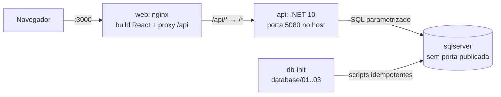

# Mini Gestão de Pedidos

Teste técnico Full Stack da Joya Solutions: cadastro e consulta de pedidos de clientes com SQL Server 2022, API
.NET 10 e frontend React + TypeScript, tudo no Docker. Desenvolvido com o Claude Code em Spec-Driven Development:
especificação aprovada, plano em entregas pequenas, testes no mesmo commit de cada funcionalidade, revisão
independente ao fechar as entregas e aprovação humana antes de cada publicação.

**Sumário:** [Escopo](#objetivo-e-escopo) · [Início rápido](#início-rápido) · [Arquitetura](#stack-e-arquitetura) ·
[Docker](#execução-com-docker-compose) · [Endpoints](#endpoints) · [Testes](#testes) ·
[Diferenciais](#diferenciais-e12) ·
[Concorrência](#regras-transacionais-e-concorrência) · [Erros](#problem-details-e-tratamento-de-erros) ·
[Interface](#interface-react) · [SDD](#spec-driven-development) · [Claude Code](#como-usei-o-claude-code) ·
[MCP](#mcp-do-sql-server) · [Parte 4](#parte-4-debug-da-query-de-ranking) ·
[Decisões](#principais-decisões-de-engenharia) · [Limitações](#limitações-e-riscos-residuais)

## Objetivo e escopo

A aplicação permite:

- criar um pedido com um ou mais itens, validando cliente, produtos, quantidades e estoque, com baixa de estoque
  atômica e protegida contra concorrência (`POST /pedidos`);
- listar pedidos com filtros por cliente e período, com paginação (`GET /pedidos`);
- consultar os cinco clientes com maior valor comprado num período (`GET /relatorios/top-clientes`);
- corrigir, medir e explicar a query de ranking de 2026 do enunciado ([Parte 4](#parte-4-debug-da-query-de-ranking)).

A regra de negócio é simples de propósito: o que se avalia é o processo de engenharia assistido por IA. Ficaram fora
do escopo (spec §1.3) autenticação, cadastro de clientes e produtos (vêm do seed), edição ou cancelamento de pedidos,
idempotência do `POST`, tela de ranking, Swagger e deploy online (DUV-03; a viabilidade foi avaliada, mas nada foi
publicado). Diferenciais do enunciado (entrega E12, prioridade P2): os testes ponta a ponta com Playwright estão
implementados e aprovados localmente e no runner Linux do GitHub (CA-29); o pipeline do GitHub Actions foi aprovado
com uma execução verde no GitHub em 14/11/2026 (CA-30; ver [Diferenciais](#diferenciais-e12)).

| Documento | Conteúdo |
|---|---|
| [docs/spec.md](docs/spec.md) | Especificação aprovada: requisitos, regras de negócio, contratos HTTP, modelo de dados, catálogo de testes e critérios de aceite (CA-01 a CA-30). |
| [docs/plan.md](docs/plan.md) | Plano aprovado (entregas E0–E13), decisões humanas e o registro detalhado de execução de cada entrega (§14). |
| [CLAUDE.md](CLAUDE.md) e [.claude/](.claude) | Convenções, comandos testados, regras por área, hooks, agentes revisores e skill. |
| [docs/evidencias/parte4](docs/evidencias/parte4) | Logs das medições, consolidado e planos reais da investigação da query. |
| [docs/entrega](docs/entrega) | Roteiro do vídeo, checklists de gravação e de publicação e a avaliação do deploy online. |

## Início rápido

Requisitos: Docker com Compose v2 e containers Linux x64. Não é preciso `.env`, SDK .NET nem Node.

```bash
docker compose up --build -d
```

- Interface: **http://localhost:3000**
- API: **http://localhost:5080** (`curl http://localhost:5080/health` responde `Healthy`; no PowerShell 5.1, use
  `curl.exe`)

`docker compose ps -a` deve mostrar `db-init` com `Exited (0)` e `api` e `web` em execução. No clone limpo da E11,
com as imagens base já baixadas, tudo subiu em 75 s, sem passo manual. O primeiro download das imagens leva mais.

## Stack e arquitetura

| Camada | Tecnologia |
|---|---|
| Banco | SQL Server 2022 CU28, edição Developer (`mcr.microsoft.com/mssql/server:2022-CU28-ubuntu-22.04`) |
| API | .NET 10, ASP.NET Core Minimal APIs, Dapper 2.1.89 com SQL explícito, `Microsoft.Data.SqlClient` 7.1.1 |
| Domínio | `JoyaPedidos.Dominio`: entidades e regras puras, sem dependências externas |
| Frontend | React 19, TypeScript `strict`, Vite 8 e ícones `lucide-react`; nginx serve o build e faz o proxy de `/api` |
| Testes | xUnit v3 no Microsoft.Testing.Platform, `Assert` nativo, Testcontainers com SQL Server real |
| Infraestrutura | Docker Compose com `sqlserver`, `db-init`, `api` e `web` |



Monólito modular (DEC-01). `JoyaPedidos.Api` organiza o código por módulo: `Pedidos` (endpoints, contratos,
validadores, serviço transacional e repositório), `Catalogo` (clientes e produtos), `Relatorios` (ranking) e
`Compartilhado` (Problem Details, conexão e períodos no fuso de São Paulo). A camada de serviço existe só onde há
orquestração, na criação de pedido. `JoyaPedidos.Dominio` recebe dados já lidos, inclusive o instante atual, e
devolve um resultado; o compilador impede que ele dependa de infraestrutura. Não há interfaces de repositório, CQRS,
mensageria nem microsserviços.

## Organização do repositório

```
├── backend/
│   ├── JoyaPedidos.slnx, Directory.Packages.props, nuget.config, Dockerfile
│   ├── src/JoyaPedidos.Api/        # Program.cs, Modulos/{Pedidos,Catalogo,Relatorios}, Compartilhado/
│   ├── src/JoyaPedidos.Dominio/    # entidades e regras puras
│   └── tests/                      # JoyaPedidos.TestesUnitarios e JoyaPedidos.TestesIntegracao
├── frontend/                       # Vite + React + TypeScript, Dockerfile e nginx.conf
├── e2e/                            # Playwright (pacote npm próprio): testes/api-real e testes/simulado
├── .github/workflows/ci.yml        # GitHub Actions: backend, frontend, hooks e E2E
├── database/                       # 01..03 (automáticos), consultas/, performance/, dev/
├── docs/                           # spec.md, plan.md, evidencias/parte4/, entrega/
├── .claude/                        # settings.json (hooks), hooks/, rules/, agents/, skills/
├── CLAUDE.md, .mcp.json, global.json, .env.example
└── docker-compose.yml, docker-compose.dev.yml, docker-compose.perf.yml
```

## Execução com Docker Compose

| Serviço | Papel |
|---|---|
| `sqlserver` | SQL Server 2022 CU28 no volume `joya-pedidos_dados-sql`, **sem porta publicada no host**. `sqlservr` roda como processo principal (parada limpa) e o banco tem `IDENTITY_CACHE = OFF`. |
| `db-init` | Espera o banco ficar saudável, aplica `database/01..03*.sql` em ordem e termina com código 0. Rodar de novo não duplica nada; se um script falhar, a API não sobe. |
| `api` | Build multi-stage `sdk:10.0.404-noble` → `aspnet:10.0.15-noble`. Usuário não root, ambiente `Production`, string de conexão só no ambiente do container. Sobe depois que o `db-init` termina com sucesso. |
| `web` | Build multi-stage `node:24.22.3-alpine3.24` → `nginx:1.30.6-alpine3.24`. Serve o build e encaminha `/api/*` para `http://api:8080/*` sem o prefixo ([nginx.conf](frontend/nginx.conf)): mesma origem, sem CORS, com CSP e cabeçalhos de segurança. Logo depois de subir, o proxy pode responder 502 por alguns segundos; a tela mostra o erro com "Tentar novamente". |

| Objetivo | Comando |
|---|---|
| Logs da API / do frontend | `docker compose logs api` / `docker compose logs web` (acompanhar: `-f`) |
| Reconstruir e subir só a API ou só o frontend | `docker compose up --build -d --no-deps api` / `docker compose up --build -d --no-deps web` |
| Outra porta para a API ou o frontend | `API_PORTA=5090` / `WEB_PORTA=3100` no `.env` ou no ambiente do shell (padrões 5080 e 3000) |
| Banco acessível no host, só em `127.0.0.1` (MCP, SSMS) | `docker compose -f docker-compose.yml -f docker-compose.dev.yml up --build -d` |
| Parar mantendo os dados | `docker compose down` |
| Reset completo (apaga só o volume deste projeto e recarrega o seed) | `docker compose down -v` |

- O `--no-deps` evita que o compose recrie também as dependências. Se o banco estiver no ar com o
  `docker-compose.dev.yml`, continue usando os **dois** arquivos: um `up` só com o `docker-compose.yml` recria o
  `sqlserver` sem a porta, e o MCP perde a conexão (os dados continuam no volume).
- Os logs da API mostram a inicialização e os erros; cada 500 registra a exceção com o mesmo `traceId` da resposta. O
  log por requisição fica desligado (`Logging__LogLevel__Microsoft.AspNetCore=Warning`).
- O build da imagem da API roda a auditoria NuGet com avisos tratados como erro. Se um advisory for publicado depois
  desta entrega para um pacote usado, o `docker compose up --build` falha no `dotnet restore` com `NU1901`–`NU1904`;
  a correção é atualizar ou fixar a versão em `backend/Directory.Packages.props`, como o próprio erro indica.

**Credenciais de desenvolvimento.** A senha padrão do `sa` (`Joya_Dev_2026_Inseguro`) é **pública, insegura e
exclusiva de desenvolvimento local**. A API usa o próprio `sa`, recebido em `ConnectionStrings__BancoPedidos`, montada
no compose. É uma limitação consciente deste ambiente (spec §11.4, RSK-10): em produção haveria um login de
privilégio mínimo e um gerenciador de segredos. Para trocar a senha, copie `.env.example` para `.env` e defina
`MSSQL_SA_PASSWORD` (sem `$`, aspas ou `;`) **antes da primeira subida**: a senha fica gravada no volume, e trocá-la
depois exige `docker compose down -v` (apaga os dados) ou `ALTER LOGIN sa`; senão o healthcheck falha com
"Login failed" e os demais serviços não sobem. Nenhuma credencial vai para as imagens.

## Endpoints

Rotas sem prefixo em `http://localhost:5080`; pelo frontend, as mesmas rotas ficam em `http://localhost:3000/api/...`.
Contratos completos na spec §5.

| Rota | Uso | Respostas |
|---|---|---|
| `POST /pedidos` | Cria um pedido: `clienteId` e `itens` (`produtoId`, `quantidade`). O preço vem sempre do banco. | 201 com `Location: /pedidos/{id}`; 400; 415; 422; 409; 503; 500 |
| `GET /pedidos` | Lista com `clienteId`, `dataInicio` e `dataFim` (datas civis `yyyy-MM-dd` de São Paulo, inclusivas), `pagina` (a partir de 1; padrão 1) e `tamanhoPagina` (1 a 100; padrão 10). Ordem `DataPedido DESC, Id DESC`. | 200 com `itens`, `pagina`, `tamanhoPagina`, `totalItens` e `totalPaginas`; 400 |
| `GET /pedidos/{id}` | Detalhe do pedido, com o mesmo corpo do 201. | 200; 404 |
| `GET /relatorios/top-clientes` | Os 5 clientes com maior valor no período (`dataInicio` e `dataFim` obrigatórios); desempate pelo menor `clienteId`. | 200; 400 |
| `GET /clientes` e `GET /produtos` | Catálogos dos seletores do frontend, ordenados por nome e id; produtos sem estoque incluídos. | 200 |
| `GET /health` | Indica que a API está no ar (não consulta o banco). | 200 `Healthy` |

```bash
curl "http://localhost:5080/pedidos?dataInicio=2026-01-01&dataFim=2026-12-31&pagina=1&tamanhoPagina=10"
```

```bash
curl "http://localhost:5080/relatorios/top-clientes?dataInicio=2026-01-01&dataFim=2026-12-31"
```

```bash
curl -i -X POST http://localhost:5080/pedidos -H "Content-Type: application/json" -d '{"clienteId":3,"itens":[{"produtoId":1,"quantidade":2}]}'
```

O último comando grava um pedido no banco em uso. Dinheiro sai como número com duas casas (`159.87`) e instantes em
UTC com `Z`.

## Testes

Requisitos: .NET SDK 10 e Docker em execução. Os testes de integração sobem um SQL Server real via Testcontainers, com
a mesma imagem e os mesmos scripts do compose; o compose do projeto não precisa estar no ar.

```bash
dotnet test backend/JoyaPedidos.slnx
```

| Projeto | Testes | Cobertura |
|---|---|---|
| `JoyaPedidos.TestesUnitarios` | 114 | Regras de domínio e validadores (UT-01 a UT-15), conversão de períodos no fuso de São Paulo, inclusive horário de verão histórico (UT-16, UT-17), e mapeamento de erros, com 1205 → 503 (UT-18). Sem banco. |
| `JoyaPedidos.TestesIntegracao` | 140 | Endpoints contra SQL Server real (IT-01 a IT-26), Problem Details em 5 valores de `Accept`, deadlock real, cancelamento durante espera por lock, scripts aplicados duas vezes em container próprio (IT-21) e as queries da Parte 4 sobre dados de referência (IT-23, IT-24). |

- Só um projeto: `dotnet test --project backend/tests/JoyaPedidos.TestesUnitarios` (ou `...TestesIntegracao`).
- Integração em ordem aleatória: `dotnet test --project backend/tests/JoyaPedidos.TestesIntegracao -- --seed 20261112`.
- Resultado no estado entregue: **254/254**, build com 0 avisos (warnings tratados como erro).
- Testes de mutação nas E4, E5, E6 e E8: cada proteção importante foi desfeita, numa cópia descartável (E4 a E6) ou
  num arquivo alterado temporariamente e restaurado com o hash conferido (E8), para provar que algum teste reprova o
  defeito. Na E6, um mutante sobreviveu (desempate invertido só no CTE da listagem) e ganhou um teste próprio.
- O frontend é coberto pelos testes ponta a ponta com Playwright ([Diferenciais](#diferenciais-e12)). Antes deles,
  os fluxos foram conferidos no navegador, a maior parte com a API e o banco reais num ambiente descartável; erros de
  servidor e de rede, o estado de carregando, a corrida entre consultas e o envio duplicado, com respostas simuladas.

## Diferenciais (E12)

### Testes ponta a ponta (Playwright)

Suíte em [e2e/](e2e), pacote npm próprio com `@playwright/test` 1.64.1 fixado, Chromium headless e TypeScript
`strict`. Roda contra o stack do Docker Compose num **projeto isolado** (`joya-e12`, web na porta 3012, API na 5012).
A preparação global recusa endereços que não sejam locais e qualquer porta que não seja publicada por um container do
projeto `joya-e12` (conferido no Docker; isso barra a stack principal e o servidor do Vite, que encaminha `/api` para a
API principal), e depois espera `GET /api/health` responder 200.

No Git Bash (ou em Linux/macOS):

```bash
WEB_PORTA=3012 API_PORTA=5012 docker compose -p joya-e12 up --build -d
```

```bash
npm --prefix e2e ci
```

```bash
cd e2e && npx playwright install chromium && npx playwright test
```

```bash
docker compose -p joya-e12 down -v
```

No Windows PowerShell 5.1 (sem `&&`): defina `$env:WEB_PORTA = '3012'` e `$env:API_PORTA = '5012'`, rode o
`docker compose -p joya-e12 up --build -d` e, em seguida, `Remove-Item Env:WEB_PORTA, Env:API_PORTA`, para que um
`up` posterior da stack principal na mesma sessão não use essas portas. Depois, em `e2e`, rode
`npx playwright install chromium` e `npx playwright test` em linhas separadas. Em Linux, use
`npx playwright install --with-deps chromium` para instalar também as bibliotecas do sistema.

O `down -v` apaga só o volume `joya-e12_dados-sql`. **Nunca** rode `docker compose down -v` sem `-p`: o compose fixa
`name: joya-pedidos`, e o comando atingiria o banco principal. O relatório HTML fica em `e2e/playwright-report`.

| Projeto | Teste | O que prova |
|---|---|---|
| `api-real` | abre a aplicação com os pedidos do backend | Tabela e paginação iguais ao que a API devolve no mesmo momento. |
| `api-real` | navega para a próxima página e volta | Página 2 e de volta à 1, com os números de pedido certos; "Anterior" desabilitado na primeira. |
| `api-real` | **E2E-02**: filtra por cliente e por período | No arranjo, a API cria no mesmo dia um pedido do cliente e outro do homônimo dele; o filtro (cliente identificado pelo e-mail) traz o primeiro e não o segundo, só pedidos do cliente e do dia, com parâmetros, linhas e "Página X de Y · N pedidos" iguais aos da API. |
| `api-real` | período invertido mostra o erro sem consultar a API | Mensagem ligada ao campo (`aria-invalid` e descrição acessível); o "Limpar" seguinte é a única consulta registrada. |
| `api-real` | **E2E-01**: cria pedido com dois produtos | Total estimado, modal fechado, mensagem de sucesso e pedido no topo com cliente, itens e total corretos; o id do cliente gravado e o valor conferem com a escolha e os preços. |
| `api-real` | **E2E-03**: estoque consumido antes do envio | Outro pedido pela API leva 1 unidade; o envio recebe 409, mostra "solicitado S, disponível S−1" e "Disponível agora" ligado ao campo, o modal fica aberto com os dados, e nada do pedido recusado é gravado. |
| `api-real` | valida campos inválidos no navegador | Erros de cliente, produto e quantidade 0 ligados aos campos, sem requisição; só o envio válido vira `POST`. |
| `simulado` | quatro acionamentos seguidos geram um único POST | Três cliques e um `requestSubmit` na mesma tarefa; o `POST` fica retido até o teste responder 201 simulado. |
| `simulado` | depois de uma falha, um novo envio gera um segundo POST | 503 simulado mostra "Conflito momentâneo", mantém os dados e permite reenviar. |

- **`api-real`**: navegador, nginx, API e SQL Server reais, **sem nenhuma interceptação**. Clientes e produtos vêm do
  seed pela API (spec §10.5); os produtos são os de maior estoque (1.000 ou mais), e as asserções não dependem de ids
  nem de totais fixos: a tela é comparada com a API no mesmo instante. Seletores por papéis e rótulos acessíveis
  (spec §6.5). Cada execução grava 5 pedidos de poucas unidades.
- **`simulado`**: a listagem e o catálogo vêm da API real, mas o `POST /api/pedidos` é interceptado com `page.route`
  para segurar ou falhar a resposta. Prova comportamento do frontend; não é teste de integração e não grava nada.
- Execução em série (`workers: 1`) e **sem retries**: uma falha intermitente aparece em vez de ser mascarada.
- Resultados (14/11/2026, Windows, `joya-e12`), todos com 9 de 9 aprovados e nenhuma falha:
  - versão final: 10 execuções seguidas num stack recriado do zero (dados de 33 para 83 pedidos), rodando ao mesmo
    tempo que a suíte do backend num container Linux; de 23 a 44 s cada;
  - primeira versão, antes das correções da revisão: 1 execução inicial e 10 seguidas no mesmo stack (de 33 para 77
    pedidos), e 10 num stack recriado com carga de CPU paralela.
- No GitHub Actions (runner Linux, job `e2e`), os 9 testes também passaram na execução que aprovou o CA-30.
- Mutação: com a trava por `ref` do envio removida numa cópia descartável do frontend, o teste de envio duplicado
  reprovou (4 `POST` em vez de 1).

### Integração contínua (GitHub Actions)

[.github/workflows/ci.yml](.github/workflows/ci.yml) roda em todo push e pull request, com quatro jobs em
`ubuntu-24.04`:

| Job | Passos |
|---|---|
| `backend` | .NET pelo `global.json`; restore com auditoria NuGet (vulnerabilidade quebra o passo); build com avisos como erro; testes unitários e de integração (SQL Server real via Testcontainers); pacotes vulneráveis com transitivos, falhando se houver algum. |
| `frontend` | Node 24.22.3 (o da imagem de build); `npm ci`, lint, typecheck, build e `npm audit --omit=dev`. |
| `hooks` | `.NET` e Node; `node .claude/hooks/verificar-hooks.mjs`. Como o job tem todas as dependências, qualquer caso pulado faz o job falhar (em Linux, numa cópia sem `node_modules`, como no runner: 165 aprovadas, nenhuma pulada). |
| `e2e` | Stack isolada `joya-e12` (portas 3012 e 5012, SQL Server sem porta publicada), Chromium do Playwright, a suíte E2E, relatório como artefato em caso de falha e `down -v` do projeto `joya-e12` no fim, sempre. |

Segurança: permissões só de leitura, nenhum segredo no YAML, `persist-credentials: false` e actions oficiais fixadas
por SHA de commit. O E2E usa a senha padrão de desenvolvimento do compose, que é pública e rotulada como insegura.
O workflow foi validado localmente com o `actionlint` 1.7.12 e **aprovado no GitHub em 14/11/2026 (CA-30)**: a
execução #1, disparada pelo push do commit `7e6e12c`, terminou com os quatro jobs (`backend`, `frontend`, `hooks` e
`e2e`) em `success` ([execução no GitHub Actions](https://github.com/thiagom3005/joya-mini-gestao-pedidos/actions/runs/43636057666)). Nela, o backend teve 254 de 254 testes aprovados, o
verificador de hooks 165 aprovados e nenhum pulado, e o Playwright 9 de 9.

### Deploy online (fora do escopo, só avaliado)

**Não foi feito**: a spec deixa o deploy fora desta entrega (RNF-18, DUV-03). A avaliação, com custos,
compatibilidade, segurança e os passos da opção recomendada, está em
[docs/entrega/deploy-online.md](docs/entrega/deploy-online.md). Resumo:
- Não há, na pesquisa feita, opção gratuita comprovada que rode SQL Server compatível com os scripts sem adaptação.
- A edição Developer não pode ser usada em produção, e a aplicação não tem autenticação: numa URL pública, qualquer
  pessoa criaria pedidos.
- A recomendação é não publicar antes do envio. Se o candidato quiser publicar, a opção de menor risco é uma VPS x86 com
  o mesmo compose, a edição Express e HTTPS por proxy, o que depende de contratar o servidor.

## Regras transacionais e concorrência

Cada pedido é criado numa transação `READ COMMITTED` (spec §7.2, DEC-05):

1. Validação de formato fora da transação: um 400 nem abre conexão de escrita.
2. O cliente é lido primeiro; se não existe, rollback e 422 antes de qualquer lock de produto.
3. Um `SELECT ... WITH (UPDLOCK, ROWLOCK)` por produto, em sequência e em ordem crescente de `ProdutoId`. A ordem de
   aquisição dos locks é determinística por construção, sem depender de um `IN (...)`.
4. Regras puras do domínio sobre os dados bloqueados: existência, estoque (todos os itens sem estoque são listados),
   preço congelado e total em `decimal`.
5. `UPDATE ... SET Estoque = Estoque - @Quantidade WHERE Id = @ProdutoId AND Estoque >= @Quantidade`, exigindo
   exatamente 1 linha afetada; senão, exceção, rollback e 409.
6. `INSERT` do pedido (`OUTPUT INSERTED.Id`) e dos itens, e `COMMIT`.

Três barreiras protegem o estoque: o lock U ordenado, o `UPDATE` condicional com contagem de linhas e o
`CHECK (Estoque >= 0)`. Retorno antecipado, exceção ou cancelamento da requisição descartam a transação sem commit. O
erro 1205 (vítima de deadlock) vira 503 `CONFLITO_CONCORRENCIA`, sem retry automático: a ordem dos locks reduz o
risco de deadlock, mas não o elimina (§7.5).

| Prova | Resultado |
|---|---|
| IT-09: estoque 5 e 20 `POST` simultâneos de 1 unidade (largada por barreira) | Exatamente 5 × 201 e 15 × 409, todos com disponível 0; estoque final 0; 5 pedidos e 5 itens; zero 500 e zero 503; o servidor registra esperas `LCK_M_U`. |
| IT-10: 3 rodadas de 20 `POST` simultâneos alternando `[P1, P2]` e `[P2, P1]` (largada por barreira) | Todos 201, estoques finais 940 e 880, 60 pedidos e 120 itens (nenhum excedente), zero 500 e zero 503. |
| Deadlock real (§7.5) | Uma sessão de prioridade alta fecha o ciclo com a API: o servidor registra o deadlock, a resposta é 503 e nada é gravado. |
| Cancelamento durante espera por lock | A transação é desfeita e o lock já obtido é liberado em até 5 s do cancelamento. |
| IT-25: falha depois de baixas já executadas | Um trigger de teste falha após as duas baixas e o primeiro item, inclusive com `XACT_ABORT OFF`: 500 sem detalhes, estoques inalterados e nada gravado. |
| Mutações da E5 | 7 proteções desfeitas uma a uma (ordem dos locks, `UPDLOCK`, contagem de linhas, commit antes dos itens, 1205 como 500, `dataPedido` sem `Z`, cliente depois dos produtos): todas reprovadas por ao menos um teste. Sem a ordem crescente, o próprio IT-10 reprova com 503. |

Garantido: estoque nunca negativo, nenhuma venda além do estoque, pedido, itens e baixas gravados juntos, e preço do
item igual ao lido sob lock. Não garantido: ausência absoluta de deadlocks, atendimento justo entre requisições
concorrentes, idempotência num reenvio (RSK-14) e alto throughput num único produto muito disputado (RSK-13).

## Problem Details e tratamento de erros

Toda resposta de erro é `application/problem+json` (RFC 9457), com `type`, `title`, `status`, `detail`, `codigo`
estável e `traceId`. `VALIDACAO` traz `errors` por campo, com chaves no caminho JSON (`itens[1].quantidade`);
`PRODUTO_NAO_ENCONTRADO` traz `produtosNaoEncontrados`, e `ESTOQUE_INSUFICIENTE` traz `itensSemEstoque`. Testes e
frontend decidem pelo `codigo`, nunca pelo texto.

| `codigo` | Status | Quando |
|---|---|---|
| `VALIDACAO` | 400 | Campo ausente, fora da faixa ou duplicado; data fora do formato `yyyy-MM-dd`; `dataInicio > dataFim`. |
| `REQUISICAO_INVALIDA` | 400, 405, 415 | Erros do framework: JSON malformado, número não inteiro, método não permitido, `Content-Type` que não é JSON. |
| `CLIENTE_NAO_ENCONTRADO`, `PRODUTO_NAO_ENCONTRADO` | 422 | O corpo referencia cliente ou produtos inexistentes (todos os ausentes são listados). |
| `ESTOQUE_INSUFICIENTE` | 409 | Itens sem estoque, com quantidade solicitada e disponível. |
| `PEDIDO_NAO_ENCONTRADO` | 404 | `GET /pedidos/{id}` com id numérico inexistente. |
| `RECURSO_NAO_ENCONTRADO` | 404 | Rota inexistente ou id não numérico. |
| `CONFLITO_CONCORRENCIA` | 503 | Vítima de deadlock (1205); o cliente pode tentar de novo. |
| `ERRO_INTERNO` | 500 | Qualquer outra falha. Nunca expõe stack trace, SQL ou nome de classe; a exceção vai ao log com o mesmo `traceId`. |

A precedência da criação é `VALIDACAO` > `CLIENTE_NAO_ENCONTRADO` > `PRODUTO_NAO_ENCONTRADO` > `ESTOQUE_INSUFICIENTE`
(RN-12). Erros do framework recebem o `codigo` pelo status numa regra central.

Correção da E11 (CA-14): com `Accept: text/html`, as páginas de status respondiam `text/plain` e os erros da aplicação
saíam sem `traceId`, porque o escritor padrão só escreve quando o `Accept` aceita JSON. O
[EscritorProblemDetailsReserva](backend/src/JoyaPedidos.Api/Compartilhado/EscritorProblemDetailsReserva.cs), registrado
depois do padrão, aceita qualquer requisição e delega a escrita a ele. A regressão cobre 6 erros × 5 valores de
`Accept` (30 casos) e 2 respostas de sucesso; sem a correção, 7 dos 37 testes da classe falhavam. A correção também foi
conferida no Kestrel real e pelo proxy do nginx.

## Interface React

Página única em http://localhost:3000 (spec §6), sem router e sem biblioteca de estado ou de componentes.

- **Listagem**: 10 pedidos por página, mais recentes primeiro, com Nº, Cliente, Data (horário de São Paulo, qualquer
  que seja o fuso do navegador), Itens (produtos distintos) e Valor total; **Anterior**, **Próxima** e
  "Página X de Y · N pedidos"; estados de carregando, vazio e erro com "Tentar novamente".
- **Filtros**: cliente (homônimos aparecem como "Nome (email)"), data inicial e data final, inclusivas no calendário
  de São Paulo. Período invertido ou data digitada pela metade mostram o erro sem consultar a API.
- **Novo pedido** (modal `<dialog>`): recarrega clientes e produtos ao abrir; até 50 itens; produto sem estoque ou já
  escolhido fica desabilitado; quantidade de 1 até o estoque, no máximo 10.000. O total exibido é uma estimativa; o
  valor oficial é o que a API grava.
- **Respostas da criação**: 201 fecha o modal, anuncia "Pedido nº X criado com sucesso." e volta à página 1 sem
  filtros. Os erros mantêm o modal e os dados: 400 marca os campos; 422 recarrega as listas; 409 lista "solicitado X,
  disponível Y", marca as linhas com "Disponível agora: N." e recarrega os estoques; 503 pede nova tentativa; 500, 502
  e falha de rede mostram mensagem genérica (no 500, com um código para suporte).
- **Envio sem duplicidade**: "Criar pedido" fica desabilitado com "Criando…", e uma trava por `ref` barra disparos
  repetidos antes da re-renderização (4 acionamentos seguidos geraram 1 `POST`, conferido no navegador com a resposta
  simulada).
- **Cliente HTTP**: base relativa `/api`, `AbortController` em todas as chamadas (uma consulta nova cancela a
  anterior) e três falhas tipadas: rede, resposta não JSON (como o 502 do nginx) e Problem Details.
- **Acessibilidade e layout**: rótulo em todo campo; erros com `role="alert"` ligados ao campo por
  `aria-describedby`; sucesso em região `aria-live`; foco gerenciado no modal, na paginação e nos erros; contraste
  WCAG AA medido nos pares de cores usados; tabela em cartões até 640 px e modal como painel inferior no celular.

Desenvolvimento local (Node 22.12 ou mais recente; testado com o 24), com a API no ar em `localhost:5080`. O Vite
(http://localhost:5173) faz o mesmo proxy `/api` do nginx:

```bash
npm --prefix frontend ci
```

```bash
npm --prefix frontend run dev
```

Verificações: `npm --prefix frontend run lint`, `npm --prefix frontend run typecheck` e
`npm --prefix frontend run build`. Dependências com versões exatas no `package.json` e no `package-lock.json`.

## Spec-Driven Development

1. **Spec** ([docs/spec.md](docs/spec.md)): requisitos rastreados até o enunciado (`[ENUNCIADO]`, `[DIRETRIZ]`,
   `[DECISAO]`), prioridades P0/P1/P2, regras RN-01 a RN-15, contratos HTTP, modelo, estratégia de concorrência,
   catálogo de testes (UT, IT, E2E), critérios de aceite mensuráveis (CA-01 a CA-30), decisões DEC-01 a DEC-15,
   premissas, dúvidas e riscos. Produzida em plan mode e aprovada depois de duas revisões pedidas pelo candidato e de
   uma revisão independente (22 achados aceitos, 2 rejeitados).
2. **Plano** ([docs/plan.md](docs/plan.md)): entregas E0–E13 com escopo, testes, validação, commits e gate. Teve
   revisão crítica por agente (25 achados incorporados) e revisão externa do candidato, que substituiu três propostas
   do agente: supressão genérica dos avisos NuGet de vulnerabilidade, senha da DSN nos argumentos do DBHub e
   `DROP DATABASE` no IT-21. A ordem sugerida também foi ajustada: Docker do banco cedo, testes junto de cada
   funcionalidade e Parte 4 antes do frontend, pelo peso maior na avaliação.
3. **Execução**: uma entrega por vez, só quando pedida. O registro de cada entrega (§14 do plano) traz o que foi
   feito, os números das validações, os achados das revisões, as decisões humanas e as pendências.
4. **Divergências** encontradas na implementação são registradas e decididas pelo candidato, sem alterar a spec em
   silêncio. Exemplo: a §9.2 afirma que o otimizador simplifica o `LEFT JOIN` da query original, e os planos reais
   mostraram o contrário ([D3](#o-que-estava-errado-d1d6)); o candidato manteve a spec e o registro.

## Como usei o Claude Code

Fluxo de cada entrega: plano da entrega → implementação com testes (hook de build a cada edição) → validação completa
(build, testes, auditoria, segredos) → revisão independente por agente de contexto limpo → correção dos achados
reproduzidos → aprovação do candidato → commits pequenos e push. O Claude não fez commit nem push sem pedido explícito.

### Configuração versionada

| Artefato | Função | Evidência |
|---|---|---|
| [CLAUDE.md](CLAUDE.md) | Fontes de verdade, arquitetura, convenções, segurança, política de Git e tabela de comandos, só com comandos executados de fato. | Comandos reexecutados na E11 (CA-19). |
| [.claude/rules/](.claude/rules) | Regras de `backend`, `database`, `frontend` e `testes`, carregadas por `paths` quando a pasta é tocada. | A regra sobre triggers do `database.md` nasceu da revisão da E11. |
| Hook `PreToolUse`: [proteger-historico.mjs](.claude/hooks/proteger-historico.mjs) | Antes de executar Bash, PowerShell ou edições, bloqueia push forçado, rebase, `pull --rebase`, `commit --amend`, `reset` que move a branch, `clean -x`, `stash --all` e leitura ou escrita do `.env`. Entrada ilegível também bloqueia. | Bloqueio ao vivo de `git rebase --abort` (inofensivo) pelas duas ferramentas de shell (E1). |
| Hook `PostToolUse`: [pos-edicao.mjs](.claude/hooks/pos-edicao.mjs) | Depois de cada edição, compila só o projeto do `.cs` editado ou faz o typecheck do frontend para `.ts`/`.tsx`. Em erro, devolve as linhas do compilador ao Claude; a edição fica no arquivo e é corrigida em seguida. | Erros reais de compilação devolvidos ao Claude ao longo das entregas, inclusive em edições intermediárias da E11 e da E13. |
| [verificar-hooks.mjs](.claude/hooks/verificar-hooks.mjs) | Roda os dois hooks contra fixtures de entrada; comandos perigosos são testados só por simulação. | 164 verificações aprovadas e 1 pulada no Windows; 158 aprovadas e 7 puladas em Linux (`node:24-alpine`). |
| Agentes [revisor-spec](.claude/agents/revisor-spec.md) e [revisor-sql-concorrencia](.claude/agents/revisor-sql-concorrencia.md) | Revisão independente de aderência à spec e de SQL, transações e concorrência, somente leitura. | Usados na E6, na E8 e na E11; nas demais entregas, um agente geral seguiu o mesmo papel. |
| Skill [novo-endpoint](.claude/skills/novo-endpoint/SKILL.md) | Cria um endpoint da spec no padrão da E5: contratos, validador, repositório, testes unitários e de integração, build, testes, auditoria e checklist de aderência. | 4 invocações reais na E6, uma por endpoint: `GET /clientes`, `GET /produtos`, `GET /pedidos` e `GET /relatorios/top-clientes` (commits `54489f7`, `6d64220` e `a3772de`). |
| [.mcp.json](.mcp.json) | Servidor MCP `sqlserver-joya` (DBHub) com o login de leitura `joya_mcp`. | Ver [MCP do SQL Server](#mcp-do-sql-server). |

### O que funcionou bem

- **Spec com identificadores e critérios mensuráveis**: cada teste nasceu de um cenário do catálogo (UT, IT), e a
  matriz CA-01 a CA-30 foi conferida item a item nas E11 e E13.
- **Hooks**: o pós-edição devolveu erros de compilação no momento da edição; o de proteção reforçou a política de
  histórico (sem squash, amend, rebase ou force push; na E11, o reflog confirmou que nenhum commit foi reescrito).
- **Skill**: os quatro endpoints de leitura saíram no mesmo padrão e passaram pelo mesmo checklist.
- **Revisões independentes**: encontraram problemas reais que os testes ainda não pegavam (tabela abaixo).
- **MCP**: acelerou a investigação da Parte 4 e mudou o protocolo de medição (forma parametrizada e variáveis locais).
- **Testes de mutação**: provaram que os testes reprovam os defeitos que deveriam pegar.

### O que precisou ser corrigido

| Entrega | Problema encontrado | Correção |
|---|---|---|
| E1 | 13 achados na revisão do hook de proteção (continuação de linha, guarda que desligava o hook via link, atribuição no PowerShell, `reset --soft`, `config pull.rebase`, heredoc). | 11 corrigidos com novas fixtures; agentes somente leitura apenas por instrução aceito como limitação. |
| E3 | `docker stop` virava SIGKILL e o `IDENTITY` saltava para 1001; o `db-init` falhava (erro 904) depois de `down`/`up`, porque o healthcheck só provava o `master`. | `sqlservr` como processo principal, `IDENTITY_CACHE = OFF` e healthcheck que abre o banco. |
| E3 | `Microsoft.Data.SqlClient` 7.1.1 trazia `System.Security.Cryptography.Pkcs` 9.0.18, com advisory alto. | Fixação transitiva na 10.0.15. |
| E4 | O validador percorria todas as linhas acima de 50 itens (900 mil linhas geravam 69 MB de resposta); `dataFim = 9999-12-31` lançaria exceção. | Só o erro em `itens`; data máxima tratada como "sem limite superior". |
| E5 | O IT-25 não provava o rollback da aplicação (o `THROW` no trigger condena a transação e o servidor desfaz sozinho), e o teste de cancelamento passava mesmo ignorando o cancelamento. | Variante com `XACT_ABORT OFF` e prazo de 5 s contado do cancelamento, ambas provadas por mutação. |
| E5 | Revisão do candidato: a baixa sem linha afetada devolvia o erro sem lançar exceção, divergindo da §7.2, passo 5. | Exceção controlada, capturada depois do rollback e convertida em 409. |
| E6 | Um mutante sobreviveu: o desempate invertido só no CTE da listagem. | Teste com pedidos do mesmo segundo divididos entre páginas. |
| E7 | O script do login do MCP rejeitava toda senha com `_` ou `-`: na collation binária, `[_-]` no `LIKE` vira uma faixa vazia. | Escape no `LIKE`, sem afrouxar a política de senha. |
| E8 | A redução de leituras atribuída à D6 estava inflada pelo paralelismo, e o feedback de memória ligava as passadas de medição entre si. | Variantes com `MAXDOP 1`, Query Store e feedbacks desligados só no banco isolado, 5 passadas refeitas do zero e travas dos scripts pelo hostname da instância. |
| E9 | O comando documentado para reconstruir a API recriaria o `sqlserver` sem a porta do MCP. | `--no-deps` em todos os comandos parciais. |
| E10 | Dois `click()` na mesma tarefa geravam dois `POST`; o foco se perdia em alguns fluxos; o total fixo encobria o campo focado (WCAG 2.4.11). | Trava por `ref`, foco restaurado e total movido para o rodapé fixo. |
| E11 | Com `Accept: text/html`, erros do framework saíam em `text/plain` e os da aplicação sem `traceId` (CA-14). | Escritor de Problem Details de reserva e 32 testes de regressão. |
| E11 | O verificador de hooks falhava em Linux num caso escrito antes de o frontend existir. | Caso marcado para rodar só quando o frontend não está instalado. |

### Decisões humanas registradas

- Auditoria NuGet sem supressão genérica, com avisos como erro também no build da imagem; o risco de um advisory
  futuro quebrar o build ficou documentado.
- Massa de desempenho só num projeto Compose isolado (`joya-perf`), nunca no banco de demonstração.
- Divergência da spec sobre o D3 aceita e registrada, sem alterar a spec.
- `lucide-react` autorizado como única biblioteca de UI; chave `itens[i]` aprovada para elemento nulo da lista.
- Na E6, o revisor de SQL gravou e apagou um arquivo temporário no container de desenvolvimento, sem alterar o banco.
  O candidato registrou como desvio: revisões somente leitura não escrevem, nem temporariamente.
- O script do login do MCP recebeu uma ressalva de segurança no README (ver [MCP](#mcp-do-sql-server)).

### Limites do uso

- Os agentes são somente leitura por instrução; o Bash deles não tem bloqueio técnico de escrita.
- O hook de proteção é uma rede de proteção, não uma fronteira de segurança: aliases do Git, scripts e APIs de
  arquivo escapam da análise.
- O MCP depende de o `npx` iniciar o DBHub em até 30 s; na E6, na E10 e na E11 a conexão esgotou esse tempo e foi
  restabelecida depois, sem mudar a configuração.
- As transcrições das sessões ficam só na máquina do candidato. As evidências versionadas são o plano, os commits e
  este README; o vídeo mostra o uso ao vivo.

## MCP do SQL Server

Servidor **DBHub `@bytebase/dbhub@1.6.1`** (transporte stdio), versão fixada no [.mcp.json](.mcp.json) e posterior às
correções dos advisories GHSA-mwwr-p57h-56pf, GHSA-fm8p-53ww-hf6w e GHSA-j656-3hf2-fvjc. No Claude Code ele aparece
como `sqlserver-joya`, com as ferramentas `execute_sql` e `search_objects`. A conexão usa o login `joya_mcp` com
`sslmode=require`; a senha vem só da variável de ambiente `JOYA_MCP_SENHA`, nunca do repositório nem dos argumentos
do processo.

### Configuração (uma vez por máquina)

1. Suba o banco com a porta no loopback:
   `docker compose -f docker-compose.yml -f docker-compose.dev.yml up -d sqlserver db-init`.
2. Defina `JOYA_MCP_SENHA` no ambiente do usuário (8 ou mais caracteres; só letras, dígitos, `_` ou `-`; com
   maiúsculas, minúsculas e dígitos). Evite `setx JOYA_MCP_SENHA <valor>`, que deixa o valor no histórico do terminal
   e nos argumentos do processo. Use a tela "Variáveis de ambiente" do Windows ou, no PowerShell, leia a senha sem eco:
   `$s = Read-Host -AsSecureString; [Environment]::SetEnvironmentVariable('JOYA_MCP_SENHA', [Net.NetworkCredential]::new('', $s).Password, 'User')`.
   Em Linux ou macOS, use `read -rs JOYA_MCP_SENHA && export JOYA_MCP_SENHA` na sessão que abre o Claude Code.
3. Crie ou atualize o login (a senha é lida do ambiente; só o nome da variável aparece no comando):
   `docker compose run --rm --no-deps -e JOYA_MCP_SENHA db-init /opt/mssql-tools18/bin/sqlcmd -C -b -f 65001 -S sqlserver -U sa -i /database/dev/criar-login-mcp.sql`.
   No Git Bash, prefixe `MSYS_NO_PATHCONV=1`, senão o caminho `/opt/...` vira um caminho do Windows. O login fica no
   volume do banco: depois de um `docker compose down -v`, repita este passo.
4. Com porta diferente de 1433, defina também `SQL_PORTA` no ambiente do usuário: o `.mcp.json` lê o ambiente do
   Claude Code, não o `.env` do compose.
5. Reinicie o Claude Code para carregar o `.mcp.json` com as variáveis. O `.mcp.json` usa `cmd /c npx`, exigido no
   Windows nativo; em Linux ou macOS, troque por `"command": "npx"` e retire `"/c", "npx"` dos argumentos.

Se o servidor aparecer como `failed` com "connection timed out after 30000ms", o problema costuma ser o tempo de
partida do `npx`, não a senha: na E11, o DBHub levou 21,7 s até a primeira saída com o cache frio e 7 s com o cache
quente, perto do limite de 30 s do cliente. Reconecte em `/mcp` ou aumente o limite com a variável `MCP_TIMEOUT` (em
milissegundos) no ambiente do Claude Code.

**Ressalva de segurança do [criar-login-mcp.sql](database/dev/criar-login-mcp.sql).** O `sqlcmd` substitui
`$(JOYA_MCP_SENHA)` no texto do script **antes** da validação em SQL, e um valor malicioso nessa variável poderia
injetar SQL executado como `sa`. Por isso o script é exclusivo do ambiente de desenvolvimento local, deve ser
executado manualmente com uma senha gerada por procedimento controlado (por exemplo, um gerador de senhas aleatórias
que respeite os caracteres permitidos), não deve receber valores de origem não confiável e não deve ser reutilizado
como provisionamento em produção.

### Privilégio mínimo comprovado (E7)

Numa sessão real do Claude Code, só pelas ferramentas MCP:

- **Identidade**: `SYSTEM_USER` = `ORIGINAL_LOGIN()` = `joya_mcp`, `DB_NAME()` = `JoyaPedidos`, SQL Server
  16.0.4325.4 (CU28), conexão TCP com `encrypt_option = TRUE`.
- **Permissões efetivas** (`fn_my_permissions`): no servidor, `CONNECT SQL` e `VIEW SERVER PERFORMANCE STATE` (mais
  `VIEW ANY DATABASE`, do papel `public`); no banco, `CONNECT`, `SELECT` (papel único `db_datareader`) e
  `VIEW DATABASE PERFORMANCE STATE`, além de `VIEW ANY COLUMN ENCRYPTION KEY DEFINITION` e
  `VIEW ANY COLUMN MASTER KEY DEFINITION`, do papel `public`. Nenhum papel de servidor. Zero em `db_owner`, `db_datawriter`, `db_ddladmin`,
  `CONTROL SERVER`, `VIEW SERVER STATE`, `ALTER ANY LOGIN` e, no banco, `CONTROL`, `ALTER`, `CREATE TABLE`, `INSERT`,
  `UPDATE`, `DELETE`, `EXECUTE` e `SHOWPLAN`.
- **Escrita negada pelo banco**, não pela ferramenta (o modo somente leitura do DBHub está desligado: a 1.6.1 só o
  aceita num arquivo TOML que também teria os dados de conexão). Cada tentativa usou `WHERE 1 = 0`, `XACT_ABORT ON` e
  `ROLLBACK` no mesmo lote; o retrato das tabelas (linhas, checksums e `IDENT_CURRENT`) ficou idêntico antes e depois.

| Operação via `execute_sql` | Erro | Mensagem do SQL Server |
|---|---|---|
| `UPDATE dbo.Produtos SET Estoque = Estoque WHERE 1 = 0` | 229 | The UPDATE permission was denied on the object 'Produtos', database 'JoyaPedidos', schema 'dbo'. |
| `INSERT INTO dbo.Clientes (Nome, Email) SELECT ... WHERE 1 = 0` | 229 | The INSERT permission was denied on the object 'Clientes', database 'JoyaPedidos', schema 'dbo'. |
| `DELETE FROM dbo.ItensPedido WHERE 1 = 0` | 229 | The DELETE permission was denied on the object 'ItensPedido', database 'JoyaPedidos', schema 'dbo'. |
| `CREATE TABLE dbo.TesteNegativoMcp (Id int NOT NULL)` | 262 | CREATE TABLE permission denied in database 'JoyaPedidos'. |

### Como o MCP foi usado

- **E7**: estrutura, chaves, restrições e índices das 4 tabelas; conferência do seed (10 clientes, 12 produtos, 33
  pedidos, 52 itens, pedidos de fronteira e preços congelados); pedidos de 01/01 a 31/10/2026 (18 pedidos de 10
  clientes, 5.513,57); DMVs de consultas, planos em cache, uso de índices e índices ausentes.
- **E7**: diagnóstico da validação de senha do script do login, com 28 casos sintéticos testados via `execute_sql`
  (nunca a senha real).
- **E8**: V0 e V2 com `STATISTICS IO` no banco de desenvolvimento, operadores do plano em cache por XQuery e
  estatísticas ([registro](docs/evidencias/parte4/mcp-banco-desenvolvimento.md); detalhes na
  [Parte 4](#como-o-mcp-foi-usado-na-investigação)).
- **E8, E9 e E10**: retrato do banco de desenvolvimento (contagens e checksums) para provar que as entregas não o
  alteraram. Na publicação da E10, com o MCP em timeout de partida, a conferência foi feita pela API (35 pedidos,
  com os pedidos 34 e 35 criados pela interface).
- **E11**: com a integração do Claude Code em timeout de partida, a integridade do banco principal foi conferida com
  o mesmo DBHub e o login `joya_mcp` por um cliente MCP mínimo de diagnóstico.
- **13/11/2026, depois da reconexão**: consulta real pelo `execute_sql` no Claude Code, que devolveu
  `SYSTEM_USER` = `joya_mcp`, `DB_NAME()` = `JoyaPedidos` e 35 pedidos em `dbo.Pedidos`.

**O que o MCP mudou no trabalho**:

- O DBHub 1.6.1 devolve vários result sets e as mensagens informativas: `SET STATISTICS IO ON` via `execute_sql`
  retornou `Table 'Pedidos'. Scan count 1, logical reads 2...` (mensagem 3615) no campo `messages`.
- O plano em cache é legível sem `SHOWPLAN`: `VIEW SERVER PERFORMANCE STATE` basta para `sys.dm_exec_query_plan`.
- Em consultas ad hoc ou parametrizadas, `sys.dm_exec_sql_text(...).dbid` vem `NULL`; para filtrar por banco, use
  `sys.dm_exec_plan_attributes(plan_handle)` com `attribute = 'dbid'`.
- Com variáveis locais (`DECLARE`), o otimizador estimou 5,4 linhas para um período que tinha 18. Como a API envia
  parâmetros, a medição da E8 incluiu a forma parametrizada e a de variáveis locais.
- Com 2 páginas por índice, os planos do seed não dizem nada sobre desempenho: a E8 precisava de uma massa de dados.
- Catálogos e banco têm collations diferentes, e o `joya_mcp` não vê as definições de `CHECK` (sem
  `VIEW DEFINITION`): a fonte do esquema continua sendo `database/`.

**Riscos aceitos** (desenvolvimento local): o certificado autoassinado do container não é validado; o `npx` fixa a
versão do DBHub, mas não as dependências transitivas dele; o DBHub carrega um `.env` da pasta atual, o que coloca a
senha do `sa` de desenvolvimento no ambiente do processo do MCP, mesmo sem usá-la; as respostas do MCP passam pelo
contexto do modelo; e `VIEW SERVER PERFORMANCE STATE` vale para a instância inteira (131 planos de 3 bancos visíveis
na E7), aceitável num container exclusivo, mas vazamento de informação numa instância compartilhada. A proteção
efetiva é o login `joya_mcp`, que não escreve nem administra.

## Parte 4: debug da query de ranking

Arquivos: [ranking-2026-original.sql](database/consultas/ranking-2026-original.sql),
[ranking-2026-corrigida.sql](database/consultas/ranking-2026-corrigida.sql),
[gerar-massa.sql](database/performance/gerar-massa.sql), [medir-ranking.sql](database/performance/medir-ranking.sql)
e as evidências em [docs/evidencias/parte4](docs/evidencias/parte4).

### Query original (literal do enunciado)

```sql
SELECT c.Nome, SUM(i.Quantidade * i.PrecoUnitario) AS Total
FROM Clientes c
LEFT JOIN Pedidos p ON p.ClienteId = c.Id
LEFT JOIN ItensPedido i ON i.PedidoId = p.Id
WHERE YEAR(p.DataPedido) = 2026
GROUP BY c.Nome
ORDER BY Total
```

O arquivo é idêntico a esse texto; um teste compara o arquivo com o bloco da spec §9.1 (CA-12).

### O que estava errado (D1–D6)

| # | Tipo | Defeito | Efeito | Comprovação |
|---|---|---|---|---|
| D1 | Funcional | `ORDER BY Total` é crescente. | Lista primeiro quem **menos** comprou. | IT-24: totais em ordem crescente, a primeira linha com 400,00. |
| D2 | Funcional | `GROUP BY c.Nome`. | Homônimos viram uma linha só, com os totais somados; sem `Id`, não identifica o cliente. | IT-24: uma "Ana Souza" com 550,00 (300,00 + 250,00). No seed, via MCP: 1.952,35. |
| D3 | Funcional / clareza | `LEFT JOIN Pedidos` seguido de `WHERE` sobre `p.DataPedido`. | O `WHERE` descarta quem não tem pedido: a junção externa devolve o mesmo que uma interna, e o texto sugere uma intenção que não se cumpre. Pelo `LEFT JOIN ItensPedido`, pedido sem item daria `Total` nulo, que vem primeiro. | Plano real (ver abaixo): com `YEAR()`, a junção com `Pedidos` continua `Left Outer Join` e o filtro só vem depois dela. |
| D4 | Funcional | `YEAR(p.DataPedido)` sobre instantes UTC. | Usa o ano UTC, não o ano civil de São Paulo: entram os pedidos de 31/12/2025 21:00–23:59 e saem os de 31/12/2026 21:00–23:59 (horário local). | IT-24: Fábio (31/12/2025 23:59:59 local) entra com 1.000,00 e Elisa (31/12/2026 23:59:59 local) sai. Na massa: 2026 local = 39.982 pedidos; 2026 UTC = 39.983. |
| D5 | Determinismo | Sem desempate nem posição. | Ordem de empates instável. | IT-24 não verifica o nome nas duas primeiras linhas (Carla e Diego empatam em 400,00). |
| D6 | Desempenho (hipótese) | Função sobre a coluna (`YEAR(coluna)`). | Predicado não *SARGable*: impede a busca por intervalo em índice de `DataPedido`. | **Confirmada** na massa: `Index Scan` de todos os 120.033 pedidos + `Filter`, contra `Index Seek` de 39.983 na V1. |

**Observação sobre o D3: semântica relacional × plano físico.** Na semântica relacional, o `LEFT JOIN Pedidos`
seguido de `WHERE` sobre `p.DataPedido` equivale a uma junção interna, e o resultado é o mesmo. A spec (§9.2)
acrescenta que o otimizador faz essa simplificação. **Nos planos físicos observados, ele não faz**: com `YEAR()`, o
plano real mantém `Left Outer Join` com `Pedidos` e aplica o `Filter` depois, na V0 paralela (`Hash Match`), na V0
serial (`Merge Join`) e no seed (`Nested Loops`, via MCP). Só com o predicado em intervalo (V1) a junção vira
`Inner Join`. Evidências: [v0-original.sqlplan](docs/evidencias/parte4/planos/v0-original.sqlplan),
[v0-maxdop-1-diagnostico.sqlplan](docs/evidencias/parte4/planos/v0-maxdop-1-diagnostico.sqlplan),
[v1-original-com-intervalo.sqlplan](docs/evidencias/parte4/planos/v1-original-com-intervalo.sqlplan) e
[mcp-banco-desenvolvimento.md](docs/evidencias/parte4/mcp-banco-desenvolvimento.md). O efeito no resultado é o que a
spec descreve; só a afirmação sobre o otimizador não vale para esta query. A divergência foi aceita pelo candidato e
está registrada no plano (§14, E8), sem alterar a spec.

### Query corrigida

```sql
-- Ranking de clientes por valor comprado em 2026 (ano civil em America/Sao_Paulo).
-- DataPedido é armazenado em UTC. São Paulo = UTC-3 (sem horário de verão desde 2019):
--   01/01/2026 00:00 local = 2026-01-01 03:00 UTC (início, inclusivo)
--   01/01/2027 00:00 local = 2027-01-01 03:00 UTC (fim, exclusivo)
SELECT
    ROW_NUMBER() OVER (ORDER BY SUM(i.Quantidade * i.PrecoUnitario) DESC, c.Id) AS Posicao,
    c.Id   AS ClienteId,
    c.Nome,
    SUM(i.Quantidade * i.PrecoUnitario) AS Total
FROM Pedidos p
INNER JOIN Clientes c    ON c.Id = p.ClienteId
INNER JOIN ItensPedido i ON i.PedidoId = p.Id
WHERE p.DataPedido >= '2026-01-01T03:00:00'
  AND p.DataPedido <  '2027-01-01T03:00:00'
GROUP BY c.Id, c.Nome
ORDER BY Total DESC, c.Id;
```

D1: `DESC`. D2: `GROUP BY c.Id, c.Nome` e `ClienteId` no resultado. D3: `INNER JOIN` explícito. D4: limites UTC do
ano civil local, em intervalo semiaberto. D5: desempate por `c.Id` e `Posicao` por `ROW_NUMBER()`. D6: predicado
sobre a coluna sem função. Ranking completo (sem `TOP`), batch único sem `GO`; o total é `DECIMAL(38,2)`, com as 2
casas preservadas. O endpoint `GET /relatorios/top-clientes` usa a mesma lógica com `TOP (5)` e parâmetros (§9.4).

### Correção funcional (DR-RANK)

`RankingSqlTestes` executa os dois arquivos **sem alteração**, via SqlClient, sobre os dados de referência DR-RANK
da spec §9.5, em banco de teste limpo (Testcontainers).

| Posição | Cliente | Total (V2, IT-23) |
|---|---|---|
| 1 | Bruno Lima | 500,00 (o pedido de 01/01/2027 00:00 local, de 999,00, fica fora) |
| 2 | Elisa Rocha | 450,00 (31/12/2026 23:59:59 local, dentro) |
| 3 | Carla Dias | 400,00 |
| 4 | Diego Alves | 400,00 (01/01/2026 00:00:00 local, dentro; empate com Carla, que tem `Id` menor) |
| 5 | Ana Souza (ana1) | 300,00 (2 itens: 2 × 100,00 + 1 × 100,00) |
| 6 | Ana Souza (ana2) | 250,00 |

Fábio (31/12/2025 local) e o cliente sem pedidos ficam fora. Trocar o preço atual de todos os produtos para 9.999,99
não muda nada: o total usa o preço gravado no item. A V0 sobre o mesmo DR-RANK (IT-24) devolve 5 linhas só com
`Nome` e `Total`, nesta ordem de totais: 400,00, 400,00, 500,00, 550,00 ("Ana Souza") e 1.000,00 (Fábio).

### Ambiente isolado e massa

A massa **nunca** foi carregada no banco de desenvolvimento. Ela roda num projeto Compose separado, `joya-perf`
([docker-compose.perf.yml](docker-compose.perf.yml)): containers, rede e volume (`joya-perf_dados-sql`) próprios,
mesma imagem e mesmos scripts, sem porta no host, teto de 2.048 MB de memória e hostname fixo `joya-perf-sqlserver`:

```bash
docker compose -p joya-perf -f docker-compose.yml -f docker-compose.perf.yml up -d sqlserver db-init
```

```bash
docker compose -p joya-perf -f docker-compose.yml -f docker-compose.perf.yml run --rm --no-deps -T db-init /opt/mssql-tools18/bin/sqlcmd -C -b -f 65001 -S sqlserver -U sa -i /database/performance/gerar-massa.sql
```

```bash
docker compose -p joya-perf -f docker-compose.yml -f docker-compose.perf.yml run --rm --no-deps -T db-init /opt/mssql-tools18/bin/sqlcmd -C -b -f 65001 -y 0 -S sqlserver -U sa -d JoyaPedidos -i /database/performance/medir-ranking.sql
```

```bash
docker compose -p joya-perf -f docker-compose.yml -f docker-compose.perf.yml down -v
```

No Git Bash, prefixe `MSYS_NO_PATHCONV=1` nos comandos `run`. A saída da medição é grande (resultados e XML dos
planos): redirecione-a para um arquivo fora do repositório. O `down -v` apaga só o volume `joya-perf_dados-sql`.

**Travas.** Os dois scripts conferem, dentro do SQL Server, se `SERVERPROPERTY('MachineName')` é
`joya-perf-sqlserver`, hostname que só o `docker-compose.perf.yml` define. Em qualquer outra instância, inclusive a de
desenvolvimento, eles param com erro antes de tocar em dados. `gerar-massa.sql` é idempotente: se a massa já existe,
não faz nada e sai com código 0. `medir-ranking.sql` remove e recria `IX_Pedidos_DataPedido` só nesse banco e pode
ser executado de novo mesmo depois de abortar no meio: ele recria o índice se o encontrar ausente.

**Massa**: determinística e set-based, sobre uma tabela de números; sem `WHILE`, `NEWID()` ou `RAND()`. Leva 20 s e
se soma ao seed. Gerada duas vezes, em instâncias distintas, deu dados idênticos: mesmos `CHECKSUM_AGG` nas 4 tabelas
e mesma soma de `Quantidade × PrecoUnitario`.

| Item | Valor |
|---|---|
| Clientes | 1.210 (600 nomes da massa usados por 2 clientes cada; 50 sem pedidos) |
| Produtos | 262 |
| Pedidos | 120.033, de `2024-01-01T03:00:00Z` a `2027-01-01T02:54:51Z`; por ano local: 40.073 (2024), 39.978 (2025), 39.982 (2026) |
| Itens | 360.052 (3,0 por pedido; 1 a 5) |
| Páginas (índices reconstruídos após a carga) | `PK_Pedidos` 344, `IX_Pedidos_DataPedido` 300, `IX_Pedidos_ClienteId_DataPedido` 300, `PK_ItensPedido` 1.547, `UX_ItensPedido_PedidoId_ProdutoId` 1.410, `PK_Clientes` 17; ~31 MB no total |
| Estatísticas | `UPDATE STATISTICS ... WITH FULLSCAN` nas 4 tabelas |
| Ambiente | SQL Server 2022 CU28 Developer (compatibilidade 160), 12 CPUs visíveis, 2.048 MB, MAXDOP 0, limiar de paralelismo 5; Docker Desktop (WSL 2) num notebook i7-1255U |

### Protocolo de medição

[medir-ranking.sql](database/performance/medir-ranking.sql) inclui cada variante pelo próprio arquivo (`:r`), sem
alteração, e aplica a cada uma o [medir-variante.sql](database/performance/medir-variante.sql): 1 execução de
aquecimento descartada, 3 rodadas medidas com `SET STATISTICS IO, TIME ON` e 1 execução separada com
`SET STATISTICS XML ON` para o plano real, fora da medição de tempo. O cache de dados fica aquecido (nenhum
`DBCC DROPCLEANBUFFERS` ou `FREEPROCCACHE`). O tempo de cada rodada é o bloco `SQL Server Execution Times` da
instrução; em `sp_executesql`, o bloco externo.

**Condições controladas**, só no banco isolado: Query Store desligado e desligados os feedbacks que ajustam concessão
de memória e cardinalidade entre execuções (`ROW_MODE_`/`BATCH_MODE_MEMORY_GRANT_FEEDBACK`,
`MEMORY_GRANT_FEEDBACK_PERCENTILE_GRANT`, `MEMORY_GRANT_FEEDBACK_PERSISTENCE` e `CE_FEEDBACK`). Assim, cada passada é
independente e cada plano reflete só a escolha do otimizador. Esse controle entrou depois da revisão independente: na
primeira rodada, com as configurações padrão do SQL Server 2022, todos os planos vinham com a memória ajustada pelo
feedback (`IsMemoryGrantFeedbackAdjusted="Yes"`), e as passadas herdavam o ajuste umas das outras. Dois planos dessa
rodada estão em `planos/rodada-inicial-com-feedback`.

O roteiro inteiro rodou **5 vezes** (passadas A a E). Cada passada dá a mediana das suas 3 rodadas, e as tabelas
mostram a mediana das 5 medianas e a faixa entre elas. As leituras lógicas foram idênticas nas 5 passadas. O resumo é
calculado por [resumir-medicao.ps1](database/performance/resumir-medicao.ps1) a partir dos logs versionados em
[docs/evidencias/parte4](docs/evidencias/parte4), junto com o `consolidado.txt` e os planos reais (`.sqlplan`).

### Medições (massa de 120.033 pedidos, cache de dados aquecido)

| Variante | Leituras lógicas `Pedidos` / `ItensPedido` / `Clientes` (total) | CPU ms, mediana (faixa) | Decorrido ms, mediana (faixa) | Plano | Linhas devolvidas |
|---|---|---|---|---|---|
| **V0** original | 895 / 1.475 / 46 (2.416) | 963 (806–1.346) | 198 (165–284) | paralelo (DOP 12), row mode | 604 (por nome) |
| V1 = V0 só com o predicado em intervalo | 102 / 1.475 / 46 (1.623) | 613 (547–909) | 103 (97–163) | paralelo (DOP 12), row mode | 604 |
| V0 com `OPTION (MAXDOP 1)` (diagnóstico) | 300 / 1.398 / 17 (1.715) | 247 (223–339) | 248 (232–346) | serial, row mode | 604 |
| V1 com `OPTION (MAXDOP 1)` (diagnóstico) | 102 / 1.398 / 17 (1.517) | 157 (148–194) | 157 (152–198) | serial, row mode | 604 |
| **V2** corrigida | 102 / 1.398 / 17 (1.517) | 54 (50–89) | 60 (56–91) | serial, batch mode (exceto o seek) | 1.160 (por cliente) |
| **V2 sem `IX_Pedidos_DataPedido`** | 344 / 1.398 / 17 (1.759) | 86 (83–88) | 90 (89–92) | serial; `Merge Join` e varredura de `Pedidos` em row mode | 1.160 |
| V0 sem `IX_Pedidos_DataPedido` | 895 / 1.475 / 46 (2.416) | 912 (825–978) | 188 (154–204) | igual à V0 | 604 |

**V0 e V2 não devolvem o mesmo resultado**: a V0 está funcionalmente errada (agrupa por nome, usa o ano UTC, ordena
ao contrário). A comparação é de **custo**, não de equivalência. As variantes com `MAXDOP 1` não são a query
literal: servem só para separar o efeito do paralelismo.

### Variante parametrizada (forma da aplicação)

Mesma V2, mudando só a forma dos limites. "Estimado / real" é o `Index Seek` em `IX_Pedidos_DataPedido`.

| Variante | Busca em `IX_Pedidos_DataPedido` | Estimado / real (pedidos) | Junção com itens, estimado / real | CPU ms (faixa) | Decorrido ms (faixa) |
|---|---|---|---|---|---|
| V2 com literais (`'2026-01-01T03:00:00'`) | dinâmica (`GetRangeWithMismatchedTypes`, `Merge Interval`) | 39.975,1 / 39.982 | 119.910 / 119.924 | 54 (50–89) | 60 (56–91) |
| `sp_executesql`, `DATETIME2(0)` (tipo da coluna) | direta | 39.975,1 / 39.982 | 119.910 / 119.924 | 61 (55–88) | 63 (61–94) |
| `sp_executesql`, `DATETIME2(7)` (como o SqlClient envia) | dinâmica (`GetRangeWithMismatchedTypes`) | 39.975,1 / 39.982 | 119.910 / 119.924 | 60 (57–61) | 64 (60–69) |
| variáveis locais (`DECLARE`) | direta | **19.723,4** / 39.982 | **59.162,6** / 119.924 | 54 (49–57) | 61 (54–64) |
| SQL da API (`TOP (5)`, `DATETIME2(7)`) | dinâmica | 39.975,1 / 39.982 | 119.910 / 119.924 (`Adaptive Join`) | 56 (50–63) | 60 (54–65) |
| `DATETIME2(7)` sem `IX_Pedidos_DataPedido` | (sem índice: `Clustered Index Scan`) | 39.975,2 / 39.982 | 119.910 / 119.924 | 99 (91–104) | 101 (92–110) |

- Literais e parâmetros (com *parameter sniffing*) estimam o intervalo quase exatamente.
- Com variáveis locais, o otimizador não conhece os valores e usa uma seletividade fixa para as duas desigualdades:
  0,3 × √0,3 ≈ 16,4%, ou 19.723 de 120.033 linhas. Ser metade do real é coincidência desta massa. O formato do plano
  é o mesmo da forma com `DATETIME2(0)`, e a concessão de memória é menor (77.512 contra 88.192 KB). O tempo fica
  dentro do ruído.
- `DATETIME2(7)` contra a coluna `DATETIME2(0)` gera a busca dinâmica (`GetRangeWithMismatchedTypes`, com
  `Nested Loops`/`Merge Interval` sobre `Constant Scan`, em row mode); o literal em texto também. Continua um
  `Index Seek` *SARGable*, com a mesma estimativa. `DATETIME2(0)` faz a busca direta, com o plano todo em batch mode.
  As faixas de tempo se sobrepõem: **nenhuma diferença mensurável**, então a API não mudou.
- O SQL da API agrega por `p.ClienteId`, ordena o top 5 e só então busca os 5 clientes (`Clientes`: 10 leituras
  contra 17), com um `Adaptive Join` que, nesta massa, executou como hash join. O custo fica na faixa da V2.
- As variantes V2 ficam entre 54 e 61 ms de CPU, com faixas sobrepostas; nenhuma é declarada mais rápida.

### Planos de execução (operadores principais)

- **V0** (paralelo, DOP 12, row mode; memória concedida 56.640 KB, usada no máximo 17.280 KB):
  - `Index Scan` em `IX_Pedidos_ClienteId_DataPedido` lendo os **120.033** pedidos. É o índice coberto mais estreito;
    `IX_Pedidos_DataPedido` não serve para `YEAR()`.
  - `Hash Match (Left Outer Join)` com `Clientes`: 120.083 linhas, porque os 50 clientes sem pedido ainda estão lá.
  - `Compute Scalar` de `YEAR` → `Filter [Expr1005] = 2026` (est. 40.011 / real 39.983) → `Bitmap`.
  - `Hash Match (Left Outer Join)` com `Index Scan` em `UX_ItensPedido_PedidoId_ProdutoId`.
  - Agregação parcial → `Sort` + `Stream Aggregate` por `Nome` (est. 335,6 / real 604 grupos) → `Sort` pelo total.
- **V0 serial**: `Merge Join (Left Outer Join)` entre `Clientes` e `IX_Pedidos_ClienteId_DataPedido` (300 páginas,
  contra 895 leituras no paralelo) → `Filter` → `Hash Match (Left Outer Join)` com os itens → `Hash Match (Aggregate)`
  por nome. Continua `Left Outer Join` + `Filter`, também sem paralelismo.
- **V1**: muda só o acesso a `Pedidos`, que vira `Index Seek` em `IX_Pedidos_DataPedido` (39.983 linhas lidas), e a
  primeira junção passa a `Inner Join`. O resto segue a V0 (row mode, agrupamento por nome).
- **V2** (serial; junções, agregação, `Sort` e `Window Aggregate` em batch mode; o seek e a busca dinâmica em row
  mode):
  - `Index Seek` em `IX_Pedidos_DataPedido` (39.982).
  - `Hash Match (Inner Join)` com `Index Scan` em `UX_ItensPedido_PedidoId_ProdutoId`: lê as 360.052 linhas, e o
    filtro *bitmap* reduz a saída a 119.924.
  - `Hash Match (Aggregate)` por cliente (1.160) → `Hash Match (Inner Join)` com `Clustered Index Scan` em
    `PK_Clientes` → `Sort` → `Window Aggregate` (`ROW_NUMBER`).
  - Em `Pedidos`, nas junções e na agregação, a estimativa fica a menos de 0,1% do real. A exceção é a varredura de
    `ItensPedido`: estima 360.052 linhas e entrega 119.924, porque o *bitmap* é aplicado durante a leitura.
- **V2 sem `IX_Pedidos_DataPedido`**: `Clustered Index Scan` em `PK_Pedidos` (120.033 lidas, 39.982 passam pelo
  predicado) → `Merge Join` com `Index Scan` em `UX_ItensPedido_PedidoId_ProdutoId` (360.052; os dois lados já vêm
  em ordem de `PedidoId`). O agregado e a ordenação são os mesmos.
- **Concessão de memória excessiva na V2** (`MemoryGrantWarning`, `Excessive Grant`): todas as formas da V2 e o SQL
  da API pedem de 71 a 88 MB e usam no máximo 1,6 a 3,1 MB. A V0 serial pede 15,6 MB e usa 3,7 MB, sem aviso. A
  causa exata não foi isolada. Com as configurações padrão do SQL Server 2022 (feedback ligado), o próprio servidor
  corrige essa concessão: na rodada inicial, a V2 recebia 6.304 KB (`IsMemoryGrantFeedbackAdjusted="Yes: Stable"`).
  Com várias execuções simultâneas antes desse ajuste, a reserva excessiva pode gerar espera por memória
  (`RESOURCE_SEMAPHORE`). Concorrência não foi medida; nada foi alterado na API.
- Nenhum plano teve `Key Lookup` nem *spill*. A única conversão implícita é a de `Quantidade` (`int`) para `decimal`
  na multiplicação, inevitável e sem efeito no acesso.

### O que os números mostram

Critério para tempo: uma diferença só é afirmada quando as faixas entre passadas não se sobrepõem, ou quando a ordem
se repete em todas as passadas. Leituras são determinísticas.

1. **D6 confirmada sem paralelismo.** Comparando V0 e V1 com `MAXDOP 1`:
   - Com `YEAR()`, `Pedidos` é lida inteira (`Index Scan` + `Filter`, 300 páginas). Trocando **só** o predicado,
     vira `Index Seek` com 102 leituras (−66% em `Pedidos`, −12% no total).
   - A CPU cai de 247 para 157 ms (−36%), com faixas que não se sobrepõem (223–339 contra 148–194).
   - Nas versões paralelas, as 895 leituras de `Pedidos` incluem o custo do próprio paralelismo: elas não medem a D6.
2. **V0 → V2, como o servidor executa cada uma**: leituras −37% (2.416 → 1.517), CPU 963 → 54 ms, decorrido
   198 → 60 ms, sem sobreposição. Grande parte da diferença de CPU é **paralelismo**: a V0 roda com DOP 12 e gasta
   ~4× mais CPU que ela mesma em série (963 contra 247 ms), terminando só um pouco antes (198 contra 248 ms).
3. **V0 → V2, ambas em série**: leituras −12% (1.715 → 1.517), CPU 247 → 54 ms (~4,6×), decorrido 248 → 60 ms (~4×).
   A V1 serial já tem as mesmas leituras da V2 (1.517) e ainda gasta 157 ms. O restante vem das diferenças de plano
   (**hipóteses**, não isoladas uma a uma): row mode contra batch mode, agrupamento por `NVARCHAR` (`Nome`) contra
   `Id` inteiro, e a junção externa com `ItensPedido`.
4. **`ItensPedido` domina o custo da V2**: 1.398 de 1.517 leituras (92%). O otimizador preferiu varrer o índice com
   filtro *bitmap* a buscar os itens pedido a pedido (seriam ~40 mil buscas; essa alternativa não foi medida).
5. **`IX_Pedidos_DataPedido`** reduz as leituras de `Pedidos` de 344 para 102 (−70%; −14% no total da V2). No tempo,
   a mediana de CPU vai de 86 para 54 ms e a de decorrido de 90 para 60 ms (cerca de −1/3); o decorrido foi menor com
   o índice em todas as 5 passadas, e a CPU em 4 de 5; na passada B, mais lenta para todas as V2, a faixa da V2
   (50–89) encosta na da V2 sem índice (83–88). Ganho modesto e provável, coerente com as leituras. Com parâmetros
   `DATETIME2(7)`, o mesmo: CPU 99 → 60 ms.
6. Com 2026 = 1/3 dos pedidos, o otimizador ainda prefere o `Index Seek`. Com uma fração maior do período, a
   varredura pode ser legitimamente melhor (RSK-08): seek não é superior a scan por princípio.

### Decisão sobre índices: nenhuma mudança no esquema

| Índice | Evidência | Decisão |
|---|---|---|
| `IX_Pedidos_DataPedido (DataPedido) INCLUDE (ClienteId)` | Seek em V1, V2, nas formas parametrizadas e no SQL da API. Coberto, sem `Key Lookup`. −70% de leituras em `Pedidos` e tempo da V2 cerca de 1/3 menor (item 5). Custo: 300 páginas (2,3 MB por 120 mil pedidos) e 1 inserção a mais por pedido criado. Pela spec (§8.5), também serve ao filtro de período de `GET /pedidos`, não medido aqui. | **Mantido.** |
| `IX_Pedidos_ClienteId_DataPedido (ClienteId, DataPedido)` | Não aparece em nenhum plano da V2 na massa. A V0 o varre por ser o índice coberto mais estreito. No seed pequeno, o plano da V2 (via MCP) faz seek nele por cliente. Existe para o filtro por cliente de `GET /pedidos` (§8.5), fora desta medição. | **Mantido** (não medido para a listagem). |
| `UX_ItensPedido_PedidoId_ProdutoId (PedidoId, ProdutoId) INCLUDE (Quantidade, PrecoUnitario)` | Garante a RN-04. O `INCLUDE` cobre a soma: em todas as variantes ele é lido no lugar do índice clusterizado (1.410 contra 1.547 páginas), sem `Key Lookup`. | **Mantido.** |

Nenhum índice foi criado ou alterado no esquema versionado, e o IT-21 continua valendo sem mudança. A remoção de
`IX_Pedidos_DataPedido` foi feita só no banco isolado, e o índice foi recriado com a mesma definição. Reduzir a
varredura de `ItensPedido` exigiria outro desenho (por exemplo, columnstore ou agregados pré-calculados), sem medição
nem necessidade neste escopo.

### Limitações da medição

- **Ambiente**: um único notebook (i7-1255U, núcleos híbridos, Docker Desktop/WSL 2), com outros processos. Tempos
  de 50 a 350 ms variam entre passadas (a V0 paralela, de 806 a 1.346 ms de CPU). As conclusões de tempo seguem o
  critério acima.
- **Cache**: só cache de dados aquecido. Os dados (~31 MB) cabem inteiros na memória. Não houve medição com cache
  frio.
- **Condições controladas**: Query Store e feedbacks desligados para medir. Com as configurações padrão, a
  concessão de memória da V2 é corrigida automaticamente e os planos podem mudar entre execuções.
- **Massa**: sintética e uniforme (2026 = 1/3 dos pedidos). Outras distribuições e volumes podem mudar as escolhas
  do otimizador.
- **Batch mode sobre rowstore**: depende do nível de compatibilidade (150+) e da edição (Developer aqui). Em outro
  ambiente, o plano da V2 pode ser diferente.
- **Planos reais**: capturados numa execução separada, porque `STATISTICS XML` tem custo próprio.
- **MCP**: aponta para o banco de desenvolvimento (seed de 33 pedidos). As medições da massa foram feitas por
  `sqlcmd` no banco isolado, e os números do seed nunca foram misturados aos da massa.

### Como o MCP foi usado na investigação

- **Na E7**, pelo MCP: o DBHub repassa as mensagens de `STATISTICS IO`; o plano em cache é legível sem `SHOWPLAN`;
  `dm_exec_sql_text.dbid` vem nulo em consultas ad hoc (filtrar por `dm_exec_plan_attributes`); variáveis locais
  distorcem a estimativa. Esses achados definiram o protocolo: a forma parametrizada e a de variáveis locais entraram
  como variantes medidas.
- **Na E8**, com `execute_sql` no banco de desenvolvimento:
  - V0 e V2 executadas com `SET STATISTICS IO ON`, com as leituras devolvidas em `messages`. Os defeitos aparecem
    também no seed: "Ana Souza" com 1.952,35 na V0, e Elisa com 509,67 na V0 contra 159,77 na V2.
  - Operadores do plano em cache lidos por XQuery sobre `sys.dm_exec_query_plan`, cruzando
    `sys.dm_exec_query_stats` e `sys.dm_exec_plan_attributes` (`dbid`).
  - Estatísticas por `sys.stats` com `sys.dm_db_stats_properties`, e índices por `sys.indexes`.
- **Achados do MCP**: no seed, a V2 usa outro plano (`Nested Loops` com seek em `IX_Pedidos_ClienteId_DataPedido`
  por cliente), o que mostrou que os planos do banco pequeno não representam o volume e justificou a massa; e a V0
  também mantém `Left Outer Join` + `Filter` no seed, o mesmo que se viu na massa.

## Principais decisões de engenharia

As decisões completas, com alternativas descartadas, estão na spec §13 (DEC-01 a DEC-15) e no registro do plano.

| Decisão | Motivo | Ref. |
|---|---|---|
| Monólito modular com dois projetos de produção: API por módulos e domínio puro | Separa regras de infraestrutura sem cerimônia; o compilador impede o domínio de depender de infraestrutura. | DEC-01 |
| ASP.NET Core Minimal APIs no .NET 10 | Sete endpoints agrupados por módulo, sem a verbosidade de controllers. | DEC-02 |
| Dapper com SQL explícito; scripts em `database/` como única fonte do esquema | A avaliação inclui SQL: transações, hints de lock e consultas ficam visíveis e revisáveis. Sem EF nem migrations. | DEC-03 |
| Valor total derivado dos itens, sem coluna no pedido | Fonte única de verdade, coerente com a query do enunciado; pedidos são imutáveis. | DEC-04 |
| Lock pessimista ordenado e `UPDATE` condicional | Correto sob concorrência e com mensagens completas; deadlock reduzido, não eliminado (1205 → 503, sem retry). | DEC-05 |
| Instantes em UTC; períodos no fuso America/Sao_Paulo | UTC é inequívoco; filtros convertem datas civis em intervalos UTC semiabertos; relógio injetável (`TimeProvider`). | DEC-06 |
| Problem Details com `codigo` estável; 400, 422, 409 e 503 distintos | Cliente e testes decidem pelo código; 422 para referência inexistente, 409 para conflito com o estado atual. | DEC-07 |
| Validadores escritos à mão | Poucas regras, funções puras e testáveis, sem dependência extra. | DEC-08 |
| Paginação por offset com envelope | Simples no volume do desafio; keyset fica como evolução. | DEC-10 |
| Frontend mínimo: página única, `<dialog>` nativo e proxy `/api` | Menos superfície para errar; sem CORS. | DEC-11 |
| Testcontainers e scripts aplicados via `sqlcmd` dentro do container | Banco descartável por execução, com a mesma imagem e o mesmo mecanismo do `db-init`. | DEC-12 |
| `db-init` dedicado, SQL Server sem porta publicada e senha padrão rotulada como insegura | Um comando, sem ajustes manuais e sem expor o banco. | DEC-14 |
| Limites de entrada: 1 a 50 itens, 1 a 10.000 unidades, página de 1 a 100 | Limitam o tamanho do payload e a duração da transação. | DEC-15 |
| Massa de desempenho só no projeto isolado `joya-perf`, com trava pelo hostname da instância | O banco de demonstração nunca recebe a massa. | Plano, E8 |
| Auditoria NuGet com avisos como erro, também no build da imagem | Uma vulnerabilidade quebra o build em vez de passar despercebida. | Plano, E2 e E9 |
| E2E num projeto Compose isolado (`joya-e12`), com guarda de porta, execução em série e sem retries | Os testes gravam pedidos: o banco principal nunca é tocado, e uma falha intermitente aparece em vez de ser repetida até passar. | Plano, E12 |

## Limitações e riscos residuais

- **Segurança do ambiente**: sem autenticação (fora do escopo); a API usa o `sa` com a senha padrão pública de
  desenvolvimento (RSK-10); API e frontend ficam publicados em todas as interfaces do host (5080 e 3000); o processo
  mestre do nginx roda como root, padrão da imagem.
- **Concorrência**: deadlocks continuam possíveis fora dos cenários testados (§7.5). Sem idempotência do `POST`
  (RSK-14): o botão bloqueia o reenvio, mas um reenvio pela rede criaria outro pedido. Um produto muito disputado
  serializa as criações (RSK-13). `READ_COMMITTED_SNAPSHOT` ligado não foi testado; a baixa condicional continua
  protegendo o estoque. O IT-10 não prova sozinho que houve disputa de lock em cada rodada (achado da revisão da
  E11): a disputa é provada pelo IT-09, e a ordem dos locks, pela mutação da E5. Uma versão determinística do IT-10
  foi testada na E13 e não foi adotada (registro da E13 no plano).
- **Escala**: `GET /clientes` e `GET /produtos` sem paginação (RSK-06) e paginação por offset (RSK-07).
- **Testes**: a integração roda no TestServer, com conferências manuais no Kestrel e pelo nginx. Os E2E rodam só no
  Chromium e cobrem os fluxos principais, não todos os estados de erro.
- **Frontend**: não foi verificado com leitores de tela, com o Alto Contraste real do Windows nem no Safari ou no
  Firefox (verificação manual no navegador embutido do app do Claude e E2E no Chromium). Pendências de baixa severidade aceitas na E10: resumo
  de validação longo empurra o formulário em telas baixas, vários `role="alert"` simultâneos, densidade dos cartões
  no celular e semântica de tabela com `display: block` no Safari.
- **Dependências**: `npm audit` acusa 9 vulnerabilidades moderadas só em dependências de desenvolvimento (advisory
  GHSA-g3hv-75wg-m249 do `minimatch`, via eslint e typescript-eslint), fora da imagem final; em produção, 0. Um
  advisory NuGet futuro pode quebrar o `docker compose up --build` (comportamento intencional). As imagens estão
  fixadas por tag, não por digest.
- **Plataforma**: a imagem do SQL Server é só amd64 (RSK-04). As regras de fuso do Windows divergem do tzdata antes
  de 2004; as datas dos testes e do seed são posteriores.
- **Operação**: o `IDENTITY` não garante sequência sem lacunas (inserts desfeitos consomem valores); o `Location`
  relativo à raiz da API não passa pelo `/api` do proxy (RSK-11; o frontend não o usa). Uma falha de inicialização da
  API termina com código 139, não 134: o `dotnet` é o PID 1, o `SIGABRT` do `abort()` é ignorado e a glibc força um
  `SIGSEGV`. Não há falha de memória, e a operação normal encerra com 0; `init: true` daria 134 e ficou como opção não
  adotada.
- **MCP e Parte 4**: os riscos do MCP estão na [seção dele](#mcp-do-sql-server); as limitações da medição, na
  [Parte 4](#limitações-da-medição).
