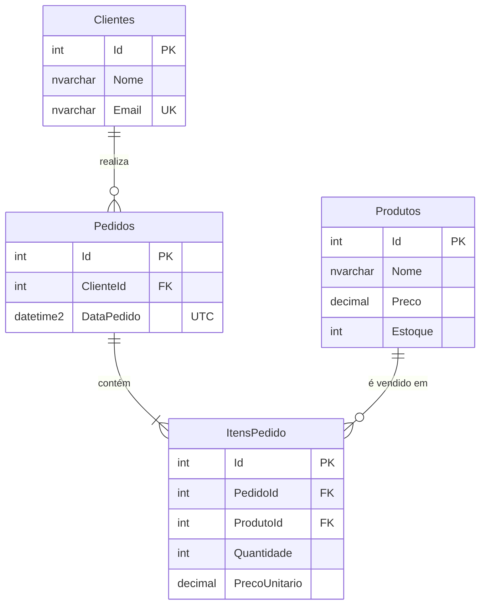
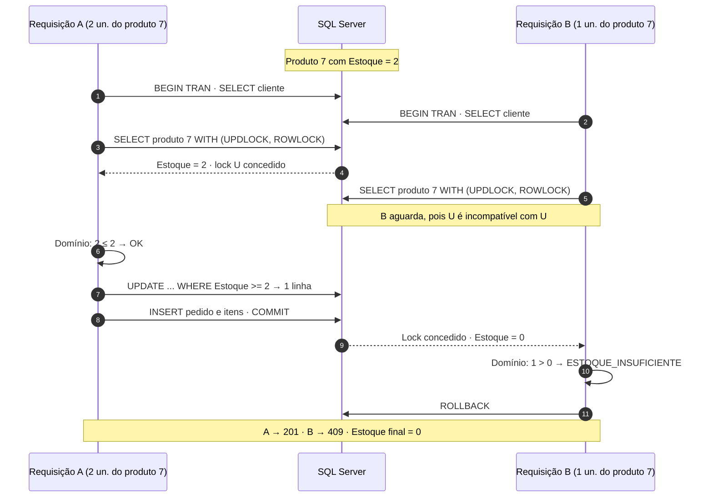
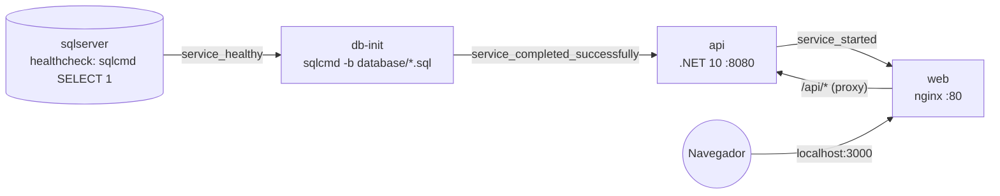

# Especificação Técnica — Mini Gestão de Pedidos

> Teste técnico Full Stack · Joya Solutions
> Versão 1.0 · 12/11/2026 · Status: **Aprovada** (após revisão técnica externa)
> Produzida em Spec-Driven Development (SDD), com apoio do Claude Code em plan mode.

## Como ler este documento

**Origem de cada requisito ou regra**

| Etiqueta | Significado |
|---|---|
| **[ENUNCIADO]** | Exigido pelo e-mail do teste técnico da Joya, como obrigatório ou como diferencial (indicado). |
| **[DIRETRIZ]** | Restrição definida pelo candidato antes desta spec (stack, qualidade, idioma, segurança). |
| **[DECISAO]** | Escolha de projeto feita nesta spec, justificada na seção 13 (`DEC-xx`). |

**Prioridade**

| Nível | Significado |
|---|---|
| **P0** | Obrigatório pelo enunciado. Bloqueia a entrega. |
| **P1** | Diretriz ou decisão necessária para que os P0 tenham qualidade (consistência, testabilidade, segurança). |
| **P2** | Diferencial do enunciado. Só é iniciado depois de todos os P0 e P1 estarem concluídos. |
| **Fora** | Fora do escopo desta entrega (seção 1.3). |

**Prefixos de identificadores**: `RF` requisito funcional · `RNF` requisito não funcional · `RN` regra de negócio ·
`DEC` decisão · `PRE` premissa · `DUV` dúvida em aberto · `RSK` risco · `UT` teste unitário · `IT` teste de integração ·
`E2E` teste ponta a ponta · `CA` critério de aceite.

"Deve" indica obrigação. "Pode" indica opção. Trechos SQL e JSON são **contratos de referência**, não código final.

---

## 1. Objetivo e escopo

### 1.1 Objetivo

Construir uma aplicação pequena de cadastro e consulta de pedidos de clientes, de ponta a ponta (SQL Server, API .NET,
frontend React), que permita:

- criar um pedido com um ou mais itens, com validação de cliente, produtos, quantidades e estoque, baixa de estoque
  atômica e protegida contra concorrência;
- listar pedidos com filtros por cliente e período, com paginação;
- consultar os cinco clientes com maior valor comprado em um período;
- corrigir, otimizar e explicar uma query de ranking de clientes de 2026 fornecida pelo enunciado.

O enunciado deixa claro que a regra de negócio é simples de propósito. O que se avalia é o **processo de engenharia
assistido por IA**: planejamento (SDD), configuração do Claude Code (rules, hooks, skills, MCP), qualidade, testes e
evolução do histórico Git. Esta spec, portanto, prioriza precisão, testabilidade e simplicidade em vez de abrangência.

### 1.2 Escopo incluído

- Banco SQL Server com as tabelas `Clientes`, `Produtos`, `Pedidos` e `ItensPedido`, e scripts de criação e carga em `database/`.
- API HTTP com os três endpoints exigidos e quatro endpoints auxiliares de leitura (seção 5.10).
- Frontend com uma tela de listagem com filtros e um modal de criação de pedido.
- Script corrigido da query de ranking, script de massa para medição e explicação da investigação no README.
- Testes unitários e de integração (P0). Playwright e GitHub Actions (P2).
- `docker-compose.yml` que sobe banco, carga, backend e frontend com um único comando.
- Requisitos de processo: `docs/plan.md`, `CLAUDE.md`, hook, skill, MCP (§2.3), README, commits e vídeo. Esses
  artefatos são **especificados aqui e produzidos em etapas posteriores**.

### 1.3 Fora do escopo

| Item | Motivo |
|---|---|
| Autenticação e autorização | Não exigidas pelo enunciado (PRE-01). |
| CRUD de clientes e produtos | Cadastros vêm do seed. O frontend só precisa consultá-los (PRE-02). |
| Edição, cancelamento ou exclusão de pedidos | Não exigidos. Pedidos são imutáveis (RN-13). |
| Reserva temporária de estoque, devolução, reposição | Não exigidas. |
| Impostos, frete, descontos, várias moedas | Não exigidos (PRE-04). |
| Idempotência de `POST /pedidos` (`Idempotency-Key`) | Fora do escopo. Registrado como evolução (RSK-14). |
| Tela de ranking no frontend | Não exigida (DUV-05). O relatório é demonstrado pela API. |
| Deploy online (diferencial) | Fora desta entrega (DUV-03). |
| Swagger UI ou Scalar | Os contratos ficam nesta spec e no README (DEC-09). |
| Microsserviços, mensageria, cache, CQRS | Proibidos pela diretriz de simplicidade (RNF-22). |

### 1.4 Etapas do trabalho

Esta spec é o artefato da etapa **Spec**. As demais etapas aparecem na matriz de rastreabilidade (seção 15) com os
nomes **Plano** (`docs/plan.md` gerado em plan mode), **Config. Claude** (`CLAUDE.md`, `.claude/`, MCP),
**Implementação** (banco, backend, testes, frontend, Docker), **Diferenciais** (Playwright, GitHub Actions) e
**Entrega** (README, vídeo, envio). A ordem e o detalhamento dessas etapas pertencem ao `docs/plan.md`.

---

## 2. Requisitos funcionais e não funcionais identificados

### 2.1 Requisitos funcionais

| ID | Requisito | Origem | Prioridade | Detalhe |
|---|---|---|---|---|
| RF-01 | Modelo relacional com `Clientes`, `Produtos`, `Pedidos` e `ItensPedido`, com chaves primárias, estrangeiras e índices adequados. | [ENUNCIADO] | P0 | §4 |
| RF-02 | Scripts SQL de criação e de carga de dados de exemplo em `database/`, executados automaticamente no Docker. | [ENUNCIADO] | P0 | §4.6, §11 |
| RF-03 | `POST /pedidos` cria um pedido com itens e valida se o cliente existe e se há estoque suficiente. Também valida produtos e quantidades, com atomicidade e proteção contra concorrência. | [ENUNCIADO] (cliente, estoque) + [DIRETRIZ] (produtos, quantidades, atomicidade, concorrência) | P0 | §3, §5.3, §7 |
| RF-04 | `GET /pedidos` lista pedidos com filtros por cliente e período, com paginação. | [ENUNCIADO] | P0 | §5.4, §8 |
| RF-05 | `GET /relatorios/top-clientes` retorna os 5 clientes com maior valor total de pedidos no período informado. | [ENUNCIADO] | P0 | §5.6, §9.4 |
| RF-06 | Frontend com tela de listagem de pedidos e filtros. | [ENUNCIADO] | P0 | §6.2 |
| RF-07 | Frontend com tela **ou** modal de criação de pedido. Adotado: modal. | [ENUNCIADO] + [DECISAO] DEC-11 | P0 | §6.3 |
| RF-08 | Corrigir e otimizar a query de ranking de 2026 e explicar no README o defeito e a investigação (plano de execução, índices). | [ENUNCIADO] | P0 | §9 |
| RF-09 | `GET /clientes` e `GET /produtos` para alimentar os seletores do frontend. | [DIRETRIZ] | P1 | §5.7, §5.8 |
| RF-10 | `GET /pedidos/{id}`, destino do cabeçalho `Location` do `201 Created`. | [DECISAO] DEC-09 | P1 | §5.5 |
| RF-11 | `GET /health` para verificar se a API está no ar (espera em CI e E2E). | [DECISAO] DEC-09 | P1 | §5.9 |

### 2.2 Requisitos não funcionais

| ID | Requisito | Origem | Prioridade | Detalhe |
|---|---|---|---|---|
| RNF-01 | Backend em .NET (≥ 8 pelo enunciado). Adotado: .NET 10, ASP.NET Core Minimal APIs e Dapper. | [ENUNCIADO] + [DIRETRIZ] | P0 | DEC-01..03 |
| RNF-02 | Frontend em React ou Angular, com TypeScript. Adotado: React, TypeScript e Vite. | [ENUNCIADO] + [DIRETRIZ] | P0 | §6, DEC-11 |
| RNF-03 | Banco SQL Server. | [ENUNCIADO] | P0 | §4 |
| RNF-04 | Projeto roda inteiramente no Docker. `docker-compose.yml` na raiz sobe SQL Server (com scripts automáticos), backend e frontend com um único comando, sem ajustes manuais. | [ENUNCIADO] | P0 | §11 |
| RNF-05 | Testes unitários no backend, cobrindo ao menos as regras e validações do pedido (cliente inexistente, estoque insuficiente, pedido sem itens etc.). | [ENUNCIADO] | P0 | §10.3 |
| RNF-06 | Testes de integração do backend exercitando os endpoints contra SQL Server real. | [ENUNCIADO] | P0 | §10.4 |
| RNF-07 | SDD: `docs/spec.md` (este documento) e `docs/plan.md` (plano do plan mode, com ajustes e discordâncias justificados). | [ENUNCIADO] | P0 | §15 |
| RNF-08 | `CLAUDE.md` versionado com convenções do projeto (arquitetura, nomenclatura, como rodar build e testes). | [ENUNCIADO] | P0 | CA-19 |
| RNF-09 | Ao menos um hook funcional do Claude Code em `.claude/` (ex.: build, lint ou testes após edições). | [ENUNCIADO] | P0 | CA-20 |
| RNF-10 | Ao menos uma skill personalizada (ex.: "criar novo endpoint seguindo o padrão do projeto"). | [ENUNCIADO] | P0 | CA-21 |
| RNF-11 | Integração real do Claude Code com o SQL Server por meio de um MCP. | [ENUNCIADO] | P0 | §11.6, CA-22 |
| RNF-12 | README explica como o MCP foi usado durante o desenvolvimento. | [ENUNCIADO] | P0 | CA-23 |
| RNF-13 | README na raiz com: como rodar no Docker, como rodar os testes, principais decisões, como o Claude foi usado (o que funcionou e o que precisou ser corrigido) e a explicação da Parte 4. | [ENUNCIADO] | P0 | CA-23 |
| RNF-14 | Histórico de commits preservado: commits pequenos, frequentes e claros, sem squash e sem reescrita. | [ENUNCIADO] | P0 | CA-25 |
| RNF-15 | Repositório no GitHub e vídeo de até 10 minutos sobre o fluxo com o Claude Code e o código. | [ENUNCIADO] | P0 | CA-26 |
| RNF-16 | Testes ponta a ponta com Playwright cobrindo ao menos criar um pedido e vê-lo na listagem. | [ENUNCIADO] diferencial | P2 | §10.5 |
| RNF-17 | Pipeline do GitHub Actions com build e testes a cada push ou pull request. | [ENUNCIADO] diferencial | P2 | CA-30 |
| RNF-18 | Deploy online com link no README. | [ENUNCIADO] diferencial | Fora | DUV-03 |
| RNF-19 | Valores monetários em `decimal` (C#) e `DECIMAL` (SQL), nunca `float` ou `double`. | [DIRETRIZ] | P1 | §4.5 |
| RNF-20 | Transação de banco e controle de concorrência na baixa de estoque. | [DIRETRIZ] | P1 | §7 |
| RNF-21 | Respostas HTTP consistentes, com status e corpo de erro padronizados. | [DIRETRIZ] | P1 | §5.2 |
| RNF-22 | Monólito modular simples, SOLID e Clean Code, sem microsserviços, mensageria ou abstrações desnecessárias. Entidades, DTOs, regras, validações e persistência separados. | [DIRETRIZ] | P1 | DEC-01 |
| RNF-23 | Comunicação, código autoral, nomenclatura, testes e documentação em português do Brasil, exceto termos técnicos, bibliotecas e contratos externos. Identificadores sem acento. | [DIRETRIZ] | P1 | CA-27 |
| RNF-24 | Nenhum segredo real versionado. | [DIRETRIZ] | P1 | §11.4, CA-28 |
| RNF-25 | Instantes armazenados em UTC. Períodos interpretados no fuso do negócio (America/Sao_Paulo). | [DECISAO] DEC-06 | P1 | §8.2 |
| RNF-26 | Evidências preparadas para a demonstração em vídeo. | [DIRETRIZ] | P1 | §12.2 |

### 2.3 Requisitos do ambiente AI First (Parte 2)

Especificados agora e implementados na etapa **Config. Claude**. São ferramentas do **processo de desenvolvimento**:
o avaliador não precisa delas para rodar a aplicação.

| Artefato | Requisito mínimo | Verificação |
|---|---|---|
| `CLAUDE.md` (RNF-08) | Arquitetura e módulos (§13); convenções de nomenclatura (pt-BR, sem acento, sufixos `Endpoints`, `Validador`, `Repositorio`, `Testes`); comandos de build, testes, Docker e frontend; regras de qualidade (SQL parametrizado, `decimal`, UTC, Problem Details, commits pequenos sem reescrita). Conciso: aponta para esta spec em vez de repeti-la. | CA-19 |
| Hook pós-edição (RNF-09, obrigatório) | Evento `PostToolUse` nas ferramentas de edição. Para `.cs`, compila o backend. Para `.ts`/`.tsx`, faz verificação de tipos ou lint do frontend. Roda **depois** da edição: não a impede nem a desfaz. Em falha de build ou testes, comunica o erro ao Claude (código de saída de bloqueio com a mensagem em stderr) para que ele corrija na sequência. Ignora arquivos irrelevantes. Alvo: menos de 60 s. | CA-20 |
| Hook de proteção (recomendado, P1) | Evento `PreToolUse`, que roda **antes** da operação e pode impedi-la. Bloqueia `git push --force`, `git rebase`, `git commit --amend`, `git reset --hard` e edição de `.env`. Reforça RNF-14 e RNF-24. | CA-20 |
| Skill (RNF-10) | `novo-endpoint`: recebe módulo, verbo, rota e contrato. Produz endpoint, contratos, validador, repositório e testes (UT do validador, IT do endpoint) no padrão da §13.1, e termina rodando build e testes. Inclui checklist das convenções. | CA-21 |
| MCP SQL Server (RNF-11) | Servidor MCP que conecta o Claude Code ao SQL Server do compose (exposto pelo arquivo opt-in da §11.6). `.mcp.json` versionado **sem segredo**: credenciais por expansão de variáveis de ambiente (`${VAR}`). Permissões na §2.3.1. Antes de depender do MCP na Parte 4, validar que ele devolve result sets de DMVs e catálogos (`sys.dm_exec_query_stats`, `sys.indexes`). Usos previstos: inspecionar esquema e índices, conferir o seed, executar as queries do ranking e coletar estatísticas. | CA-22 |
| Documentação do MCP (RNF-12) | Seção do README sobre o MCP: qual servidor, como configurar, consultas feitas e o que mudou por causa delas. | CA-23 |

**Portabilidade**: os comandos dos hooks devem funcionar em Windows (Git Bash), Linux e macOS. Eles chamam `dotnet`,
`npm` ou `node` diretamente, sem recursos exclusivos de um shell. Scripts versionados com fim de linha LF (§11.7).
O servidor MCP específico é escolhido na etapa Config. Claude com base nesses critérios (DUV-08).

#### 2.3.1 Permissões do login do MCP

- **Privilégio mínimo**: o MCP usa um login dedicado, preferível ao `sa` (DUV-04), com só o necessário para os usos
  previstos:
  - leitura no banco `JoyaPedidos` (`db_datareader`), que também dá visibilidade dos metadados em `sys.indexes` e
    demais catálogos dos objetos lidos;
  - `VIEW SERVER PERFORMANCE STATE`, permissão granular do SQL Server 2022 exigida por `sys.dm_exec_query_stats`
    (em versões anteriores, o equivalente era `VIEW SERVER STATE`);
  - `SHOWPLAN` no banco, apenas se o plano de execução também for obtido pelo MCP.
- **Nada administrativo**: sem `sysadmin`, `db_owner`, `CONTROL SERVER`, `ALTER ANY ...` e sem permissão de escrita.
  O MCP observa. Alterações de esquema e de dados passam pelos scripts versionados.
- **Validação**: durante a configuração, conectado como o login do MCP, conferir as permissões efetivas com
  `SELECT * FROM fn_my_permissions(NULL, 'SERVER')` e `fn_my_permissions(NULL, 'DATABASE')`. Confirmar que uma
  escrita (ex.: `UPDATE`) é **negada** e que `sys.dm_exec_query_stats` responde. O resultado vai ao README.
- O login e sua senha existem só no ambiente local de desenvolvimento. A senha vem de variável de ambiente e nunca é
  versionada (RNF-24). Se a criação do login se mostrar inviável no prazo, o uso do `sa` deve ser registrado no README
  como limitação.

---

## 3. Regras de negócio detalhadas

| ID | Regra | Origem | Violação | Verificação |
|---|---|---|---|---|
| RN-01 | O cliente informado deve existir. A verificação acontece **antes** de bloquear qualquer produto. Se o cliente não existe, a transação é encerrada na hora. | [ENUNCIADO] | 422 `CLIENTE_NAO_ENCONTRADO` | UT-01, IT-02 |
| RN-02 | O pedido tem de 1 a 50 itens. Pedido sem itens é rejeitado. O limite de 50 é [DECISAO] DEC-15. | [ENUNCIADO] + [DECISAO] | 400 `VALIDACAO` | UT-02, UT-13, IT-08 |
| RN-03 | A quantidade de cada item é um inteiro de 1 a 10.000. O limite superior é [DECISAO] DEC-15. | [DIRETRIZ] + [DECISAO] | 400 `VALIDACAO` | UT-03, UT-13, IT-08 |
| RN-04 | Um produto não pode aparecer em mais de uma linha do mesmo pedido. O banco reforça com índice único. | [DECISAO] | 400 `VALIDACAO` | UT-04, UT-13, IT-08 |
| RN-05 | Todo produto informado deve existir. A resposta lista **todos** os ausentes. | [DIRETRIZ] | 422 `PRODUTO_NAO_ENCONTRADO` | UT-05, IT-03 |
| RN-06 | Cada item precisa de estoque suficiente no momento da confirmação, lido sob bloqueio. A resposta lista **todos** os itens sem estoque, com quantidade solicitada e disponível. Quantidade igual ao estoque é aceita. | [ENUNCIADO] | 409 `ESTOQUE_INSUFICIENTE` | UT-06..08, IT-04, IT-09 |
| RN-07 | Ao confirmar o pedido, o estoque de cada produto é reduzido pela quantidade do item, na mesma transação. O estoque nunca fica negativo. | [DIRETRIZ] | Rollback; 409 | IT-01, IT-09, IT-10 |
| RN-08 | O preço unitário fica congelado: `ItensPedido.PrecoUnitario` recebe `Produtos.Preco` lido dentro da transação. Preço enviado pelo cliente HTTP é ignorado. Mudanças futuras no preço do produto não alteram pedidos existentes. | [DIRETRIZ] | — | UT-10, IT-06, IT-07 |
| RN-09 | A data do pedido é o instante do servidor, obtido via `TimeProvider`, em UTC e truncado a segundos. O cliente HTTP não informa a data. | [DECISAO] DEC-06 | — | UT-12, IT-13 |
| RN-10 | Atomicidade: ou o pedido, seus itens e todas as baixas de estoque são gravados juntos, ou nada é gravado. | [DIRETRIZ] | Rollback completo | IT-02..05, IT-25 |
| RN-11 | Subtotal do item = `Quantidade × PrecoUnitario`. Valor total = soma dos subtotais. Aritmética `decimal` exata, sem arredondamento intermediário. O total **não** é armazenado: é sempre derivado dos itens (DEC-04). | [DIRETRIZ] + [DECISAO] | — | UT-11, IT-01, IT-11 |
| RN-12 | Precedência de erros na criação: `VALIDACAO` (400) > `CLIENTE_NAO_ENCONTRADO` (422) > `PRODUTO_NAO_ENCONTRADO` (422) > `ESTOQUE_INSUFICIENTE` (409). Só a categoria de maior precedência é retornada, com todas as suas ocorrências. | [DECISAO] DEC-07 | — | UT-09, IT-26 |
| RN-13 | Um pedido criado é imutável: não há edição, cancelamento ou exclusão. | [DECISAO] (PRE-03) | — | — |
| RN-14 | Ranking: valor total por **cliente** (`ClienteId`, nunca nome) = soma dos subtotais dos itens dos pedidos do período. Retorna os 5 maiores, em ordem decrescente de valor, com empate resolvido pelo menor `ClienteId`. Clientes sem pedidos no período não aparecem. | [ENUNCIADO] + [DECISAO] | — | IT-18..20, IT-23 |
| RN-15 | Período: `dataInicio` e `dataFim` são datas civis inclusivas no fuso America/Sao_Paulo, com `dataInicio ≤ dataFim`. | [DECISAO] DEC-06 | 400 `VALIDACAO` | UT-14..17, IT-13, IT-19 |

### 3.1 Ordem de processamento de `POST /pedidos`

1. Validar o formato da requisição (RN-02, RN-03, RN-04). Se houver erro, responder 400 sem abrir transação.
2. Abrir a transação. Ler o cliente (RN-01). Se não existir, fazer rollback e responder 422. Nenhum produto foi bloqueado.
3. Bloquear e ler cada produto em ordem crescente de `ProdutoId` (§7).
4. Aplicar as regras puras de domínio (RN-05, RN-06, RN-08, RN-09, RN-11). Se houver falha, fazer rollback e responder 422 ou 409.
5. Baixar o estoque com `UPDATE` condicional (RN-07), gravar pedido e itens e confirmar (RN-10).

As regras de domínio (passos 2 e 4) são **funções puras** do projeto `JoyaPedidos.Dominio`. Recebem dados já lidos e
não acessam banco, relógio ou HTTP. Por isso são testáveis sem infraestrutura (§10.3). Nomes de referência:
`RegrasPedido.VerificarCliente(cliente?)` e `RegrasPedido.CriarPedido(cliente, itensSolicitados, produtosBloqueados, agoraUtc)`.

As regras de formato (RN-02..04) ficam **somente** no validador (passo 1). O domínio recebe entrada já validada e não
as repete, o que evita duplicação de lógica e de testes.

---

## 4. Modelo lógico de dados, tipos, relacionamentos e restrições

### 4.1 Diagrama entidade-relacionamento



Banco: `JoyaPedidos`. Esquema: `dbo`. Nomes de tabelas e colunas seguem o enunciado (PascalCase, pt-BR, sem acento).

### 4.2 Tabelas

**`Clientes`**

| Coluna | Tipo | Nulo | Restrição |
|---|---|---|---|
| `Id` | `INT IDENTITY(1,1)` | não | `PK_Clientes` (clustered) |
| `Nome` | `NVARCHAR(150)` | não | `CK_Clientes_Nome`: `LEN(Nome) > 0` |
| `Email` | `NVARCHAR(254)` | não | `UQ_Clientes_Email` (único). Distingue homônimos. |

**`Produtos`**

| Coluna | Tipo | Nulo | Restrição |
|---|---|---|---|
| `Id` | `INT IDENTITY(1,1)` | não | `PK_Produtos` (clustered) |
| `Nome` | `NVARCHAR(150)` | não | `CK_Produtos_Nome`: `LEN(Nome) > 0` |
| `Preco` | `DECIMAL(18,2)` | não | `CK_Produtos_Preco`: `Preco > 0` |
| `Estoque` | `INT` | não | `CK_Produtos_Estoque`: `Estoque >= 0` (última barreira contra estoque negativo) |

**`Pedidos`**

| Coluna | Tipo | Nulo | Restrição |
|---|---|---|---|
| `Id` | `INT IDENTITY(1,1)` | não | `PK_Pedidos` (clustered) |
| `ClienteId` | `INT` | não | `FK_Pedidos_Clientes` → `Clientes(Id)`, `ON DELETE NO ACTION` |
| `DataPedido` | `DATETIME2(0)` | não | Instante **UTC**, precisão de segundos, sem `DEFAULT`. A API sempre informa o valor (RN-09) e o seed usa valores explícitos. |

O valor total não é coluna de `Pedidos` (DEC-04).

**`ItensPedido`**

| Coluna | Tipo | Nulo | Restrição |
|---|---|---|---|
| `Id` | `INT IDENTITY(1,1)` | não | `PK_ItensPedido` (clustered) |
| `PedidoId` | `INT` | não | `FK_ItensPedido_Pedidos` → `Pedidos(Id)`, `ON DELETE NO ACTION` |
| `ProdutoId` | `INT` | não | `FK_ItensPedido_Produtos` → `Produtos(Id)`, `ON DELETE NO ACTION` |
| `Quantidade` | `INT` | não | `CK_ItensPedido_Quantidade`: `Quantidade > 0` |
| `PrecoUnitario` | `DECIMAL(18,2)` | não | `CK_ItensPedido_PrecoUnitario`: `PrecoUnitario > 0`. Preço congelado (RN-08). |

### 4.3 Índices

Além das PKs clusterizadas:

| Índice | Tabela | Chave | `INCLUDE` | Finalidade pretendida |
|---|---|---|---|---|
| `UQ_Clientes_Email` | Clientes | `Email` (único) | — | Unicidade do e-mail. |
| `IX_Pedidos_DataPedido` | Pedidos | `DataPedido` | `ClienteId` | Filtro só por período na listagem. Ranking por período (§9). |
| `IX_Pedidos_ClienteId_DataPedido` | Pedidos | `ClienteId, DataPedido` | — | Filtro por cliente, com ou sem período, na ordem de data. Suporte à FK. |
| `UX_ItensPedido_PedidoId_ProdutoId` | ItensPedido | `PedidoId, ProdutoId` (único) | `Quantidade, PrecoUnitario` | RN-04 (sem produto repetido). Suporte à FK. Soma dos itens por pedido sem lookup. |

`ItensPedido.ProdutoId` **não** tem índice próprio, por decisão: não há exclusão de produtos (que exigiria verificar a
FK) nem consulta por produto. Criar o índice só encareceria os inserts. Ele passa a ser necessário se surgir uma
dessas operações.

Os índices de `Pedidos` e o `INCLUDE` de `ItensPedido` são **hipóteses de projeto**. O protocolo da §9.6 os valida com
medição, e o README registra se foram mantidos, ajustados ou removidos. `Clientes.Nome` e `Produtos.Nome` não têm
índice: as tabelas são pequenas e a ordenação por nome é barata (PRE-09).

### 4.4 Onde cada regra é garantida

| Regra | Aplicação | Banco |
|---|---|---|
| Cliente existe (RN-01) | Verificação no serviço → 422 | FK `FK_Pedidos_Clientes` |
| Produto existe (RN-05) | Regra de domínio → 422 | FK `FK_ItensPedido_Produtos` |
| Quantidade > 0 (RN-03) | Validador → 400 | `CK_ItensPedido_Quantidade` |
| Quantidade ≤ 10.000, 1 a 50 itens | Validador → 400 | — (limites de API) |
| Produto não repetido (RN-04) | Validador → 400 | `UX_ItensPedido_PedidoId_ProdutoId` |
| Estoque suficiente e não negativo (RN-06, RN-07) | Domínio + `UPDATE` condicional → 409 | `CK_Produtos_Estoque` |
| Preço positivo | — (preço vem do banco) | `CK_Produtos_Preco`, `CK_ItensPedido_PrecoUnitario` |

### 4.5 Convenções de tipos

- **Dinheiro**: `DECIMAL(18,2)` no banco e `decimal` no C#. Produto `INT × DECIMAL(18,2)` e somas são exatos. No JSON,
  número com duas casas. No TypeScript, só exibição: estimativas usam centavos inteiros (§6.3). Nenhum `float` ou `double` (RNF-19).
- **Instantes**: `DATETIME2(0)` em UTC. A aplicação trunca a segundos **antes** de gravar, para que o valor devolvido
  seja igual ao gravado e para evitar que o arredondamento de 23:59:59,6 leve o pedido ao dia seguinte (DEC-06).
  Parâmetros de data vão como `DbType.DateTime2`. Na leitura, o SqlClient devolve `datetime2` sem fuso
  (`DateTimeKind.Unspecified`), e sem tratamento o JSON sairia **sem** `Z`. Por isso o repositório marca o valor como
  UTC (`DateTime` com `Kind = Utc`, ou `DateTimeOffset`). Toda resposta, de escrita ou de leitura, serializa com `Z`
  (IT-01, IT-11, IT-17).
- **Textos**: `NVARCHAR`, com a collation padrão da instância.
- **Identificadores**: `INT IDENTITY`, suficiente para o volume do desafio.

### 4.6 Scripts em `database/`

| Arquivo | Conteúdo | Execução |
|---|---|---|
| `01-criar-banco.sql` | Cria `JoyaPedidos` se não existir. | Automática (`db-init`) |
| `02-criar-tabelas.sql` | Tabelas, PKs, FKs, CHECKs, UNIQUEs e índices da §4.2–4.3, cada objeto criado só se não existir. | Automática |
| `03-dados-exemplo.sql` | Carga de exemplo (§4.7), em uma transação, executada só se `Clientes` estiver vazia. | Automática |
| `consultas/ranking-2026-original.sql` | A query do enunciado, **literal** (§9.1). | Manual e pelo IT-24 |
| `consultas/ranking-2026-corrigida.sql` | A query corrigida (§9.3), em um único batch sem `GO`. | Manual e pelo IT-23 |
| `performance/gerar-massa.sql` | Massa determinística para medição (§9.6). | Manual, nunca no compose |

Regras dos scripts:

- **Idempotentes**: executar duas vezes não falha nem duplica dados (IT-21, CA-02).
- Executados com `sqlcmd -b` (para no primeiro erro). Podem usar `GO`.
- `db-init` executa só os arquivos `*.sql` da raiz de `database/`, em ordem lexical. Subpastas ficam de fora.

### 4.7 Dados de exemplo (mínimos)

O seed é determinístico (sem `NEWID()` ou `RAND()`) e deve conter:

- ≥ 8 clientes, incluindo **dois homônimos** (mesmo `Nome`, e-mails diferentes), cuja soma em 2026 supere o maior
  cliente individual. Isso demonstra o defeito do `GROUP BY c.Nome`.
- ≥ 10 produtos com preços com centavos (ex.: 19,99), incluindo um com `Estoque = 0` e um com `Estoque ≤ 2`.
- ≥ 30 pedidos com 1 a 4 itens, distribuídos em 2025 e 2026. **Nenhum** `DataPedido` posterior a 31/10/2026 23:59:59
  em São Paulo (`2026-11-01T02:59:59Z`). Assim, um pedido criado na demonstração sempre aparece no topo da listagem.
- Ao menos dois produtos com estoque alto (≥ 1.000), usados pelos testes E2E sem esgotar estoque.
- Pedidos nas fronteiras do ano civil local: 31/12/2025 23:59:59 em São Paulo (`2026-01-01T02:59:59Z`, conta como 2025)
  e 01/01/2026 00:00:00 em São Paulo (`2026-01-01T03:00:00Z`, conta como 2026).
- Ao menos um item com `PrecoUnitario` diferente do `Preco` atual do produto (preço alterado depois do pedido).
- `Estoque` já representa o saldo **após** os pedidos históricos. O seed não recalcula estoque.

---

## 5. Contratos HTTP

### 5.1 Convenções gerais

- **Rotas**: as do enunciado, sem prefixo de versão (`/pedidos`, `/relatorios/top-clientes`). Atrás do proxy do
  frontend, ficam acessíveis em `/api/...`, e o nginx remove o prefixo (§6.6).
- **Formato**: JSON UTF-8. Propriedades em camelCase pt-BR. Requisições com corpo exigem `Content-Type: application/json`.
- **Campos desconhecidos** no corpo são ignorados. Isso inclui qualquer preço enviado (RN-08).
- **Números no corpo**: `clienteId`, `produtoId` e `quantidade` são inteiros JSON. Valor fracionário (`1.5`), texto
  não numérico ou objeto fazem a desserialização falhar: 400 `REQUISICAO_INVALIDA`, sem `errors` por campo. Números em
  texto (`"3"`) são aceitos, pelo padrão de serialização Web do ASP.NET Core. Esse padrão é mantido sem customização.
- **Ausente × zero**: os contratos usam tipos anuláveis para distinguir campo ausente de valor 0. Ambos geram `VALIDACAO`.
- **Índices** nas chaves de erro (`itens[i]`) começam em 0.
- **Dinheiro**: número JSON com duas casas (`159.87`).
- **Instantes**: ISO 8601 em UTC com sufixo `Z` (`"2026-11-12T19:30:00Z"`).
- **Datas civis** (query string e eco de período): `yyyy-MM-dd`. A API faz parsing estrito desse formato e rejeita
  qualquer outro com `VALIDACAO`. Formatos culturais ambíguos (ex.: `01/02/2026`) não são aceitos.
- **Coleções** sempre ordenadas de forma determinística.

### 5.2 Formato de erro

Todas as respostas de erro usam **Problem Details** (RFC 9457), `Content-Type: application/problem+json`, com os campos
padrão `type`, `title`, `status`, `detail` e as extensões:

- `codigo`: identificador estável do erro (tabela abaixo). Testes e frontend decidem por ele, nunca pelo texto.
- `traceId`: correlação com os logs.
- `errors`: só em `VALIDACAO`. Dicionário campo → mensagens, com chaves no caminho JSON (`itens[1].quantidade`).
- Extensões específicas por código (`produtosNaoEncontrados`, `itensSemEstoque`).

**Códigos emitidos pela aplicação**

| `codigo` | Status | Quando |
|---|---|---|
| `VALIDACAO` | 400 | Campo ausente, fora da faixa, duplicado ou data fora do formato. |
| `CLIENTE_NAO_ENCONTRADO` | 422 | RN-01. |
| `PRODUTO_NAO_ENCONTRADO` | 422 | RN-05. |
| `ESTOQUE_INSUFICIENTE` | 409 | RN-06, ou `UPDATE` condicional sem linha afetada (§7.2). |
| `PEDIDO_NAO_ENCONTRADO` | 404 | `GET /pedidos/{id}` com id numérico inexistente. |
| `CONFLITO_CONCORRENCIA` | 503 | SQL Server escolheu a transação como vítima de deadlock (erro 1205). O cliente pode tentar de novo (§7.5). |
| `ERRO_INTERNO` | 500 | Qualquer outra falha não tratada. Nunca expõe stack trace, SQL ou mensagem interna. |

**Erros gerados pelo framework** (JSON malformado, tipo incompatível, rota inexistente, método não permitido,
`Content-Type` não suportado) não são tratados caso a caso. Uma regra central (`CustomizeProblemDetails`, com
`UseStatusCodePages` para respostas sem corpo) preenche `codigo` **pelo status**: `RECURSO_NAO_ENCONTRADO` para 404
(inclusive `/pedidos/abc`) e `REQUISICAO_INVALIDA` para os demais 4xx (400, 405, 415).

### 5.3 `POST /pedidos`

Cria um pedido. Origem: [ENUNCIADO] RF-03.

**Requisição**

```json
{
  "clienteId": 3,
  "itens": [
    { "produtoId": 2, "quantidade": 3 },
    { "produtoId": 5, "quantidade": 1 }
  ]
}
```

**Validações de formato (400 `VALIDACAO`)**

| Campo | Regra | Chave em `errors` |
|---|---|---|
| `clienteId` | Obrigatório, inteiro > 0 | `clienteId` |
| `itens` | Obrigatório, de 1 a 50 elementos | `itens` |
| `itens[i].produtoId` | Obrigatório, inteiro > 0 | `itens[i].produtoId` |
| `itens[i].quantidade` | Obrigatório, inteiro de 1 a 10.000 | `itens[i].quantidade` |
| `itens[i].produtoId` repetido | Não pode repetir (RN-04). O erro aparece na segunda ocorrência e nas seguintes. | `itens[i].produtoId` |

**201 Created** — cabeçalho `Location: /pedidos/1024`, relativo à raiz da API (RSK-11).

```json
{
  "id": 1024,
  "cliente": { "id": 3, "nome": "Bruno Lima" },
  "dataPedido": "2026-11-12T19:30:00Z",
  "itens": [
    { "produtoId": 2, "nomeProduto": "Caneca de cerâmica", "quantidade": 3, "precoUnitario": 19.99, "subtotal": 59.97 },
    { "produtoId": 5, "nomeProduto": "Garrafa térmica", "quantidade": 1, "precoUnitario": 99.90, "subtotal": 99.90 }
  ],
  "valorTotal": 159.87
}
```

`itens` vem ordenado por `produtoId` crescente.

**Erros**

400 `VALIDACAO`:

```json
{
  "title": "Requisição inválida",
  "status": 400,
  "detail": "Um ou mais campos são inválidos.",
  "codigo": "VALIDACAO",
  "errors": { "itens": ["O pedido deve conter ao menos um item."] },
  "traceId": "00-4bf92f3577b34da6a3ce929d0e0e4736-00f067aa0ba902b7-01"
}
```

422 `CLIENTE_NAO_ENCONTRADO`:

```json
{ "title": "Cliente não encontrado", "status": 422, "detail": "O cliente 999 não existe.", "codigo": "CLIENTE_NAO_ENCONTRADO", "traceId": "..." }
```

422 `PRODUTO_NAO_ENCONTRADO`:

```json
{ "title": "Produto não encontrado", "status": 422, "detail": "2 produto(s) informado(s) não existem.", "codigo": "PRODUTO_NAO_ENCONTRADO", "produtosNaoEncontrados": [77, 78], "traceId": "..." }
```

409 `ESTOQUE_INSUFICIENTE`:

```json
{
  "title": "Estoque insuficiente",
  "status": 409,
  "detail": "Não há estoque suficiente para 1 produto(s).",
  "codigo": "ESTOQUE_INSUFICIENTE",
  "itensSemEstoque": [
    { "produtoId": 5, "nomeProduto": "Garrafa térmica", "quantidadeSolicitada": 4, "estoqueDisponivel": 2 }
  ],
  "traceId": "..."
}
```

503 `CONFLITO_CONCORRENCIA`: `"detail": "Conflito momentâneo de concorrência. Tente novamente."`. 500 `ERRO_INTERNO`:
`"detail": "Ocorreu um erro inesperado."`.

| Status | Situação |
|---|---|
| 201 | Pedido criado. |
| 400 | `VALIDACAO` ou `REQUISICAO_INVALIDA` (corpo não desserializável). |
| 415 | `Content-Type` diferente de JSON (`REQUISICAO_INVALIDA`). |
| 422 | Cliente ou produto inexistente. |
| 409 | Estoque insuficiente. |
| 503 | Vítima de deadlock. |
| 500 | Erro inesperado. |

### 5.4 `GET /pedidos`

Lista pedidos. Origem: [ENUNCIADO] RF-04. A semântica completa está na §8.

| Parâmetro | Tipo | Obrigatório | Padrão | Regra |
|---|---|---|---|---|
| `clienteId` | inteiro | não | — | > 0. Cliente inexistente devolve lista vazia, não erro: é filtro, não referência. |
| `dataInicio` | `yyyy-MM-dd` | não | — | Data civil inclusiva (America/Sao_Paulo). |
| `dataFim` | `yyyy-MM-dd` | não | — | Data civil inclusiva. Se ambas forem informadas, `dataInicio ≤ dataFim`. |
| `pagina` | inteiro | não | 1 | ≥ 1 |
| `tamanhoPagina` | inteiro | não | 10 | De 1 a 100. Fora da faixa é rejeitado, sem ajuste silencioso. |

**200 OK** — exemplo: `GET /pedidos?clienteId=3&dataInicio=2026-01-01&dataFim=2026-12-31&pagina=1&tamanhoPagina=10`

```json
{
  "itens": [
    {
      "id": 1024,
      "cliente": { "id": 3, "nome": "Bruno Lima" },
      "dataPedido": "2026-11-12T19:30:00Z",
      "quantidadeItens": 2,
      "valorTotal": 159.87
    }
  ],
  "pagina": 1,
  "tamanhoPagina": 10,
  "totalItens": 1,
  "totalPaginas": 1
}
```

- `quantidadeItens` é o número de **linhas** de item (produtos distintos), não a soma das quantidades.
- `totalPaginas = ceil(totalItens / tamanhoPagina)`. Com `totalItens = 0`, `totalPaginas = 0`.
- Página além da última: 200 com `itens: []` e totais corretos.

| Status | Situação |
|---|---|
| 200 | Sucesso, inclusive com lista vazia. |
| 400 | `VALIDACAO` (faixas, `dataInicio > dataFim`, data fora do formato) ou `REQUISICAO_INVALIDA` (não numérico). |

### 5.5 `GET /pedidos/{id}`

Detalhe de um pedido. Origem: [DECISAO] RF-10. `id` inteiro (restrição de rota).

- **200 OK**: mesmo corpo do `201` de `POST /pedidos`, inclusive `dataPedido` com `Z` (§4.5).
- **404** `PEDIDO_NAO_ENCONTRADO` para id numérico inexistente. **404** `RECURSO_NAO_ENCONTRADO` para id não numérico.

### 5.6 `GET /relatorios/top-clientes`

Os cinco clientes com maior valor total de pedidos no período. Origem: [ENUNCIADO] RF-05. Regras em RN-14 e RN-15.

| Parâmetro | Tipo | Obrigatório | Regra |
|---|---|---|---|
| `dataInicio` | `yyyy-MM-dd` | **sim** | Data civil inclusiva. |
| `dataFim` | `yyyy-MM-dd` | **sim** | Data civil inclusiva, `dataInicio ≤ dataFim`. |

**200 OK** — exemplo: `GET /relatorios/top-clientes?dataInicio=2026-01-01&dataFim=2026-12-31`

```json
{
  "dataInicio": "2026-01-01",
  "dataFim": "2026-12-31",
  "clientes": [
    { "posicao": 1, "clienteId": 3, "nome": "Bruno Lima", "valorTotal": 500.00 },
    { "posicao": 2, "clienteId": 6, "nome": "Elisa Rocha", "valorTotal": 450.00 }
  ]
}
```

- Até 5 elementos. Com menos de 5 compradores no período, a lista é menor. Sem compras, `clientes: []`.
- `posicao` vai de 1 a N, sem lacunas. Valores iguais recebem posições distintas pelo desempate por `clienteId` (DUV-01).

| Status | Situação |
|---|---|
| 200 | Sucesso. |
| 400 | `VALIDACAO`: data ausente, fora do formato ou `dataInicio > dataFim`. |

### 5.7 `GET /clientes`

Origem: [DIRETRIZ] RF-09. Sem parâmetros e sem paginação (RSK-06). Ordenado por `nome` e depois `id`.

```json
[
  { "id": 1, "nome": "Ana Souza", "email": "ana.souza@exemplo.com" },
  { "id": 2, "nome": "Ana Souza", "email": "ana.souza2@exemplo.com" }
]
```

### 5.8 `GET /produtos`

Origem: [DIRETRIZ] RF-09. Sem parâmetros e sem paginação. Ordenado por `nome` e depois `id`. Inclui produtos com estoque 0.

```json
[
  { "id": 2, "nome": "Caneca de cerâmica", "preco": 19.99, "estoque": 12 },
  { "id": 9, "nome": "Luminária de mesa", "preco": 149.00, "estoque": 0 }
]
```

### 5.9 `GET /health`

Origem: [DECISAO] RF-11. Liveness da API: responde `200` com `Healthy` (texto). Não consulta o banco, porque a
disponibilidade do banco já é garantida pela ordem do compose (§11.2).

### 5.10 Por que endpoints auxiliares

O enunciado pede que o frontend crie pedidos, o que exige escolher cliente e produtos com preço e estoque visíveis.
Sem uma fonte de consulta, a UI teria de pedir IDs digitados, o que é inviável. A decisão é usar **o mínimo de leitura
necessário**: `GET /clientes` e `GET /produtos`, sem filtros, paginação ou escrita (DEC-09). `GET /pedidos/{id}` existe
porque `201 Created` deve indicar o recurso criado (`Location`). Também facilita verificar nos testes o preço congelado.
`GET /health` permite aguardar a API em CI e E2E sem depender de dados.

---

## 6. Fluxos do frontend

### 6.1 Visão geral

- React com TypeScript em modo `strict`, empacotado com Vite. Uma única página, **sem router** e **sem biblioteca de
  estado global**. Estado local com hooks. CSS simples, sem biblioteca de componentes (DEC-11).
- Camadas: `api/` (cliente HTTP tipado que interpreta Problem Details pelo `codigo`), `tipos/` (contratos espelhados da
  §5), `componentes/` e `utilitarios/` (formatação). Nomes em pt-BR, sem acento.
- A API é chamada em caminhos relativos `/api/...` (§6.6).

### 6.2 Tela de listagem ("Pedidos")

1. **Ao abrir**: carrega `GET /clientes` (para o filtro) e `GET /pedidos?pagina=1&tamanhoPagina=10`.
2. **Filtros**: *Cliente* (seletor com "Todos os clientes" e opções `Nome (email)`, para distinguir homônimos),
   *Data inicial* e *Data final* (`<input type="date">`), botões **Filtrar** e **Limpar**.
   - Data inicial maior que a final: mensagem junto ao campo, sem requisição.
   - **Filtrar** volta à página 1. **Limpar** zera os filtros e volta à página 1.
3. **Tabela**: colunas Nº, Cliente, Data, Itens e Valor total, na ordem devolvida pela API (mais recentes primeiro).
4. **Paginação**: botões **Anterior** e **Próxima**, desabilitados nos limites, e o texto "Página X de Y · N pedidos".
   Tamanho fixo de 10.
5. **Estados**:
   - *Carregando*: indicador visível e controles de filtro e paginação desabilitados.
   - *Vazio*: "Nenhum pedido encontrado para os filtros informados."
   - *Erro*: mensagem e botão **Tentar novamente**.
6. Botão **Novo pedido** abre o modal (§6.3). Uma mensagem de sucesso, quando houver, aparece acima da tabela (`aria-live`).

### 6.3 Modal "Novo pedido"

Implementado com `<dialog>` nativo (foco e tecla Esc tratados pelo navegador).

1. **Ao abrir**: recarrega `GET /clientes` e `GET /produtos` para mostrar estoque atual. Foco inicial no campo *Cliente*.
2. **Cliente**: seletor obrigatório.
3. **Itens**: começa com uma linha. Cada linha tem:
   - *Produto*: seletor com opções "Nome — R$ preço — estoque N". Produtos com estoque 0 e produtos já escolhidos em
     outra linha ficam **desabilitados** (evita RN-04 na origem).
   - *Quantidade*: número inteiro, mínimo 1, máximo `min(estoque, 10000)`.
   - *Subtotal estimado* e botão **Remover** (desabilitado quando só há uma linha).
   - **Adicionar item** cria nova linha, até 50.
4. **Total estimado**, calculado em centavos inteiros (`Math.round(preco * 100) * quantidade`) e rotulado "estimado".
   O valor oficial é o devolvido pela API.
5. **Validação local** antes do envio: cliente selecionado, ao menos um item, todos com produto e quantidade inteira ≥ 1,
   quantidade ≤ estoque exibido. A validação local melhora a experiência. **A API continua sendo a autoridade**.
6. **Envio**: **Criar pedido** fica desabilitado e exibe "Criando…" durante a requisição (evita envio duplo).
7. **Cancelar** ou Esc fecha o modal e descarta os dados, sem chamar a API.

### 6.4 Tratamento de respostas da criação

| Resposta | Comportamento |
|---|---|
| 201 | Fecha o modal. Mostra "Pedido nº {id} criado com sucesso." Limpa os filtros e volta à página 1, onde o pedido aparece no topo (ordem `DataPedido DESC, Id DESC`). |
| 400 `VALIDACAO` | Mantém o modal. Mostra as mensagens de `errors` junto aos campos (mapeando `itens[i].quantidade` para a linha i) e um resumo geral. |
| 422 | Mantém o modal. Mostra `detail` (cliente ou produtos inexistentes) e recarrega clientes e produtos. |
| 409 `ESTOQUE_INSUFICIENTE` | Mantém o modal. Lista cada produto com "solicitado X, disponível Y" e recarrega produtos (estoques atualizados). |
| 503 `CONFLITO_CONCORRENCIA` | Mantém o modal e os dados. "Conflito momentâneo. Tente novamente." |
| 500, falha de rede, 502 do proxy | Mantém o modal e os dados. Mensagem genérica de erro. |

### 6.5 Formatação e acessibilidade

- Moeda: `Intl.NumberFormat('pt-BR', { style: 'currency', currency: 'BRL' })`.
- Data e hora: `Intl.DateTimeFormat('pt-BR', { timeZone: 'America/Sao_Paulo', dateStyle: 'short', timeStyle: 'short' })`.
  O fuso é **explícito**, então a exibição não depende do fuso do navegador e é coerente com os filtros (RN-15).
- Todo campo tem `<label>` associado. Mensagens de erro usam `role="alert"`. A mensagem de sucesso usa `aria-live="polite"`.
- Seletores de teste (Playwright): papéis e rótulos acessíveis (`getByRole`, `getByLabel`). `data-testid` só onde não houver alternativa.

### 6.6 Integração com a API

- **Docker**: o nginx do serviço `web` serve o build estático e encaminha `/api/*` para `http://api:8080/*`, removendo o prefixo.
- **Desenvolvimento local**: o proxy do Vite faz o mesmo para a API local.
- Frontend e API ficam na mesma origem, então **não há CORS** configurado na API.

---

## 7. Concorrência e consistência transacional do estoque

### 7.1 Problema

Duas requisições simultâneas podem ler o mesmo estoque, ambas concluir que há saldo e ambas baixar, deixando estoque
negativo ou vendendo além do disponível (lost update). Um pedido com vários itens também não pode baixar o estoque de
uns e falhar em outros (atomicidade).

### 7.2 Estratégia

Uma transação por pedido, isolamento **READ COMMITTED** (padrão do SQL Server, com `READ_COMMITTED_SNAPSHOT`
desligado, que é o padrão de bancos novos):

1. Validação de formato **fora** da transação (§3.1, passo 1).
2. `BEGIN TRAN`. Ler o cliente:
   `SELECT Id, Nome FROM Clientes WHERE Id = @ClienteId`.
   Se não existir: `ROLLBACK` imediato e 422. **Nenhum lock de produto é adquirido.**
3. Para cada `ProdutoId` do pedido, **em ordem crescente**, um comando por produto:
   `SELECT Id, Nome, Preco, Estoque FROM Produtos WITH (UPDLOCK, ROWLOCK) WHERE Id = @ProdutoId`.
   O lock de atualização (U) fica retido até o fim da transação. Comandos separados e sequenciais tornam a **ordem de
   aquisição determinística por construção**. Não se confia na ordem interna de um único `SELECT ... IN (...)`.
4. Regras puras de domínio sobre os dados bloqueados: existência, estoque, preço congelado e total. Se houver falha:
   `ROLLBACK` e 422 ou 409.
5. Na mesma ordem crescente, para cada item:
   `UPDATE Produtos SET Estoque = Estoque - @Quantidade WHERE Id = @ProdutoId AND Estoque >= @Quantidade`.
   O comando **deve afetar exatamente 1 linha**. Se afetar 0, a aplicação lança exceção, a transação é desfeita e a
   resposta é 409 `ESTOQUE_INSUFICIENTE`. Com o lock U isso não deve ocorrer: é uma barreira defensiva.
6. `INSERT` em `Pedidos` (com `OUTPUT INSERTED.Id`) e em `ItensPedido`. `COMMIT`.

Qualquer exceção antes do `COMMIT` desfaz tudo: a transação é descartada sem commit (`using`/`Dispose`). O
cancelamento da requisição HTTP também resulta em rollback.

**Defesa em profundidade**: (a) lock U pessimista ordenado, (b) `UPDATE` condicional com verificação de linhas
afetadas, que continua correto mesmo se o nível de isolamento mudar (inclusive com RCSI), e (c) `CHECK (Estoque >= 0)`
como última barreira no banco.

**Custo aceito**: até 2 × 50 comandos curtos por pedido, além dos inserts. Para o volume do desafio isso é
desprezível, e a clareza compensa (DEC-05).

### 7.3 Sequência com duas requisições concorrentes



### 7.4 Compatibilidade de locks relevante

| Já concedido → / Solicitado ↓ | S (leitura comum) | U (`UPDLOCK`) | X (`UPDATE`) |
|---|---|---|---|
| **S** | compatível | compatível | aguarda |
| **U** | compatível | aguarda | aguarda |
| **X** | aguarda | aguarda | aguarda |

Consequências:

- Criações concorrentes do **mesmo** produto são serializadas no passo 3.
- Leituras comuns (`GET /produtos`, listagens) não são bloqueadas pelo lock U. Elas só aguardam durante o curto
  intervalo entre o `UPDATE` (X) e o `COMMIT`.
- Pedidos de produtos **disjuntos** não se bloqueiam.

### 7.5 Deadlocks: risco reduzido, não eliminado

A aquisição em ordem crescente de `ProdutoId` **reduz** o risco de deadlock entre criações de pedidos, porque elimina
o padrão clássico em que A espera B no produto 2 enquanto B espera A no produto 1. Ela **não garante** ausência
absoluta de deadlocks. Ainda podem ocorrer por escalonamento de lock, locks em páginas ou índices, interação com
outras cargas (scripts manuais, futuras funcionalidades) ou decisões internas do engine.

Tratamento adotado, propositalmente simples:

- O SQL Server escolhe uma vítima e desfaz a transação dela por completo. O invariante de estoque é preservado.
- A API traduz o erro 1205 para **503 `CONFLITO_CONCORRENCIA`**. **Não há retry automático**: o frontend orienta o
  usuário a tentar de novo.
- Transações curtas (sem chamadas externas e sem espera por usuário) reduzem a janela de conflito.
- A verificação é empírica. Nos cenários controlados de IT-09 e IT-10, o **objetivo é zero 503** e o **requisito é
  zero 500**. Os testes assertam ambos. Isso **não** significa que a arquitetura garanta ausência absoluta de
  deadlocks: os cenários só mostram que a ordem de locks evita o ciclo esperado nessas condições.
- Qualquer 503 inesperado, em teste ou em uso, é **registrado e investigado**: grafo de deadlock da sessão de eventos
  `system_health`, log da API com `traceId`, causa raiz e decisão documentadas. Não é mascarado por retry nem pela
  remoção da asserção.
- O mapeamento 1205 → 503 é coberto por teste unitário da função de mapeamento (UT-18). Forçar um deadlock real em teste de
  integração exige coordenar duas sessões e esperar o monitor de deadlocks do SQL Server. Esse teste é **opcional** e
  não faz parte do aceite (RSK-01).

### 7.6 Garantias e limites

| Garantido | Não garantido / fora do escopo |
|---|---|
| Estoque nunca negativo (três barreiras). | Ausência absoluta de deadlocks (§7.5). |
| Nenhuma venda além do estoque, mesmo sob concorrência. | Ordem de atendimento justa entre requisições concorrentes. |
| Pedido, itens e baixas gravados atomicamente. | Idempotência em reenvio do mesmo pedido (RSK-14). |
| Preço do item igual ao preço lido sob lock. | Alto throughput em um único produto muito disputado (serialização intencional, RSK-13). |

### 7.7 Como é verificado

UT-06..08 (regras de estoque), UT-18 (mapeamento do erro 1205), IT-04 e IT-05 (rejeição antes de qualquer escrita),
IT-25 (rollback depois de baixas já executadas), IT-09 (corrida no mesmo produto), IT-10 (pedidos cruzados),
CA-07 e CA-08.

---

## 8. Paginação e filtros

### 8.1 Parâmetros

Definidos na §5.4. As validações ficam em validadores puros (UT-14). Parâmetros de data são recebidos como texto e
convertidos com formato exato `yyyy-MM-dd`.

### 8.2 Semântica de datas e fronteiras

- O fuso do negócio é fixo: **America/Sao_Paulo** (PRE-05). A API verifica na inicialização que o fuso existe no
  sistema e falha imediatamente se não existir (RSK-02).
- Datas civis inclusivas viram um intervalo UTC semiaberto:
  - `inicioUtc` = `dataInicio` 00:00:00 em São Paulo, convertido para UTC;
  - `fimExclusivoUtc` = (`dataFim` + 1 dia) 00:00:00 em São Paulo, convertido para UTC;
  - predicado: `DataPedido >= @InicioUtc AND DataPedido < @FimExclusivoUtc`.
- A conversão usa o deslocamento do fuso para aquela data local (`TimeZoneInfo.GetUtcOffset`). Esse método não lança
  exceção em horários inexistentes de horário de verão histórico (antes de 2019) e resulta no primeiro instante válido
  do dia (UT-17).
- Só `dataInicio` informada: aplica apenas o limite inferior. Só `dataFim`: apenas o superior.
- A função de conversão é pura e recebe datas e fuso como parâmetros. O IT-13 usa `FakeTimeProvider` para criar
  pedidos via API em instantes exatos. O ranking (IT-19) usa dados históricos inseridos via SQL (§10.2).

**Exemplos de fronteira** (São Paulo = UTC−3 desde 2019):

| Pedido (hora local SP) | `DataPedido` gravado (UTC) | Filtro `2026-01-01..2026-12-31` |
|---|---|---|
| 31/12/2025 23:59:59 | `2026-01-01T02:59:59Z` | **fora** |
| 01/01/2026 00:00:00 | `2026-01-01T03:00:00Z` | **dentro** |
| 31/12/2026 23:59:59 | `2027-01-01T02:59:59Z` | **dentro** |
| 01/01/2027 00:00:00 | `2027-01-01T03:00:00Z` | **fora** |

Para esse filtro: `@InicioUtc = 2026-01-01T03:00:00`, `@FimExclusivoUtc = 2027-01-01T03:00:00`.

### 8.3 Ordenação e paginação

- Ordem total e determinística: `DataPedido DESC, Id DESC`. O `Id` desempata pedidos no mesmo segundo.
- Paginação por `OFFSET (pagina − 1) × tamanhoPagina ROWS FETCH NEXT tamanhoPagina ROWS ONLY`. O deslocamento é
  calculado em inteiro de 64 bits (`OFFSET` aceita `bigint`). Isso evita estouro com `pagina` muito alta, que
  simplesmente devolve lista vazia.
- `totalItens` vem de um `COUNT(*)` separado com os mesmos filtros. Contagem e página não compartilham snapshot. Uma
  inserção entre as duas consultas pode deixar a contagem desatualizada por uma requisição, o que é aceitável para listagem.
- Paginação por offset foi escolhida porque a UI mostra "Página X de Y". O custo cresce com páginas profundas (RSK-07).

### 8.4 SQL de referência

`<filtros>` é montado só com fragmentos **constantes**, incluídos conforme os parâmetros informados, e todos os valores
vão como parâmetros:
`p.ClienteId = @ClienteId` · `p.DataPedido >= @InicioUtc` · `p.DataPedido < @FimExclusivoUtc`.

Esse WHERE dinâmico evita a consulta "pega-tudo" (`@x IS NULL OR col = @x`), cujo plano em cache serve mal a
combinações diferentes de filtros. Não há concatenação de valores, portanto não há injeção de SQL.

```sql
-- Contagem
SELECT COUNT(*) FROM Pedidos p WHERE <filtros>;

-- Página
WITH Pagina AS (
    SELECT p.Id, p.ClienteId, p.DataPedido
    FROM Pedidos p
    WHERE <filtros>
    ORDER BY p.DataPedido DESC, p.Id DESC
    OFFSET @Deslocamento ROWS FETCH NEXT @TamanhoPagina ROWS ONLY
)
SELECT pg.Id, pg.DataPedido, c.Id AS ClienteId, c.Nome AS ClienteNome,
       t.QuantidadeItens, t.ValorTotal
FROM Pagina pg
INNER JOIN Clientes c ON c.Id = pg.ClienteId
CROSS APPLY (
    SELECT COUNT(*) AS QuantidadeItens,
           SUM(i.Quantidade * i.PrecoUnitario) AS ValorTotal
    FROM ItensPedido i
    WHERE i.PedidoId = pg.Id
) t
ORDER BY pg.DataPedido DESC, pg.Id DESC;
```

### 8.5 Índices envolvidos (hipóteses)

| Filtro | Índice pretendido |
|---|---|
| Nenhum, ou só período | `IX_Pedidos_DataPedido`, percorrido em ordem decrescente. |
| Cliente, com ou sem período | `IX_Pedidos_ClienteId_DataPedido`. |
| Totais por pedido da página | `UX_ItensPedido_PedidoId_ProdutoId`, coberto por `INCLUDE`. |

São hipóteses. A escolha real do otimizador pode variar com volume e estatísticas. A verificação experimental
obrigatória concentra-se no ranking (§9.6).

---

## 9. Ranking SQL e critérios de correção

### 9.1 Query original (literal do enunciado)

O enunciado diz que esta query deveria retornar o ranking dos clientes que mais compraram em 2026, mas está lenta e
retorna resultados incorretos:

```sql
SELECT c.Nome, SUM(i.Quantidade * i.PrecoUnitario) AS Total
FROM Clientes c
LEFT JOIN Pedidos p ON p.ClienteId = c.Id
LEFT JOIN ItensPedido i ON i.PedidoId = p.Id
WHERE YEAR(p.DataPedido) = 2026
GROUP BY c.Nome
ORDER BY Total
```

O texto acima deve ser preservado **sem alterações** em `database/consultas/ranking-2026-original.sql` e no README.

### 9.2 Diagnóstico

| # | Tipo | Defeito | Efeito |
|---|---|---|---|
| D1 | Funcional | `ORDER BY Total` é crescente. | Lista primeiro quem **menos** comprou. |
| D2 | Funcional | `GROUP BY c.Nome` agrupa por nome. | Homônimos viram uma linha só, com totais somados. Sem `Id`, o resultado nem identifica o cliente. |
| D3 | Funcional / clareza | `LEFT JOIN Pedidos` seguido de `WHERE` sobre `p.DataPedido`. | Para clientes sem pedido, `p.DataPedido` é nulo e o `WHERE` descarta a linha. A junção externa se comporta como interna (o otimizador faz essa simplificação), e o texto sugere uma intenção que não se cumpre. Pelo `LEFT JOIN ItensPedido`, um cliente cujos pedidos do ano não tivessem nenhum item ficaria com `Total` nulo, e nulos vêm **primeiro** na ordem crescente. |
| D4 | Funcional (no modelo desta spec) | `YEAR(p.DataPedido)` sobre instantes UTC. | Usa o ano UTC, não o ano civil de São Paulo. Pedidos de 31/12 entre 21:00 e 23:59:59 (hora local) já estão no ano seguinte em UTC. Para 2026, **entram** indevidamente os de 31/12/2025 e **saem** os de 31/12/2026. |
| D5 | Determinismo | Sem desempate nem posição. | Ordem de empates instável entre execuções. |
| D6 | Desempenho (**hipótese**) | Função aplicada à coluna (`YEAR(coluna)`). | O predicado deixa de ser *SARGable*: o otimizador não consegue usar um índice em `DataPedido` como intervalo. Espera-se varredura de `Pedidos`. |

D6 é uma **hipótese a confirmar** pelo protocolo da §9.6. A spec não promete operador de plano nem ganho numérico.
A ordem das junções escritas na query não determina o trabalho: o otimizador reordena junções internas.

### 9.3 Query corrigida (`database/consultas/ranking-2026-corrigida.sql`)

Forma mais simples que corrige D1–D6, em um único batch sem `GO` (para ser executável pelo IT-23):

```sql
-- Ranking de clientes por valor comprado em 2026 (ano civil em America/Sao_Paulo).
-- DataPedido é armazenado em UTC. São Paulo = UTC-3 (sem horário de verão desde 2019):
--   01/01/2026 00:00 local = 2026-01-01 03:00 UTC (início, inclusivo)
--   01/01/2027 00:00 local = 2027-01-01 03:00 UTC (fim, exclusivo)
SELECT
    ROW_NUMBER() OVER (ORDER BY SUM(i.Quantidade * i.PrecoUnitario) DESC, c.Id) AS Posicao,
    c.Id   AS ClienteId,
    c.Nome,
    SUM(i.Quantidade * i.PrecoUnitario) AS Total
FROM Pedidos p
INNER JOIN Clientes c    ON c.Id = p.ClienteId
INNER JOIN ItensPedido i ON i.PedidoId = p.Id
WHERE p.DataPedido >= '2026-01-01T03:00:00'
  AND p.DataPedido <  '2027-01-01T03:00:00'
GROUP BY c.Id, c.Nome
ORDER BY Total DESC, c.Id;
```

| Defeito | Correção |
|---|---|
| D1 | `ORDER BY Total DESC`. |
| D2 | `GROUP BY c.Id, c.Nome` e `ClienteId` no resultado. |
| D3 | `INNER JOIN` explícito: só clientes com compras no período entram no ranking. |
| D4 | Limites UTC equivalentes ao ano civil local, documentados no comentário. |
| D5 | Desempate por `c.Id` e `Posicao` via `ROW_NUMBER()`. |
| D6 | Predicado em intervalo semiaberto sobre a coluna sem função (*SARGable*). |

Os limites são **literais** de propósito, para que V0 e V2 sejam medidas em condições equivalentes (variáveis locais
mudariam a estimativa de cardinalidade). O script devolve o **ranking completo**, como pede a Parte 4. O endpoint
limita a 5 (§9.4).

### 9.4 Variante usada por `GET /relatorios/top-clientes`

Mesma lógica com `SELECT TOP (5)`, parâmetros `@InicioUtc` e `@FimExclusivoUtc` vindos da conversão da §8.2 e
`ORDER BY Total DESC, c.Id`. `posicao` vem de `ROW_NUMBER()` no SQL ou da enumeração na aplicação, com o mesmo
resultado. Parâmetros enviados via Dapper (`sp_executesql`).

### 9.5 Critérios de correção funcional (independentes de desempenho)

A correção é validada por um **conjunto de dados de referência** inserido em banco limpo (DR-RANK), com resultado
esperado exato. Clientes inseridos nesta ordem, de modo que os `Id` sejam crescentes:

| Cliente | Pedidos (hora local SP → UTC) | Valor |
|---|---|---|
| Ana Souza (ana1@…) | 15/03/2026 10:00 → `2026-03-15T13:00:00Z` | 300,00 |
| Ana Souza (ana2@…) | 20/04/2026 10:00 → `2026-04-20T13:00:00Z` | 250,00 |
| Bruno Lima | 10/06/2026 10:00 → `2026-06-10T13:00:00Z`; 01/01/2027 00:00:00 → `2027-01-01T03:00:00Z` | 500,00; 999,00 |
| Carla Dias | 05/05/2026 10:00 → `2026-05-05T13:00:00Z` | 400,00 |
| Diego Alves | 01/01/2026 00:00:00 → `2026-01-01T03:00:00Z` | 400,00 |
| Elisa Rocha | 31/12/2026 23:59:59 → `2027-01-01T02:59:59Z` | 450,00 |
| Fábio Nunes | 31/12/2025 23:59:59 → `2026-01-01T02:59:59Z` | 1.000,00 |

**Resultado esperado da query corrigida (2026, ranking completo)**:

| Posição | Cliente | Total |
|---|---|---|
| 1 | Bruno Lima | 500,00 |
| 2 | Elisa Rocha | 450,00 |
| 3 | Carla Dias | 400,00 |
| 4 | Diego Alves | 400,00 (empate com Carla; Carla tem `Id` menor) |
| 5 | Ana Souza (ana1) | 300,00 |
| 6 | Ana Souza (ana2) | 250,00 |

Fábio (pedido de 2025 local) e o segundo pedido de Bruno (2027 local) ficam fora. O endpoint devolve as posições de 1 a 5.

**Comportamento esperado da query original sobre o mesmo DR-RANK** (caracterização do defeito, IT-24): uma única
linha "Ana Souza" com 550,00 (D2); Fábio **incluído** com 1.000,00 e Elisa **excluída** (D4); cinco linhas, a primeira
com o **menor** total, 400,00 (D1). Carla e Diego empatam em 400,00 sem ordem definida: o teste verifica o valor da
primeira linha e o conjunto completo, nunca o nome nessa posição.

### 9.6 Protocolo de investigação de desempenho

As medições são **evidências experimentais**, não garantias. O README registra os números obtidos, inclusive
resultados neutros ou contrários às hipóteses, e as decisões de índice tomadas a partir deles.

1. **Massa**: `database/performance/gerar-massa.sql`, executado manualmente após o compose. É determinístico
   (aritmética modular, sem `NEWID()` ou `RAND()`), com ordem de grandeza de ≥ 1.000 clientes (com homônimos),
   ≥ 200 produtos, ≥ 100.000 pedidos entre 2024 e 2026 e cerca de 3 itens por pedido. Afeta o banco de demonstração:
   com a massa, `GET /clientes` e os seletores do frontend ficam pesados (a PRE-09 deixa de valer). Medir e depois
   voltar ao estado inicial com `docker compose down -v`.
2. **Variantes obrigatórias**: V0 = original literal; V2 = corrigida (§9.3); V2 também **sem** `IX_Pedidos_DataPedido`,
   para medir o efeito do índice. **Opcionais**: V1 = original trocando só o predicado por intervalo (isola a
   SARGabilidade); V3 = V2 com pré-agregação em CTE por `ClienteId` (a CTE **não** é presumida mais eficiente);
   variações do `INCLUDE` de `ItensPedido`; execução com cache frio.
3. **Instrumentação**: executar via `sqlcmd`, que exibe as mensagens de `SET STATISTICS IO, TIME ON`. Capturar o plano
   real com `SET STATISTICS XML ON` ou com ferramenta gráfica conectada pelo arquivo opcional da §11.6. Servidores MCP
   costumam devolver só o primeiro result set e não repassam mensagens informativas. Pelo MCP, a coleta usa DMVs
   (`sys.dm_exec_query_stats` para leituras e CPU) e catálogos (`sys.indexes`) (§2.3).
4. **Execução**: cada variante ao menos 3 vezes com cache aquecido, descartando a primeira. Registrar a mediana.
5. **Registro por variante**: leituras lógicas por tabela, tempo de CPU, tempo decorrido, operadores principais
   (Seek ou Scan e em qual índice, tipo de junção, Sort, Key Lookup) e linhas estimadas × reais.
6. **Ressalvas**: V0 e V2 devolvem resultados **diferentes**, pois V0 está errada. A comparação é de custo, não de
   equivalência. Um intervalo que cobre grande fração dos dados pode, legitimamente, levar o otimizador a preferir
   varredura mesmo com o índice (RSK-08).

### 9.7 Conteúdo exigido no README (Parte 4)

Query original literal; tabela de defeitos D1–D6; query corrigida; tabela de medições V0 × V2 (e variantes
executadas) com a configuração da massa; trechos ou capturas dos planos; conclusão sobre índices; passos da
investigação, indicando onde o MCP foi usado.

---

## 10. Estratégia de testes e cenários críticos

### 10.1 Pirâmide e ferramentas

| Nível | Prioridade | Alvo | Ferramentas |
|---|---|---|---|
| Unitário | P0 | Regras de domínio, validadores, conversão de datas, mapeamento de erros | xUnit e `Assert` nativo |
| Integração | P0 | Endpoints HTTP + SQL Server real + scripts reais | xUnit, `WebApplicationFactory`, Testcontainers (`Testcontainers.MsSql`), `FakeTimeProvider` |
| Ponta a ponta | P2 | Fluxos do frontend contra o compose | Playwright |

- `Assert` nativo do xUnit, sem FluentAssertions (a versão 8 tem licença comercial; DEC-13).
- Testes de integração usam a **mesma imagem do SQL Server** do compose e aplicam os **mesmos scripts** de `database/`
  via `sqlcmd` dentro do container. Os scripts contêm `GO`, que o SqlClient não interpreta (DEC-12).
- Não há testes unitários de frontend nesta entrega. O frontend é coberto por tipagem estrita, lint e E2E (P2).

### 10.2 Convenções

- Projetos `JoyaPedidos.TestesUnitarios` e `JoyaPedidos.TestesIntegracao`. Classes `<Alvo>Testes`. Métodos
  `Metodo_Cenario_ResultadoEsperado` em pt-BR (ex.: `CriarPedido_SemItens_RetornaErroDeValidacao`).
- Arrange/Act/Assert explícitos. Um comportamento por teste. Dados de entrada visíveis no próprio teste.
- Integração: um container por execução da suíte. Limpeza das tabelas (na ordem das FKs) antes de cada teste.
  Execução **sequencial** das classes de integração, porque o banco é compartilhado (RSK-12). Asserções nunca
  dependem de `Id` fixo: usam os ids retornados ou inseridos.
- Para arranjar dados históricos (ranking, fronteiras), os testes podem inserir diretamente via SQL. As **asserções**
  são feitas pelos endpoints.

### 10.3 Testes unitários (P0)

| ID | Alvo | Cenário | Resultado esperado | RN |
|---|---|---|---|---|
| UT-01 | `VerificarCliente` | Cliente nulo (inexistente) | `CLIENTE_NAO_ENCONTRADO` | RN-01 |
| UT-02 | Validador de criação | Lista de itens vazia | `VALIDACAO`, chave `itens` (pedido sem itens) | RN-02 |
| UT-03 | Validador de criação | Quantidade 0 e negativa | `VALIDACAO`, chave `itens[0].quantidade` | RN-03 |
| UT-04 | Validador de criação | Mesmo produto nas linhas 0 e 1 | `VALIDACAO`, chave `itens[1].produtoId` | RN-04 |
| UT-05 | `CriarPedido` | Dois produtos ausentes do conjunto bloqueado | `PRODUTO_NAO_ENCONTRADO` com os dois ids | RN-05 |
| UT-06 | `CriarPedido` | Um item com quantidade maior que o estoque | `ESTOQUE_INSUFICIENTE` com solicitado e disponível | RN-06 |
| UT-07 | `CriarPedido` | Dois itens sem estoque | Ambos listados | RN-06 |
| UT-08 | `CriarPedido` | Quantidade igual ao estoque | Sucesso | RN-06 |
| UT-09 | `CriarPedido` | Produto ausente + outro sem estoque | Só `PRODUTO_NAO_ENCONTRADO` | RN-12 |
| UT-10 | `CriarPedido` | Produto com `Preco` 19,99 | Item com `PrecoUnitario` 19,99 | RN-08 |
| UT-11 | `CriarPedido` | 3 × 19,99 + 1 × 99,90; e 3 × 0,10 | Subtotais 59,97 e 99,90, total 159,87; 0,30 exato | RN-11 |
| UT-12 | `CriarPedido` | `agoraUtc` = `2026-11-12T19:30:00.987Z` | `DataPedido` = `2026-11-12T19:30:00Z` | RN-09 |
| UT-13 | Validador de criação | Demais casos: `clienteId` ausente, 0 e negativo; `itens` nulo e com 51 itens; `produtoId` ≤ 0; quantidade 10.001; requisição válida com 50 itens e quantidade 10.000 | Erros com as chaves da §5.3; requisição válida sem erros | RN-02..04 |
| UT-14 | Validador de listagem | `pagina` 0; `tamanhoPagina` 0 e 101; `clienteId` 0; `dataInicio > dataFim`; data `2026-13-01` e `01/02/2026`; parâmetros omitidos | Erros por campo; padrões 1 e 10 aplicados | RN-15 |
| UT-15 | Validador do ranking | Datas ausentes; `dataInicio > dataFim`; mesmo dia | Erros; mesmo dia válido | RN-15 |
| UT-16 | Conversão de período | `2026-01-01..2026-12-31` | `[2026-01-01T03:00:00Z, 2027-01-01T03:00:00Z)` | RN-15 |
| UT-17 | Conversão de período | `dataInicio = 2018-11-04` (meia-noite inexistente no horário de verão histórico) | Não lança exceção; início `2018-11-04T03:00:00Z` | RN-15 |
| UT-18 | Mapeamento de erros | Cada `codigo` de domínio; erro SQL de número 1205; outro número de erro SQL | 400, 422, 422 e 409 conforme §5.2; 503 `CONFLITO_CONCORRENCIA`; 500 `ERRO_INTERNO` | §5.2, §7.5 |

Os três casos citados no enunciado (cliente inexistente, estoque insuficiente, pedido sem itens) correspondem a UT-01,
UT-06 e UT-02.

### 10.4 Testes de integração (P0)

A coluna **Prio** ordena a implementação sob pressão de prazo. **Todos** os cenários fazem parte do aceite (CA-15).

| ID | Prio | Cenário | Resultado esperado |
|---|---|---|---|
| IT-01 | P0 | `POST` válido com 2 itens | 201 com `Location` e corpo da §5.3 (`dataPedido` com `Z`). Estoques reduzidos exatamente. 1 linha em `Pedidos`, 2 em `ItensPedido`. |
| IT-02 | P0 | `POST` com cliente inexistente | 422 `CLIENTE_NAO_ENCONTRADO`. Nenhuma linha gravada. Estoques inalterados. |
| IT-03 | P0 | `POST` com produto inexistente | 422 com `produtosNaoEncontrados`. Nada gravado. |
| IT-04 | P0 | `POST` com estoque insuficiente | 409 com `itensSemEstoque`. Nada gravado. |
| IT-05 | P0 | Item A com estoque, item B sem | 409, rejeitado pelo domínio **antes de qualquer escrita**. Estoque de A inalterado. Zero pedidos. |
| IT-06 | P1 | Corpo com `precoUnitario: 0.01` em um item | Ignorado. Item gravado com `Produtos.Preco`. |
| IT-07 | P1 | Criar pedido, alterar `Produtos.Preco` via SQL, consultar | `GET /pedidos/{id}` e `GET /pedidos` mantêm preço e total originais. |
| IT-08 | P0 | `POST` sem itens; com produto repetido; com `"quantidade": 0`; com JSON malformado; com `"quantidade": 1.5`; com `Content-Type: text/plain` | 400 `VALIDACAO` (chave `itens`); 400 `VALIDACAO` (chave `itens[1].produtoId`); 400 `VALIDACAO` (chave `itens[0].quantidade`); 400 `REQUISICAO_INVALIDA`; 400 `REQUISICAO_INVALIDA`; 415 `REQUISICAO_INVALIDA`. Todos `application/problem+json`. Nada gravado. |
| IT-09 | P1 | Estoque 5; 20 `POST` paralelos de 1 unidade, liberados juntos (barreira) | Exatamente 5 × 201 e 15 × 409. Estoque final 0. 5 pedidos. **Zero** 500. Objetivo de **zero** 503 (assertado); ocorrência inesperada é investigada (§7.5). |
| IT-10 | P1 | Estoque amplo de P1 e P2; 20 `POST` paralelos alternando `[P1, P2]` e `[P2, P1]`, em 3 rodadas | Todos 201. Estoques finais = iniciais − soma das quantidades. **Zero** 500. Objetivo de **zero** 503 (assertado); ocorrência inesperada é investigada (§7.5). |
| IT-11 | P0 | `GET /pedidos` sem filtros | Ordem `DataPedido DESC, Id DESC`. Envelope e totais (`valorTotal`, `quantidadeItens`) corretos. `dataPedido` com `Z`. |
| IT-12 | P0 | Filtro por `clienteId` (inclusive inexistente) | Só pedidos do cliente; inexistente → 200 com lista vazia. |
| IT-13 | P0 | Pedidos criados via `POST` com `FakeTimeProvider` nos 4 instantes da §8.2; filtro `2026-01-01..2026-12-31` | Exatamente os 2 pedidos "dentro". |
| IT-14 | P1 | Cliente + período combinados | Interseção correta. |
| IT-15 | P0 | 23 pedidos, `tamanhoPagina=10` | Páginas 1 e 2 com 10, página 3 com 3, página 4 vazia. `totalItens = 23`, `totalPaginas = 3`. |
| IT-16 | P1 | Parâmetros inválidos na listagem | 400 `VALIDACAO` ou `REQUISICAO_INVALIDA`, conforme §5.4. |
| IT-17 | P1 | `GET /pedidos/{id}` existente, inexistente e não numérico | 200 com o corpo do 201 (`dataPedido` com `Z`); 404 `PEDIDO_NAO_ENCONTRADO`; 404 `RECURSO_NAO_ENCONTRADO`. |
| IT-18 | P0 | Ranking sobre DR-RANK (§9.5), 2026 | Posições 1–5 exatamente como esperado. Homônimos separados. Empate resolvido por `clienteId`. |
| IT-19 | P0 | Ranking: fronteiras de ano (Fábio fora, Elisa dentro, Diego dentro, segundo pedido de Bruno fora) | Coberto pelo DR-RANK, com asserções explícitas por cliente. |
| IT-20 | P1 | Ranking com 3 compradores; período sem pedidos; sem datas | 3 elementos; `clientes: []`; 400 `VALIDACAO`. |
| IT-21 | P0 | Aplicar `01`–`03` duas vezes em banco novo | Sem erro. Contagens iguais após a segunda execução. Seed atende os mínimos da §4.7, inclusive o limite de `DataPedido`. Constraints e índices da §4.2–4.3 existem (`sys.foreign_keys`, `sys.check_constraints`, `sys.indexes`). |
| IT-22 | P1 | `GET /clientes` e `GET /produtos` | Ordenados por nome e depois id, com campos da §5.7–5.8. Dados de teste com nomes ASCII e ordem esperada explícita, para não depender de collation. |
| IT-23 | P0 | Executar `ranking-2026-corrigida.sql` sobre DR-RANK | Resultado idêntico à tabela da §9.5 (6 linhas). |
| IT-24 | P1 | Executar `ranking-2026-original.sql` sobre DR-RANK | 5 linhas. Uma única "Ana Souza" com 550,00. Fábio presente (1.000,00) e Elisa ausente. Primeira linha com total 400,00 (o nome não é verificado, por causa do empate). Caracteriza D1, D2 e D4. |
| IT-25 | P0 | Rollback depois de escrita parcial: trigger de teste em `ItensPedido` (criado no arranjo, removido ao final) lança erro ao inserir o item do produto B; `POST [A, B]` | 500 `ERRO_INTERNO`. Estoques de A e B **inalterados**: as baixas já executadas foram desfeitas. Zero pedidos e itens. |
| IT-26 | P1 | Precedência (RN-12): (a) `itens: []` com cliente inexistente; (b) cliente inexistente com produto inexistente; (c) produto inexistente com outro sem estoque | (a) 400 `VALIDACAO`; (b) 422 `CLIENTE_NAO_ENCONTRADO`; (c) 422 `PRODUTO_NAO_ENCONTRADO`. |

### 10.5 Testes ponta a ponta (P2)

| ID | Fluxo | Resultado esperado |
|---|---|---|
| E2E-01 | Abrir a listagem, criar um pedido pelo modal (cliente, 2 produtos) | Modal fecha, mensagem de sucesso, pedido no **topo** da listagem com cliente e total corretos. Exigido pelo diferencial. |
| E2E-02 | Filtrar por cliente e por período | Só pedidos compatíveis. Paginação reflete o total. |
| E2E-03 | Abrir o modal e escolher um produto e uma quantidade válidos. Antes de enviar, o teste consome parte do estoque desse produto com outro pedido via `POST /api/pedidos`. Enviar. | Mensagem de estoque insuficiente com o disponível atualizado. Modal permanece aberto. |

- Executados contra o stack do `docker compose up`, aguardando `GET /api/health`.
- Clientes e produtos vêm do seed, porque não há cadastro pela API (PRE-02). São escolhidos via `GET /api/clientes` e
  `GET /api/produtos`, preferindo produtos de estoque alto (§4.7). Pedidos são criados pelos próprios testes.
  Asserções não dependem de ids fixos.
- Para execução repetível, rodar sobre stack recém-criado (`docker compose down -v` antes).

### 10.6 Fora da estratégia

Testes de carga, testes de mutação, meta de cobertura percentual e testes unitários de componentes React.

---

## 11. Requisitos de Docker e inicialização

### 11.1 Serviços

| Serviço | Imagem / build | Função | Portas no host |
|---|---|---|---|
| `sqlserver` | `mcr.microsoft.com/mssql/server:2022` (tag de CU **fixada** na implementação), `MSSQL_PID=Developer`, `ACCEPT_EULA=Y` | Banco | **nenhuma** por padrão |
| `db-init` | Mesma imagem do `sqlserver` (traz `sqlcmd`) | Executa `database/*.sql` em ordem com `sqlcmd -C -b` e encerra com código 0 | nenhuma |
| `api` | Build multi-stage: SDK .NET 10 → runtime ASP.NET 10 **com tzdata** (não usar variantes *chiseled* sem fuso; RSK-02) | API em `:8080`, usuário não root | `${API_PORTA:-5080}:8080` |
| `web` | Build multi-stage: Node (build Vite) → nginx | Serve o frontend e faz proxy `/api/` → `api:8080` | `${WEB_PORTA:-3000}:80` |

Volume nomeado para os dados do SQL Server. A API roda com `ASPNETCORE_ENVIRONMENT=Production`: sem página de
exceção de desenvolvedor, e 500 nunca expõe detalhes.

### 11.2 Ordem e dependências



- **Disponibilidade real do SQL Server**: o healthcheck executa
  `/opt/mssql-tools18/bin/sqlcmd -C -S localhost -U sa -P "$$MSSQL_SA_PASSWORD" -Q "SELECT 1" -b` autenticando como
  `sa`. Isso prova que o servidor aceita login e executa comandos, não só que a porta está aberta. `start_period` e
  `retries` devem ser generosos (ordem de 30 s e 30 tentativas), porque a primeira inicialização é lenta.
- **`-C` é obrigatório** no healthcheck, no `db-init` e na execução dos scripts pelos testes (DEC-12). O `sqlcmd` do
  mssql-tools18 exige criptografia e recusa o certificado autoassinado do container sem esse parâmetro. Sem ele, o
  serviço nunca fica saudável. No compose, o `$` da variável é escapado como `$$`.
- `db-init` só começa com `sqlserver` saudável. Qualquer script com erro faz `db-init` sair com código ≠ 0, e a `api`
  **não sobe**: a falha fica visível, sem estado parcial silencioso.
- `web` depende só de a `api` ter iniciado. Nos primeiros segundos o proxy pode devolver 502, e a UI mostra o estado de
  erro com **Tentar novamente**. A imagem ASP.NET não tem `curl`, por isso não há healthcheck HTTP na `api`.

### 11.3 Variáveis de ambiente

| Variável | Padrão | Uso |
|---|---|---|
| `MSSQL_SA_PASSWORD` | Valor de desenvolvimento definido no compose (§11.4) | Senha do `sa`, usada por `sqlserver`, `db-init` e `api`. |
| `WEB_PORTA` | `3000` | Porta do frontend no host. |
| `API_PORTA` | `5080` | Porta da API no host. |
| `SQL_PORTA` | `1433` | Só no arquivo opcional `docker-compose.dev.yml` (§11.6). |

A connection string da API é montada no compose a partir de `MSSQL_SA_PASSWORD`
(`Server=sqlserver,1433;Database=JoyaPedidos;User Id=sa;Password=...;TrustServerCertificate=True`) e passada como
`ConnectionStrings__BancoPedidos`. `TrustServerCertificate=True` é aceitável só porque o certificado do container de
desenvolvimento é autoassinado.

### 11.4 Credenciais de desenvolvimento

- O compose usa `${MSSQL_SA_PASSWORD:-<valor padrão>}` para que `docker compose up` funcione **sem `.env` e sem
  passo manual** (RNF-04). A senha deve atender à política de complexidade do SQL Server.
- O valor padrão é **público, inseguro e exclusivo de desenvolvimento local**. Deve ser rotulado assim no compose, no
  `.env.example` e no README. Não é segredo real (RNF-24). Nunca deve ser reutilizado em outro ambiente.
- `.env.example` é versionado com as variáveis da §11.3. `.env` fica no `.gitignore`.
- O uso de `sa` pela API é uma limitação consciente do ambiente de desenvolvimento (RSK-10). Em produção, haveria um
  login de privilégio mínimo e um gerenciador de segredos.

### 11.5 Comandos, idempotência e reset

| Ação | Comando |
|---|---|
| Subir tudo (clone limpo; o compose constrói as imagens ausentes) | `docker compose up` |
| Subir após mudanças no código | `docker compose up --build` |
| Parar mantendo os dados | `docker compose down` |
| Reset completo (apaga o volume; o seed roda de novo) | `docker compose down -v` |
| Gerar massa de desempenho (manual, §9.6) | `docker compose run --rm db-init` com `sqlcmd -i /database/performance/gerar-massa.sql` (comando exato no README) |

Ao subir de novo com o volume existente, `db-init` executa os scripts outra vez, sem efeito (idempotência, CA-02).

### 11.6 Exposição opcional do SQL Server ao host (MCP e ferramentas)

- Por padrão o SQL Server **não** publica porta no host. Isso reduz a superfície exposta (RNF-24).
- Para MCP (RNF-11), SSMS, Azure Data Studio ou execução local da API e dos testes manuais fora do Docker, existe um
  arquivo **opt-in** `docker-compose.dev.yml` que publica `127.0.0.1:${SQL_PORTA:-1433}:1433`, apenas em loopback.
  Uso: `docker compose -f docker-compose.yml -f docker-compose.dev.yml up`.
- O arquivo **não** pode se chamar `docker-compose.override.yml`, porque esse nome é carregado automaticamente e
  publicaria a porta por padrão.
- A configuração do MCP (etapa Config. Claude) aponta para `localhost:${SQL_PORTA}`, sem segredo real versionado. A
  credencial vem do ambiente local. O login do MCP segue a §2.3.1 (privilégio mínimo; DUV-04).

### 11.7 Critérios do ambiente

- Requer Docker com Compose v2 e containers Linux x64. Em Apple Silicon, a imagem do SQL Server roda em emulação (RSK-04).
- Versões de imagens base fixadas (sem `latest` flutuante na entrega final), para reprodutibilidade.
- Arquivos de texto executados em containers Linux (`*.sh`, `*.sql`, `nginx.conf`) versionados com fim de linha LF
  via `.gitattributes`, já que o desenvolvimento ocorre em Windows (RSK-15).

---

## 12. Critérios de aceite mensuráveis

### 12.1 Critérios

| ID | Critério (resultado observável) | Como verificar | Requisitos |
|---|---|---|---|
| CA-01 | Em clone limpo, sem `.env`, `docker compose up` termina com `db-init` encerrado com código 0, `api` e `web` em execução, `GET http://localhost:5080/health` = 200 e `http://localhost:3000` exibindo pedidos do seed. Nenhum passo manual. | Manual (vídeo); pré-condição dos E2E (P2) | RNF-04, RF-02 |
| CA-02 | `docker compose down` seguido de `docker compose up` (volume mantido): `db-init` encerra com 0 e as contagens das 4 tabelas não mudam. | Manual; IT-21 | RF-02 |
| CA-03 | `docker compose ps` não mostra porta publicada para `sqlserver`. Com `-f docker-compose.dev.yml`, a porta aparece só em `127.0.0.1`. | Manual | RNF-24, RNF-11 |
| CA-04 | O banco contém exatamente as tabelas, PKs, FKs, CHECKs, UNIQUEs e índices da §4.2–4.3 (ou ajustes justificados no README pela §9.6). | IT-21 | RF-01 |
| CA-05 | O seed atende todos os mínimos da §4.7. | IT-21 | RF-02 |
| CA-06 | `POST /pedidos` válido devolve 201 com `Location` e corpo da §5.3, reduz cada estoque pela quantidade pedida e grava `PrecoUnitario` igual ao preço lido. | IT-01 | RF-03, RN-07, RN-08 |
| CA-07 | Rejeições sem efeito colateral: entrada inválida (sem itens, produto repetido, quantidade fora da faixa) → 400 `VALIDACAO` com `errors` por campo; cliente inexistente → 422; produto inexistente → 422; estoque insuficiente → 409; precedência da RN-12 respeitada. Em todos os casos, **nenhuma alteração** no banco. Pedido multi-item com um item sem estoque não altera os demais. Falha depois das baixas de estoque desfaz tudo. | IT-02..05, IT-08, IT-25, IT-26 | RF-03, RN-01..06, RN-10, RN-12 |
| CA-08 | Com estoque 5 e 20 pedidos concorrentes de 1 unidade: exatamente 5 sucessos, 15 respostas 409, estoque final 0 e zero 500. Pedidos cruzados `[P1, P2]` × `[P2, P1]` concluem sem 500 e com estoques consistentes. Nos dois cenários controlados, o objetivo de zero 503 é atingido. Ocorrência inesperada é registrada e investigada (§7.5). Isso não constitui garantia de ausência absoluta de deadlocks. | IT-09, IT-10 | RNF-20 |
| CA-09 | Preço enviado pelo cliente é ignorado. Alterar o preço do produto depois não altera pedidos existentes. | IT-06, IT-07 | RN-08 |
| CA-10 | `GET /pedidos` respeita filtros (cliente, período com fronteiras da §8.2, combinados), ordem `DataPedido DESC, Id DESC` e paginação (IT-15), com validações da §5.4. | IT-11..16 | RF-04, RN-15 |
| CA-11 | `GET /relatorios/top-clientes` devolve sobre DR-RANK exatamente as posições 1–5 da §9.5. Com menos de 5 compradores, lista menor. Sem datas → 400. | IT-18..20 | RF-05, RN-14 |
| CA-12 | `ranking-2026-corrigida.sql` devolve exatamente a tabela da §9.5 sobre DR-RANK. `ranking-2026-original.sql` é idêntico ao texto do enunciado. | IT-23, IT-24; comparação textual | RF-08 |
| CA-13 | O README contém o conteúdo da §9.7, com medições reais de V0 e V2 (leituras lógicas, CPU, tempo, operadores do plano), sem exigir ganho mínimo. As conclusões são coerentes com os números apresentados. | Revisão do README | RF-08 |
| CA-14 | Toda resposta de erro da API é `application/problem+json` com `status`, `title`, `codigo` e `traceId`. Erros da aplicação usam os códigos específicos da §5.2. Erros do framework recebem o código genérico por status. Nenhuma resposta 500 contém stack trace, SQL ou nome de classe interna. | IT-02..04, IT-08, IT-16, IT-17, IT-25 | RNF-21 |
| CA-15 | `dotnet test` na solução do backend executa **todos** os UT e IT das §10.3–10.4 com **0 falhas**, exigindo apenas Docker em execução. | Execução local; em CI pelo CA-30 (P2) | RNF-05, RNF-06 |
| CA-16 | A listagem implementa os itens 1–6 da §6.2: filtros, validação de período, tabela, paginação e estados carregando, vazio e erro, com formatação BRL e data em America/Sao_Paulo. | Manual (vídeo); E2E-02 | RF-06 |
| CA-17 | O modal implementa a §6.3 e todas as linhas da §6.4. Após 201, o novo pedido aparece no topo da listagem. | Manual (vídeo); E2E-01, E2E-03 | RF-07 |
| CA-18 | O container da `api` resolve o fuso America/Sao_Paulo: a API inicia sem erro de fuso e um filtro por período no container devolve o mesmo resultado que em IT-13. | Manual; E2E-02 | RNF-25 |
| CA-19 | `CLAUDE.md` versionado na raiz contém os itens da §2.3 (arquitetura, nomenclatura, comandos, regras de qualidade). Os comandos citados funcionam como escritos. | Revisão; executar os comandos | RNF-08 |
| CA-20 | `.claude/settings.json` versionado com o hook pós-edição da §2.3. Introduzir um erro de compilação em um `.cs` faz o hook falhar e o Claude receber a mensagem. A edição permanece no arquivo, e o Claude a corrige em seguida. Corrigir o erro faz o hook passar. Funciona em Windows e Linux. | Teste manual + vídeo | RNF-09 |
| CA-21 | Skill `.claude/skills/novo-endpoint/SKILL.md` (§2.3) usada ao menos uma vez para criar um endpoint real do projeto, com evidência no histórico e no vídeo, e citada no README. | Revisão + vídeo | RNF-10 |
| CA-22 | `.mcp.json` versionado **sem segredo** (credenciais por variável de ambiente), conectando o Claude Code ao SQL Server do compose via §11.6, com ao menos uma consulta real feita pelo Claude durante o desenvolvimento (ex.: índices, DMVs da §9.6). | Revisão + vídeo | RNF-11 |
| CA-23 | O README contém: como rodar no Docker; como rodar UT e IT; principais decisões; como o Claude foi usado (o que funcionou, o que foi corrigido); **como o MCP foi usado**; Parte 4 conforme a §9.7. | Revisão | RNF-12, RNF-13 |
| CA-24 | `docs/spec.md` (este documento) e `docs/plan.md` existem. O plano registra o que foi ajustado ou de que se discordou e por quê. | Revisão | RNF-07 |
| CA-25 | O histórico Git mostra commits pequenos e incrementais com mensagens claras em pt-BR, sem squash e sem reescrita (nenhum force-push na branch entregue). | `git log` | RNF-14 |
| CA-26 | Repositório público no GitHub e vídeo de até 10:00 enviados conforme o enunciado. | Entrega | RNF-15 |
| CA-27 | Código autoral, testes e documentação em pt-BR. Nenhum identificador com acento. | Revisão + busca por caracteres acentuados em identificadores | RNF-23 |
| CA-28 | Nenhum segredo real versionado. O único valor sensível é a senha de desenvolvimento padrão, rotulada como insegura. `.env` está no `.gitignore`. | Revisão | RNF-24 |
| CA-29 | (P2) E2E-01..03 passam contra o stack do compose. | `npx playwright test` | RNF-16 |
| CA-30 | (P2) Workflow do GitHub Actions dispara em push e pull request, executa build e testes do backend (UT + IT) e lint, verificação de tipos e build do frontend, e termina verde. | Aba Actions | RNF-17 |

### 12.2 Evidências para o vídeo (≤ 10 min)

Roteiro sugerido de evidências. A seleção final cabe à etapa Entrega.

1. Plan mode gerando esta spec e o plano, com os ajustes feitos pelo candidato.
2. `CLAUDE.md`, um hook disparando após uma edição e a skill sendo usada.
3. MCP consultando o SQL Server (índices, plano de execução).
4. `docker compose up` em clone limpo até a tela de listagem.
5. Criar pedido no modal, vê-lo no topo, forçar estoque insuficiente.
6. `dotnet test` com destaque para IT-09 (concorrência).
7. Parte 4: query original × corrigida, planos e `STATISTICS IO`.
8. `git log` mostrando a evolução incremental.

---

## 13. Decisões arquiteturais e justificativas

**DEC-01 — Monólito modular com dois projetos de produção.**
*Decisão*: `JoyaPedidos.Api` (host, endpoints, contratos, validadores, serviços, repositórios e infraestrutura HTTP)
organizado por **módulos**, e `JoyaPedidos.Dominio` (entidades e regras puras, sem dependências externas). Módulos:
`Pedidos` (endpoints, contratos, validador, serviço transacional, repositório), `Catalogo` (leitura de clientes e
produtos: endpoints e repositório), `Relatorios` (endpoint, validador, repositório) e `Compartilhado` (Problem
Details, conexão, conversão de períodos). Camada de serviço só onde há orquestração (criação de pedido).
*Por quê*: atende a separação exigida (RNF-22) e o compilador impede o domínio de depender de infraestrutura. Separar
mais (Application, Infrastructure) traria cerimônia sem benefício neste tamanho.
*Consequência*: sem interfaces de repositório. As regras testáveis vivem no domínio puro, e a orquestração
transacional é coberta por testes de integração com banco real.

**DEC-02 — ASP.NET Core Minimal APIs (.NET 10).**
*Por quê*: menos cerimônia que controllers para sete endpoints, agrupamento natural por módulo (`MapGroup`) e versão
LTS atual. *Alternativa*: controllers. Descartada por verbosidade sem ganho.

**DEC-03 — Dapper com SQL explícito; scripts como única fonte do esquema.**
*Por quê*: a avaliação inclui modelagem e otimização SQL. SQL explícito deixa transações, hints de lock e consultas
visíveis e revisáveis. Os scripts em `database/` são exigidos e usados igualmente pelo compose e pelos testes.
*Alternativa*: EF Core com migrations. Descartada: criaria duas fontes de esquema e esconderia o SQL avaliado.

**DEC-04 — Valor total derivado dos itens, sem coluna em `Pedidos`.**
*Por quê*: fonte única de verdade, coerente com a própria query do enunciado (que soma itens). Elimina o risco de
inconsistência entre total e itens. Pedidos imutáveis (RN-13) tornam o custo de recalcular previsível.
*Alternativa*: coluna `ValorTotal` gravada na transação. Mais rápida para listagem e ranking, mas redundante. Pode ser
reavaliada se a §9.6 mostrar necessidade.

**DEC-05 — Lock pessimista ordenado + `UPDATE` condicional.**
*Por quê*: correto sob concorrência, com mensagens completas (todos os itens sem estoque) e regras puras testáveis.
*Alternativas descartadas*: concorrência otimista com `rowversion` (exige retry, ruim sob contenção no mesmo produto);
apenas `UPDATE` condicional (correto, mas mistura regra com SQL e só reporta a primeira falha); `SERIALIZABLE` (locks
de faixa desnecessários); um único `SELECT ... IN (...) WITH (UPDLOCK)` (ordem de aquisição não controlada).
*Consequência*: risco de deadlock reduzido, não eliminado. 1205 → 503 sem retry (§7.5).

**DEC-06 — Instantes em UTC; períodos no fuso America/Sao_Paulo.**
*Por quê*: UTC é inequívoco para gravar e ordenar. O usuário pensa em datas civis brasileiras, então os filtros
convertem datas locais em intervalos UTC semiabertos. `TimeProvider` torna o relógio injetável e os testes determinísticos.
*Consequências*: a query da Parte 4 usa limites UTC explícitos (§9.3). A imagem runtime precisa de tzdata (RSK-02). O
frontend exibe sempre no fuso do negócio.

**DEC-07 — Problem Details com `codigo` estável; 400, 422, 409 e 503 distintos.**
*Por quê*: formato padrão (RFC 9457), nativo no ASP.NET Core. `codigo` desacopla testes e UI do texto. 400 = entrada
malformada; 422 = entrada bem formada que referencia algo inexistente; 409 = conflito com o estado atual (estoque),
que pode mudar; 503 = falha transitória. *Alternativa*: 404 para cliente ou produto inexistente. Descartada porque o
recurso da rota (`/pedidos`) existe.

**DEC-08 — Validadores escritos à mão.**
*Por quê*: poucas regras, funções puras e testáveis, sem dependência extra nem reflexão. *Alternativas*:
FluentValidation ou validação nativa de Minimal APIs. Desnecessárias neste porte.

**DEC-09 — Endpoints auxiliares mínimos; sem UI de documentação.**
*Por quê*: §5.10. Swagger UI e Scalar adicionariam dependência sem requisito. Os contratos estão nesta spec, e os GETs
podem ser abertos no navegador.

**DEC-10 — Paginação por offset com envelope.**
*Por quê*: simplicidade. A UI navega por Anterior/Próxima e mostra "Página X de Y", e o envelope traz os totais.
*Alternativa*: keyset (cursor). Mais eficiente em páginas profundas, mas exige cursor codificado e mais lógica no
cliente, sem benefício no volume do desafio (RSK-07).

**DEC-11 — Frontend mínimo: página única, modal nativo, proxy `/api`.**
*Por quê*: o enunciado pesa o frontend em 5%. Sem router, sem biblioteca de estado e sem biblioteca de UI, sobra menos
superfície para errar. `<dialog>` resolve foco e Esc. O proxy elimina CORS. O modal mantém o contexto da listagem.

**DEC-12 — Testes de integração com Testcontainers e scripts via `sqlcmd`.**
*Por quê*: o enunciado aceita Testcontainers. Cada execução usa um banco descartável, sem depender do compose estar no
ar, e reproduz em CI. `sqlcmd -C` executado dentro do container (`ExecAsync`) garante paridade com o `db-init` e
suporte a `GO`.

**DEC-13 — xUnit com `Assert` nativo.**
*Por quê*: suficiente e sem risco de licença (FluentAssertions 8 é comercial).

**DEC-14 — Docker com `db-init` dedicado, SQL sem porta publicada e senha padrão de desenvolvimento.**
*Por quê*: separa inicialização do banco do ciclo de vida da API. Torna falhas de script visíveis. Atende "um comando,
sem ajustes manuais" sem publicar o banco. A senha padrão é rotulada como insegura (§11.4).

**DEC-15 — Limites de entrada (1–50 itens, 1–10.000 unidades, página de 1–100).**
*Por quê*: limita payloads e transações longas e evita estouro aritmético. Os valores são arbitrários e ajustáveis (DUV-06).

### 13.1 Estrutura do repositório

```
/
├── backend/
│   ├── JoyaPedidos.slnx
│   ├── Dockerfile
│   ├── src/
│   │   ├── JoyaPedidos.Api/            # Program.cs, Modulos/{Pedidos,Catalogo,Relatorios}, Compartilhado/
│   │   └── JoyaPedidos.Dominio/        # entidades, regras, erros de domínio
│   └── tests/
│       ├── JoyaPedidos.TestesUnitarios/
│       └── JoyaPedidos.TestesIntegracao/
├── frontend/                           # Vite + React + TS; Dockerfile; nginx.conf
├── e2e/                                # Playwright (P2)
├── database/                           # 01..03 *.sql, consultas/, performance/
├── docs/                               # spec.md, plan.md
├── .claude/                            # settings.json (hooks), skills/
├── .github/workflows/                  # CI (P2)
├── CLAUDE.md
├── .mcp.json
├── docker-compose.yml
├── docker-compose.dev.yml
├── .env.example
├── .gitattributes
└── README.md
```

Arquivos por módulo da API, quando aplicáveis: `<Modulo>Endpoints.cs` (mapeamento HTTP), `Contratos/` (DTOs de
requisição e resposta), `Validador<Operacao>.cs`, `Repositorio<Modulo>.cs` (SQL com Dapper). `ServicoPedidos.cs`
(orquestração e transação) existe apenas no módulo `Pedidos`.

### 13.2 Segurança no escopo do desafio

- Todo SQL é parametrizado. Os fragmentos dinâmicos (§8.4) são constantes.
- Limites de entrada (DEC-15). Campos desconhecidos são ignorados, e o preço nunca vem do cliente.
- Erros 500 sem detalhes internos. Logs com `traceId`, sem registrar payloads.
- Sem segredos reais versionados. Banco sem porta publicada por padrão.
- Sem autenticação (PRE-01). Isso é uma limitação explícita, não um descuido.

---

## 14. Premissas, dúvidas e riscos

### 14.1 Premissas

| ID | Premissa |
|---|---|
| PRE-01 | Não há autenticação ou autorização. O enunciado não pede. |
| PRE-02 | Clientes e produtos existem apenas via seed. Não há cadastro pela API. |
| PRE-03 | Pedidos são imutáveis após a criação. |
| PRE-04 | Moeda única (BRL), sem impostos, frete ou descontos. |
| PRE-05 | O negócio opera no fuso America/Sao_Paulo. "Ano de 2026" e "período" referem-se a datas civis desse fuso. |
| PRE-06 | "Valor total de pedidos" = soma de `Quantidade × PrecoUnitario` dos itens, a mesma métrica da query do enunciado. |
| PRE-07 | "Filtro por cliente" = seleção de um cliente (`clienteId`), não busca textual por nome. |
| PRE-08 | "Período" = intervalo inclusivo de datas civis. Na listagem, cada limite é opcional. No relatório, ambos são obrigatórios. |
| PRE-09 | Catálogos de clientes e produtos são pequenos (dezenas a centenas de registros). |
| PRE-10 | "Validar cliente" = verificar existência. Não há status ativo ou inativo. |
| PRE-11 | O avaliador tem Docker com containers Linux x64, ou emulação equivalente. |

### 14.2 Dúvidas em aberto

| ID | Dúvida | Encaminhamento proposto |
|---|---|---|
| DUV-01 | Desempate no top 5: menor `clienteId` (adotado) × `WITH TIES` (pode devolver mais de 5). | Mantido o desempate por id, porque o enunciado diz "5 clientes". Confirmar. |
| DUV-02 | Branch local `master` × padrão `main` do repositório remoto. | Definir antes do primeiro push. |
| DUV-03 | Deploy online (diferencial). | Fora desta entrega. Reavaliar se todos os P0, P1 e P2 forem concluídos antes do prazo. |
| DUV-04 | Login do MCP: login dedicado de privilégio mínimo × `sa` de desenvolvimento. | Preferido o login dedicado, com as permissões da §2.3.1, validado na etapa Config. Claude. O `sa` é só alternativa de contingência, registrada no README como limitação. |
| DUV-05 | Tela de ranking no frontend. | Não exigida. Fora do escopo. Demonstração pela API. |
| DUV-06 | Limites de entrada (DEC-15). | Valores arbitrários. Ajustar se o avaliador sugerir. |
| DUV-07 | Total armazenado (`ValorTotal`) × derivado (DEC-04). | Mantido derivado. Reavaliar só com evidência da §9.6. |
| DUV-08 | Qual servidor MCP usar para o SQL Server. | Escolher na etapa Config. Claude pelos critérios da §2.3, validando cedo o acesso a DMVs. |

### 14.3 Riscos

| ID | Risco | Impacto | Mitigação |
|---|---|---|---|
| RSK-01 | Deadlock residual na criação de pedidos (§7.5). | Requisição falha com 503. | Ordem determinística de locks, transação curta, 503 com nova tentativa pelo usuário, IT-09 e IT-10 com zero 500 e objetivo de zero 503, UT-18 para o mapeamento, registro e investigação de qualquer 503 inesperado (§7.5). |
| RSK-02 | Imagem runtime sem tzdata (variantes *chiseled* ou Alpine). | Exceção ou filtros errados no container. | Imagem com tzdata, verificação do fuso na inicialização (falha rápida), CA-18. |
| RSK-03 | Caminho do `sqlcmd` (`/opt/mssql-tools18/bin`) muda entre versões da imagem. | `db-init` ou healthcheck falham. | Tag da imagem fixada. Testcontainers usa a mesma tag. |
| RSK-04 | Imagem do SQL Server só existe para amd64. | Lenta ou instável em Apple Silicon (emulação). | Documentar no README. |
| RSK-05 | Imagem do SQL Server grande (~1,5 GB). | Primeiro `up` e CI lentos. | Cache de imagens em CI, mesma tag em todos os usos. |
| RSK-06 | `/clientes` e `/produtos` sem paginação. | Degradação com catálogos grandes, inclusive temporariamente após gerar a massa da §9.6. | Aceito pela PRE-09. Reset com `down -v` após medir. Evolução: busca com paginação. |
| RSK-07 | Custo de `OFFSET` em páginas profundas. | Lentidão em históricos grandes. | Aceito no escopo. Evolução: keyset. |
| RSK-08 | Medições podem não mostrar ganho, ou o otimizador pode preferir varredura. | Narrativa da Parte 4 mais fraca. | Protocolo honesto (§9.6). Registrar o que se observou e explicar por quê. |
| RSK-09 | Prazo curto (3 dias corridos, 6–8 h sugeridas). | Diferenciais ou qualidade sacrificados. | Priorização P0 > P1 > P2. Diferenciais só após P0 e P1. |
| RSK-10 | `sa` e senha padrão no ambiente de desenvolvimento. | Inseguro se reutilizado. | Rotulagem explícita e porta não publicada (§11.4, §11.6). |
| RSK-11 | `Location` relativo à raiz da API não resolve diretamente atrás do proxy `/api`. | Cliente HTTP genérico via proxy precisaria prefixar. | O frontend não usa `Location`. Documentado. |
| RSK-12 | Testes de integração paralelos no mesmo banco. | Testes intermitentes. | Execução sequencial das classes de integração. Limpeza antes de cada teste. |
| RSK-13 | Serialização intencional em produto muito disputado. | Throughput limitado nesse produto. | Aceito. É o custo da consistência forte. |
| RSK-14 | Reenvio do mesmo `POST` (rede instável) cria pedido duplicado. | Duplicidade. | Botão desabilitado durante o envio. Idempotência por chave fora do escopo. |
| RSK-15 | Desenvolvimento em Windows gera CRLF em scripts executados em containers Linux. | `db-init` ou healthcheck quebram e o "um comando" falha. | `.gitattributes` forçando LF (§11.7). |

---

## 15. Matriz de rastreabilidade dos requisitos do desafio

### 15.1 Itens do enunciado

| # | Item do enunciado | Origem / prioridade | Requisito | Seções | Artefato previsto | Verificação | Etapa |
|---|---|---|---|---|---|---|---|
| E-01 | Parte 1 — `docs/spec.md` (objetivo, regras, endpoints, modelo, critérios de aceite) | [ENUNCIADO] P0 | RNF-07 | 1–15 | `docs/spec.md` | CA-24 | **Spec (esta)** |
| E-02 | Parte 1 — `docs/plan.md` com plano do plan mode e ajustes ou discordâncias | [ENUNCIADO] P0 | RNF-07 | 1.4 | `docs/plan.md` | CA-24 | Plano |
| E-03 | Parte 2 — `.claude/` e `CLAUDE.md` versionados | [ENUNCIADO] P0 | RNF-08..10 | 2.3, 13.1 | `.claude/`, `CLAUDE.md` | CA-19..21 | Config. Claude |
| E-04 | Parte 2 — Rules: `CLAUDE.md` com arquitetura, nomenclatura, build e testes | [ENUNCIADO] P0 | RNF-08 | 2.3, 13 | `CLAUDE.md` | CA-19 | Config. Claude |
| E-05 | Parte 2 — Hook útil (build, lint ou testes após edições) | [ENUNCIADO] P0 | RNF-09 | 2.3 | `.claude/settings.json` | CA-20 | Config. Claude |
| E-06 | Parte 2 — Skill personalizada | [ENUNCIADO] P0 | RNF-10 | 2.3 | `.claude/skills/novo-endpoint/SKILL.md` | CA-21 | Config. Claude |
| E-07 | Parte 2 — MCP conectando o Claude ao SQL Server | [ENUNCIADO] P0 | RNF-11 | 2.3, 11.6, 9.6 | `.mcp.json`, `docker-compose.dev.yml` | CA-22, CA-03 | Config. Claude |
| E-08 | Parte 2 — README explica como o MCP foi usado | [ENUNCIADO] P0 | RNF-12 | 2.3, 9.7 | `README.md` | CA-23 | Entrega |
| E-09 | Parte 3 — Tabelas com PKs, FKs e índices adequados | [ENUNCIADO] P0 | RF-01 | 4 | `database/02-criar-tabelas.sql` | CA-04, IT-21 | Implementação |
| E-10 | Parte 3 — Scripts de criação e carga em `database/` | [ENUNCIADO] P0 | RF-02 | 4.6, 4.7 | `database/01..03` | CA-01, CA-02, CA-05, IT-21 | Implementação |
| E-11 | Parte 3 — Backend .NET 8 ou superior | [ENUNCIADO] P0 | RNF-01 | 13 | `backend/` | CA-15 | Implementação |
| E-12 | Parte 3 — `POST /pedidos` valida cliente e estoque | [ENUNCIADO] P0 | RF-03 | 3, 5.3, 7 | Módulo `Pedidos` | CA-06..09, IT-01..10 | Implementação |
| E-13 | Parte 3 — `GET /pedidos` com filtros por cliente e período, paginado | [ENUNCIADO] P0 | RF-04 | 5.4, 8 | Módulo `Pedidos` | CA-10, IT-11..16 | Implementação |
| E-14 | Parte 3 — `GET /relatorios/top-clientes` (5 maiores no período) | [ENUNCIADO] P0 | RF-05 | 5.6, 9.4 | Módulo `Relatorios` | CA-11, IT-18..20 | Implementação |
| E-15 | Parte 3 — Frontend React ou Angular com TypeScript | [ENUNCIADO] P0 | RNF-02 | 6 | `frontend/` | CA-16, CA-17 | Implementação |
| E-16 | Parte 3 — Tela de listagem com filtros | [ENUNCIADO] P0 | RF-06 | 6.2 | `frontend/` | CA-16, E2E-02 | Implementação |
| E-17 | Parte 3 — Tela ou modal de criação | [ENUNCIADO] P0 | RF-07 | 6.3, 6.4 | `frontend/` | CA-17, E2E-01, E2E-03 | Implementação |
| E-18 | Parte 4 — Corrigir e otimizar a query; explicar o erro e a investigação (plano, índices) | [ENUNCIADO] P0 | RF-08 | 9 | `database/consultas/`, `database/performance/`, README | CA-12, CA-13, IT-23, IT-24 | Implementação / Entrega |
| E-19 | Parte 5 — Unitários: regras e validações (cliente inexistente, estoque insuficiente, sem itens) | [ENUNCIADO] P0 | RNF-05 | 10.3 | `TestesUnitarios` | CA-15, UT-01, UT-06, UT-02 e demais | Implementação |
| E-20 | Parte 5 — Integração contra SQL Server real | [ENUNCIADO] P0 | RNF-06 | 10.4 | `TestesIntegracao` | CA-15 | Implementação |
| E-21 | Parte 5 — Playwright: criar pedido e vê-lo na listagem | [ENUNCIADO] P2 | RNF-16 | 10.5 | `e2e/` | CA-29, E2E-01 | Diferenciais |
| E-22 | Parte 6 — `docker-compose.yml` com SQL Server (scripts automáticos), backend e frontend | [ENUNCIADO] P0 | RNF-04 | 11 | `docker-compose.yml`, Dockerfiles | CA-01..03 | Implementação |
| E-23 | Parte 6 — Sobe com um único comando, sem ajustes manuais | [ENUNCIADO] P0 | RNF-04 | 11.4, 11.5 | `docker-compose.yml` | CA-01 | Implementação |
| E-24 | Entrega — Repositório no GitHub | [ENUNCIADO] P0 | RNF-15 | 14.2 (DUV-02) | Remote `origin` | CA-26 | Entrega |
| E-25 | Entrega — README: Docker, testes, decisões, uso do Claude, Parte 4 | [ENUNCIADO] P0 | RNF-13 | 9.7, 13 | `README.md` | CA-23 | Entrega |
| E-26 | Entrega — Histórico de commits preservado, sem squash nem reescrita | [ENUNCIADO] P0 | RNF-14 | — | Histórico Git | CA-25 | Todas |
| E-27 | Entrega — Vídeo de até 10 minutos | [ENUNCIADO] P0 | RNF-15 | 12.2 | Link do vídeo | CA-26 | Entrega |
| E-28 | Diferencial — GitHub Actions (build e testes em push/PR) | [ENUNCIADO] P2 | RNF-17 | 10.1 | `.github/workflows/` | CA-30 | Diferenciais |
| E-29 | Diferencial — Deploy online | [ENUNCIADO] Fora | RNF-18 | 1.3, 14.2 | — | DUV-03 | — |

### 15.2 Diretrizes do candidato

| # | Diretriz | Requisito | Seções | Verificação |
|---|---|---|---|---|
| D-01 | .NET 10, ASP.NET Core, Dapper, React, TypeScript, Vite | RNF-01, RNF-02 | 6.1, 13 | CA-15..17 |
| D-02 | Validar produtos e quantidades | RF-03 | 3 (RN-03..05), 5.3 | UT-03..05, UT-13, IT-03, IT-08 |
| D-03 | Atomicidade e proteção contra concorrência na baixa de estoque | RNF-20 | 7 | CA-07, CA-08, IT-05, IT-09, IT-10 |
| D-04 | Valores monetários em `decimal` | RNF-19 | 4.5, RN-11 | UT-11, IT-01 |
| D-05 | Preço unitário preservado | RN-08 | 3, 7.2 | CA-09, UT-10, IT-06, IT-07 |
| D-06 | Endpoints auxiliares mínimos, com justificativa | RF-09..11 | 5.7–5.10 | IT-17, IT-22 |
| D-07 | Respostas HTTP consistentes | RNF-21 | 5.1, 5.2 | CA-14 |
| D-08 | Monólito modular, SOLID, sem abstrações desnecessárias | RNF-22 | 13 (DEC-01) | Revisão de código |
| D-09 | Separar entidades, DTOs, regras, validações e persistência | RNF-22 | 3.1, 13.1 | Revisão de código |
| D-10 | pt-BR e identificadores sem acento | RNF-23 | Todo o documento | CA-27 |
| D-11 | Sem segredos reais versionados | RNF-24 | 11.4, 13.2 | CA-28 |
| D-12 | Registrar hipóteses e ambiguidades | — | 14 | Seção 14 |
| D-13 | Playwright e GitHub Actions sem comprometer os obrigatórios | RNF-16, RNF-17 | Prioridade P2 | CA-29, CA-30 |
| D-14 | Evidências para o vídeo | RNF-26 | 12.2 | CA-26 |

### 15.3 Critérios de avaliação da Joya

| Critério (peso) | Onde esta spec o endereça |
|---|---|
| Qualidade da spec e do plano — 15% | Este documento (estrutura, rastreabilidade, critérios mensuráveis); `docs/plan.md` (E-02). |
| Uso estruturado do Claude (rules, hooks, skills, MCP) — 20% | §2.3; RNF-08..12; CA-19..23; §11.6; §9.6 (MCP na investigação). |
| Backend .NET e modelagem SQL — 15% | §3, §4, §5, §7, §8; DEC-01..08. |
| Debug e otimização da query — 10% | §9 inteira; CA-12, CA-13. |
| Testes unitários e de integração — 15% | §10; CA-15. |
| Docker (um comando, sem ajustes manuais) — 5% | §11; CA-01..03. |
| Histórico de commits — 10% | RNF-14; CA-25. |
| Frontend funcional — 5% | §6; CA-16, CA-17. |
| README, clareza e senso crítico — 5% | RNF-12, RNF-13; §9.7; CA-23. |

### 15.4 Regras de negócio → testes → critérios de aceite

| RN | Testes | CA |
|---|---|---|
| RN-01 | UT-01, IT-02 | CA-07 |
| RN-02 | UT-02, UT-13, IT-08 | CA-07 |
| RN-03 | UT-03, UT-13, IT-08 | CA-07 |
| RN-04 | UT-04, UT-13, IT-08, IT-21 (índice único) | CA-07, CA-04 |
| RN-05 | UT-05, IT-03 | CA-07 |
| RN-06 | UT-06..08, IT-04, IT-09 | CA-07, CA-08 |
| RN-07 | IT-01, IT-09, IT-10 | CA-06, CA-08 |
| RN-08 | UT-10, IT-06, IT-07 | CA-06, CA-09 |
| RN-09 | UT-12, IT-13 | CA-10 |
| RN-10 | IT-02..05, IT-25 | CA-07 |
| RN-11 | UT-11, IT-01, IT-11 | CA-06, CA-10 |
| RN-12 | UT-09, IT-26 | CA-07 |
| RN-13 | — (ausência de endpoints de alteração) | Revisão |
| RN-14 | IT-18..20, IT-23 | CA-11, CA-12 |
| RN-15 | UT-14..17, IT-13, IT-19 | CA-10, CA-11 |
